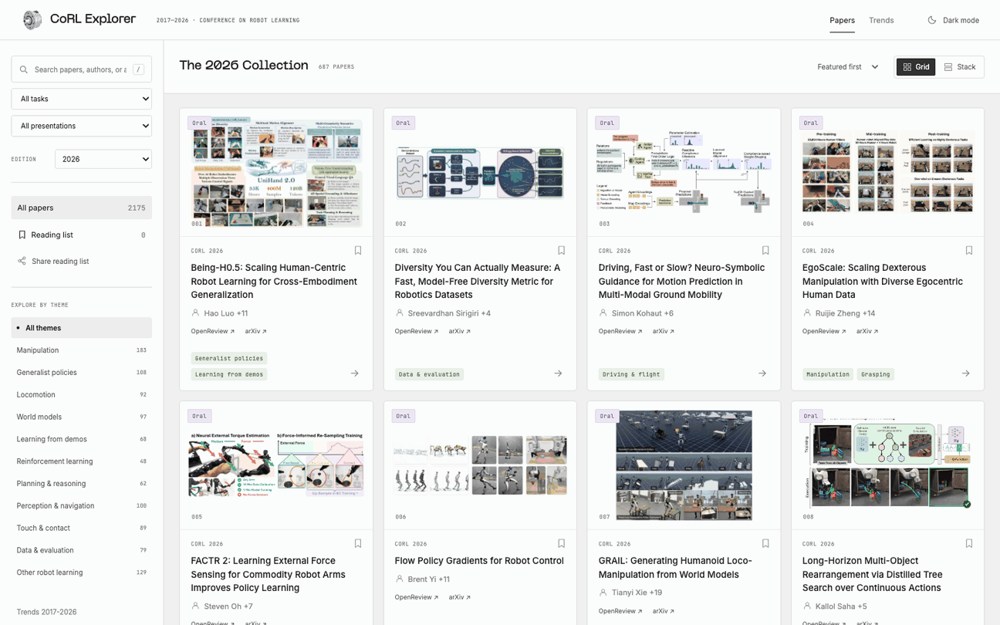

# CoRL Paper Explorer

10 years of robot learning ~

Explore **2,175 accepted papers** from the Conference on Robot Learning, spanning **2017–2026**. Search by year, task, and theme; read paper summaries, save a reading list, and share it with others.

**[Explore the papers](https://corl.operatic.ai)** · [Paper trends](https://corl.operatic.ai/trends.html) · [Run locally](docs/DEVELOPMENT.md)

<!-- PAPERS:START -->

## 2026 papers

687 accepted papers · 21 oral · 72 spotlight · 594 poster

[Oral](#-oral) · [Spotlight](#-spotlight) · [Poster](#-poster) · [Earlier years](#earlier-years)

Click a paper title to open its summary in the explorer. Authors are shown as first author + remaining authors. TL;DRs are AI-written paraphrases of paper abstracts. Tags are inferred from titles; missing links are left out.

### 🏅 Oral

| Paper | Authors | TL;DR | Tasks & themes | Links |
| --- | --- | --- | --- | --- |
| [Being-H0.5: Scaling Human-Centric Robot Learning for Cross-Embodiment Generalization](https://corl.operatic.ai/?year=2026&paper=cfzFrOJmKA) | Hao Luo +11 | A shared action space lets different robots learn transferable skills from human motion and robot demonstrations. | Generalist policies · Learning from demos | [arXiv](https://arxiv.org/abs/2601.12993) · [OpenReview](https://openreview.net/forum?id=cfzFrOJmKA) |
| [Diversity You Can Actually Measure: A Fast, Model-Free Diversity Metric for Robotics Datasets](https://corl.operatic.ai/?year=2026&paper=TscNG5Wcwn) | Sreevardhan Sirigiri +4 | Measure demonstration diversity without training a model, then select a more useful dataset for imitation learning. | Data &amp; evaluation | [arXiv](https://arxiv.org/abs/2603.11634) · [OpenReview](https://openreview.net/forum?id=TscNG5Wcwn) |
| [Driving, Fast or Slow? Neuro-Symbolic Guidance for Motion Prediction in Multi-Modal Ground Mobility](https://corl.operatic.ai/?year=2026&paper=fHzDEYENPF) | Simon Kohaut +6 | Combine learned motion forecasts with interpretable traffic rules to improve predictions in mixed traffic. | Driving &amp; flight · Other robot learning | [arXiv](https://arxiv.org/abs/2606.15251) · [OpenReview](https://openreview.net/forum?id=fHzDEYENPF) |
| [EgoScale: Scaling Dexterous Manipulation with Diverse Egocentric Human Data](https://corl.operatic.ai/?year=2026&paper=WF4X17Al2r) | Ruijie Zheng +14 | Large-scale first-person human video pretraining transfers fine motor skills to dexterous robot hands. | Manipulation · Grasping | [arXiv](https://arxiv.org/abs/2602.16710) · [OpenReview](https://openreview.net/forum?id=WF4X17Al2r) |
| [FACTR 2: Learning External Force Sensing for Commodity Robot Arms Improves Policy Learning](https://corl.operatic.ai/?year=2026&paper=03zMMFkTXk) | Steven Oh +7 | Estimate external forces without dedicated sensors, enabling force-aware learning on off-the-shelf robot arms. | Touch &amp; contact | [arXiv](https://arxiv.org/abs/2606.12406) · [OpenReview](https://openreview.net/forum?id=03zMMFkTXk) |
| [Flow Policy Gradients for Robot Control](https://corl.operatic.ai/?year=2026&paper=acslhrig33) | Brent Yi +11 | Train expressive flow-based robot policies from rewards without computing action likelihoods. | Other robot learning | [arXiv](https://arxiv.org/abs/2602.02481) · [OpenReview](https://openreview.net/forum?id=acslhrig33) · [Code](https://github.com/amazon-far/fpo-control) |
| [GRAIL: Generating Humanoid Loco-Manipulation from World Models](https://corl.operatic.ai/?year=2026&paper=2dEfANeQL7) | Tianyi Xie +19 | Generate humanoid demonstrations from 3D scenes and video models, then transfer learned skills to a real robot. | Manipulation · Whole-body control · Locomotion · World models | [arXiv](https://arxiv.org/abs/2606.05160) · [OpenReview](https://openreview.net/forum?id=2dEfANeQL7) |
| [Long-Horizon Multi-Object Rearrangement via Distilled Tree Search over Continuous Actions](https://corl.operatic.ai/?year=2026&paper=hWuk4y2AeR) | Kallol Saha +5 | Distill continuous-action tree search into policies for long-horizon rearrangement without search at deployment. | Planning &amp; reasoning | [arXiv](https://arxiv.org/abs/2610.25785) · [OpenReview](https://openreview.net/forum?id=hWuk4y2AeR) |
| [Memory-augmented Action-conditioned World Model for Robot Manipulation](https://corl.operatic.ai/?year=2026&paper=f9grq4Ncx9) | Zirui Zheng +9 | A geometry-aware memory helps robot world models recall occluded scenes and predict more consistent futures. | Manipulation · World models | [arXiv](https://arxiv.org/abs/2606.18960) · [OpenReview](https://openreview.net/forum?id=f9grq4Ncx9) |
| [MolmoB0T: Large-Scale Simulation Enables Zero-Shot Manipulation](https://corl.operatic.ai/?year=2026&paper=c4Z0Y8gvnI) | Abhay Deshpande +25 | Large-scale simulated demonstrations train manipulation policies that transfer to real robots without fine-tuning. | Manipulation · World models | [arXiv](https://arxiv.org/abs/2603.16861) · [OpenReview](https://openreview.net/forum?id=c4Z0Y8gvnI) |
| [OPENDEXGRASP: Open-vocabulary Task-Oriented Dexterous Grasping](https://corl.operatic.ai/?year=2026&paper=wLgEYxjqid) | Jiyao Zhang +6 | Generate dexterous grasps that match free-form task instructions while remaining physically feasible. | Grasping · Manipulation | [arXiv](https://arxiv.org/abs/2609.18117) · [OpenReview](https://openreview.net/forum?id=wLgEYxjqid) |
| [PACE: Temporal-Role Tactile Conditioning for Chunk-Based Insertion Policies](https://corl.operatic.ai/?year=2026&paper=AIInkHZlvB) | Zhiyuan Chen +3 | Separate persistent touch, sudden contact events, and predicted contact outcomes to improve precise insertion. | Assembly · Manipulation · Touch &amp; contact | [arXiv](https://arxiv.org/abs/2610.16308) · [OpenReview](https://openreview.net/forum?id=AIInkHZlvB) |
| [Play2Perfect: What Matters in Dexterous Play Pretraining for Precise Assembly?](https://corl.operatic.ai/?year=2026&paper=RRl1xXZLdM) | Tyler Ga Wei Lum +3 | Pretrain dexterous hands through object play, then adapt those reusable skills to precise assembly. | Grasping · Assembly · Manipulation | [arXiv](https://arxiv.org/abs/2606.26428) · [OpenReview](https://openreview.net/forum?id=RRl1xXZLdM) |
| [RL Token: Bootstrapping Online RL with Vision-Language-Action Models](https://corl.operatic.ai/?year=2026&paper=RYXo2ktK1M) | Charles Xu +6 | A compact RL token lets small actor-critic heads refine pretrained VLAs through a few hours of robot practice. | Generalist policies · Reinforcement learning | [arXiv](https://arxiv.org/abs/2604.23073) · [OpenReview](https://openreview.net/forum?id=RYXo2ktK1M) |
| [RoboNaldo: Accurate, Stable and Powerful Humanoid Soccer Shooting via Motion-Guided Curriculum Reinforcement Learning](https://corl.operatic.ai/?year=2026&paper=WBGnJHRIso) | Yichao Zhong +11 | A staged reinforcement-learning curriculum turns one human kick into stable humanoid soccer shooting. | Whole-body control · Locomotion · Reinforcement learning · Touch &amp; contact | [arXiv](https://arxiv.org/abs/2606.11092) · [OpenReview](https://openreview.net/forum?id=WBGnJHRIso) |
| [RoboTTT: Context Scaling for Robot Policies](https://corl.operatic.ai/?year=2026&paper=NHE9q2cz1n) | Yunfan Jiang +10 | Test-time training gives robot policies 8K steps of context without increasing inference latency. | Other robot learning | [arXiv](https://arxiv.org/abs/2607.15275) · [OpenReview](https://openreview.net/forum?id=NHE9q2cz1n) |
| [SuperMimic: Scaling Humanoid Whole-Body Control with One Differentiable World Model](https://corl.operatic.ai/?year=2026&paper=psNqjklVOK) | Qiayuan Liao +6 | One differentiable world model makes learning to track large collections of humanoid motions more efficient. | Whole-body control · Locomotion · World models | [arXiv](https://arxiv.org/abs/2610.28480) · [OpenReview](https://openreview.net/forum?id=psNqjklVOK) |
| [TEMPO: Learning Temporal Context for Dynamic Robot Manipulation](https://corl.operatic.ai/?year=2026&paper=FVZKpmPHV8) | Zhenyang Feng +3 | Video motion cues and recent robot states help VLAs handle moving objects and distinguish phases of a task. | Manipulation | [arXiv](https://arxiv.org/abs/2609.16864) · [OpenReview](https://openreview.net/forum?id=FVZKpmPHV8) |
| [What Are We Actually Benchmarking in Robot Manipulation?](https://corl.operatic.ai/?year=2026&paper=RdvH11pAfJ) | Tianchong Jiang +5 | Four diagnostics reveal shortcuts, overfitting, and statistical weaknesses in common robot manipulation benchmarks. | Manipulation · Data &amp; evaluation | [arXiv](https://arxiv.org/abs/2606.04233) · [OpenReview](https://openreview.net/forum?id=RdvH11pAfJ) |
| [World Action Models are Zero-shot Policies](https://corl.operatic.ai/?year=2026&paper=Bshs9HDDiu) | Seonghyeon Ye +35 | DreamZero predicts video and actions together to transfer robot skills to unfamiliar tasks and environments. | World models | [arXiv](https://arxiv.org/abs/2602.15922) · [OpenReview](https://openreview.net/forum?id=Bshs9HDDiu) · [Code](https://github.com/dreamzero0/dreamzero) |
| [π0.7: a Steerable Generalist Robotic Foundation Model with Emergent Capabilities](https://corl.operatic.ai/?year=2026&paper=5XKFwWrW0v) | Bo Ai +84 | Steer a generalist robot with language, subgoal images, and context that specifies how a task should be done. | Generalist policies | [arXiv](https://arxiv.org/abs/2604.15483) · [OpenReview](https://openreview.net/forum?id=5XKFwWrW0v) |

### 🌟 Spotlight

| Paper | Authors | TL;DR | Tasks & themes | Links |
| --- | --- | --- | --- | --- |
| [Anchor3R: Streaming 3D Reconstruction with Transient Anchors for Long-Horizon Visual Mapping](https://corl.operatic.ai/?year=2026&paper=Q53ayGo2IE) | Peilin Tao +10 | Uses temporary local anchors for accurate, bounded-memory streaming 3D reconstruction. | Planning &amp; reasoning · Perception &amp; navigation | [arXiv](https://arxiv.org/abs/2606.05035) · [OpenReview](https://openreview.net/forum?id=Q53ayGo2IE) |
| [Articulated 3D Scene Graphs for Open-World Mobile Manipulation](https://corl.operatic.ai/?year=2026&paper=FKKr8jKS29) | Martin Büchner +7 | Builds 3D scene graphs that capture object semantics and articulation from RGB-D interaction sequences. | Manipulation · Perception &amp; navigation | [arXiv](https://arxiv.org/abs/2602.16356) · [OpenReview](https://openreview.net/forum?id=FKKr8jKS29) |
| [ATOM-Bench: A Real-World Benchmark for Atomic Skills and Compositional Generalization in Manipulation Policies](https://corl.operatic.ai/?year=2026&paper=DpOVq6nE2d) | Zenan Wu +10 | Separately evaluates individual manipulation skills and their recombination on real robots. | Manipulation · Planning &amp; reasoning · Data &amp; evaluation | [arXiv](https://arxiv.org/abs/2606.16826) · [OpenReview](https://openreview.net/forum?id=DpOVq6nE2d) |
| [Bayesian Active Learning for Intent Disambiguation in Interactive Robot Planning](https://corl.operatic.ai/?year=2026&paper=El4EDBhqCG) | Huao Li +5 | Selects clarification questions by information gain over possible formal interpretations of a user's intent. | Planning &amp; reasoning | [arXiv](https://arxiv.org/abs/2609.34270) · [OpenReview](https://openreview.net/forum?id=El4EDBhqCG) |
| [BiDexGrasp: Coordinated Bimanual Dexterous Grasps across Object Geometries and Sizes](https://corl.operatic.ai/?year=2026&paper=ODnu3ohjEQ) | Mu Lin +12 | Provides a large grasp dataset and a learned model for coordinated dexterous grasping with two hands. | Grasping · Bimanual · Manipulation | [arXiv](https://arxiv.org/abs/2604.06589) · [OpenReview](https://openreview.net/forum?id=ODnu3ohjEQ) |
| [BitVLA: 1-bit Vision-Language-Action Models for Robotics Manipulation](https://corl.operatic.ai/?year=2026&paper=mHCqiRUiHi) | Hongyu Wang +3 | Trains robot policies with ternary weights to reduce the memory cost of VLA deployment. | Manipulation · Generalist policies | [arXiv](https://arxiv.org/abs/2506.07530) · [OpenReview](https://openreview.net/forum?id=mHCqiRUiHi) · [Code](https://github.com/ustcwhy/BitVLA) |
| [Chunk-wise Model-based Policy Optimization](https://corl.operatic.ai/?year=2026&paper=dngZLI0SlV) | Weixi Song +2 | Optimizes action chunks with a world model that predicts multi-step rollouts in one pass. | Reinforcement learning | [arXiv](https://arxiv.org/abs/2610.14564) · [OpenReview](https://openreview.net/forum?id=dngZLI0SlV) |
| [CMP: Robust Whole-Body Tracking for Loco-Manipulation via Competence Manifold Projection](https://corl.operatic.ai/?year=2026&paper=yyitbtz7rQ) | Ziyang Cheng +6 | Projects requested motions into a learned controller's competence region for safer whole-body tracking. | Manipulation · Whole-body control · Locomotion · Data &amp; evaluation | [arXiv](https://arxiv.org/abs/2604.07457) · [OpenReview](https://openreview.net/forum?id=yyitbtz7rQ) |
| [Collaborative Planning for UAV-UGV Teams under Operational Constraints via Masked Error-bounded Neuro-Symbolic Diffusion](https://corl.operatic.ai/?year=2026&paper=lSrxDURLdG) | Zihao Deng +5 | Generates coordinated air-ground robot plans with masked diffusion under operational constraints. | Planning &amp; reasoning | [arXiv](https://arxiv.org/abs/2610.18850) · [OpenReview](https://openreview.net/forum?id=lSrxDURLdG) |
| [Combining Constrained Sampling and Reinforcement Learning for Manipulation](https://corl.operatic.ai/?year=2026&paper=cJGMjQlgz5) | Marc Toussaint +7 | Samples diverse contact configurations to improve exploration in goal-conditioned manipulation learning. | Manipulation · Reinforcement learning · Touch &amp; contact | [arXiv](https://arxiv.org/abs/2602.08557) · [OpenReview](https://openreview.net/forum?id=cJGMjQlgz5) |
| [Constraint-Decomposed Impedance Control from Generative Policy for Articulated Object Manipulation](https://corl.operatic.ai/?year=2026&paper=MjpidVjNMS) | Kyungseo Park +4 | Uses generative-policy samples to identify feasible motion directions for articulated-object impedance control. | Manipulation | [arXiv](https://arxiv.org/abs/2610.16316) · [OpenReview](https://openreview.net/forum?id=MjpidVjNMS) |
| [Control-Ready Uncertainty for Trajectory Diffusion](https://corl.operatic.ai/?year=2026&paper=c9tCcHtVcS) | Zhiwei Xue +7 | Adds lightweight uncertainty estimates to diffusion trajectories for downstream robot control. | Data &amp; evaluation | [arXiv](https://arxiv.org/abs/2610.12431) · [OpenReview](https://openreview.net/forum?id=c9tCcHtVcS) |
| [DAVATaR: Depth-Aware Visually Augmented Tactile Learning Across the Air-Water Interface](https://corl.operatic.ai/?year=2026&paper=hSRtOgnkTM) | Bowen Jiang +5 | Fuses vision, touch, and immersion depth to learn manipulation across the air-water boundary. | Touch &amp; contact | [OpenReview](https://openreview.net/forum?id=hSRtOgnkTM) |
| [Demystifying When and Why VLAs Fail in Contact-Rich Tasks and How to Fix Them](https://corl.operatic.ai/?year=2026&paper=BV0T1o1ZIL) | Carlota Parés Morlans +4 | Diagnoses two contact-rich VLA failure modes and combines targeted fixes to improve manipulation. | Touch &amp; contact | [arXiv](https://arxiv.org/abs/2608.01402) · [OpenReview](https://openreview.net/forum?id=BV0T1o1ZIL) |
| [DeTac: Dual-branch Decoupling of Texture and Force Signals in Vision-Based Tactile Sensors](https://corl.operatic.ai/?year=2026&paper=yMD1ykviND) | Zhirui Zhang +8 | Separates texture-related shading and force-related marker signals in vision-based tactile images. | Touch &amp; contact | [arXiv](https://arxiv.org/abs/2610.16463) · [OpenReview](https://openreview.net/forum?id=yMD1ykviND) |
| [Diagnosing Compositional Generalization in Sequential Robot Tasks](https://corl.operatic.ai/?year=2026&paper=gQFYIM5dJy) | Yixiao Wang +7 | Studies which instruction combinations robot training data must cover for reliable generalization. | Planning &amp; reasoning | [arXiv](https://arxiv.org/abs/2607.29687) · [OpenReview](https://openreview.net/forum?id=gQFYIM5dJy) |
| [Diffusion ReRoll: Revisable Denoising for Robotic Sequential Prediction](https://corl.operatic.ai/?year=2026&paper=HbuX1Fe8bl) | Seonsoo Kim +2 | Lets diffusion models revise earlier predictions to improve long-horizon robot planning and control. | Other robot learning | [arXiv](https://arxiv.org/abs/2607.19919) · [OpenReview](https://openreview.net/forum?id=HbuX1Fe8bl) |
| [EagleVLA: Towards Onboard Real-Time Robot Control via Foresight-Aligned Asynchronous Inference](https://corl.operatic.ai/?year=2026&paper=OckqYiY2QM) | Zebin Yang +8 | Predicts future scene features to reduce delays and misalignment in onboard VLA control. | Other robot learning | [arXiv](https://arxiv.org/abs/2607.12659) · [OpenReview](https://openreview.net/forum?id=OckqYiY2QM) |
| [Efficient and Reliable Teleoperation through Real-to-Sim-to-Real Shared Autonomy](https://corl.operatic.ai/?year=2026&paper=QGzgVP8RnK) | Shuo Sha +4 | Learns corrective shared-autonomy behaviors in simulation to assist real-world human teleoperation. | World models · Learning from demos | [arXiv](https://arxiv.org/abs/2603.17016) · [OpenReview](https://openreview.net/forum?id=QGzgVP8RnK) |
| [Ego2Robot: Scalable Robot Data Synthesis from Egocentric Human Data](https://corl.operatic.ai/?year=2026&paper=JV472m0zgq) | Ye Wang +14 | Retargets human motion and synthesizes robot visuals to turn first-person videos into robot training data. | Other robot learning | [arXiv](https://arxiv.org/abs/2608.02580) · [OpenReview](https://openreview.net/forum?id=JV472m0zgq) |
| [EmbodiSteer: Steering Embodiment-Agnostic Visuomotor Policies with Joint-Space Guidance for Zero-Shot Cross-Embodiment Deployment](https://corl.operatic.ai/?year=2026&paper=2Z8xQxrlsY) | Shihefeng Wang +3 | Guides robot policies in joint space to avoid body collisions when transferring to new robots. | Generalist policies | [arXiv](https://arxiv.org/abs/2606.12965) · [OpenReview](https://openreview.net/forum?id=2Z8xQxrlsY) |
| [Emergent Control via Prior-Based Free Energy Minimization](https://corl.operatic.ai/?year=2026&paper=XY8QpMSxvq) | Manish Kolachalam +1 | Learns control by minimizing deviations from preferred-state priors instead of explicit environment rewards. | Other robot learning | [OpenReview](https://openreview.net/forum?id=XY8QpMSxvq) |
| [Enabling Robust Cloth Manipulation via Inference-Time Simulator-in-the-Loop Refinement](https://corl.operatic.ai/?year=2026&paper=nzYChkCtvT) | Xin Liu +9 | Refines cloth-manipulation actions at runtime using a simulator initialized from a single RGB image. | Manipulation · Deformables · Data &amp; evaluation | [arXiv](https://arxiv.org/abs/2606.24552) · [OpenReview](https://openreview.net/forum?id=nzYChkCtvT) |
| [FedGuide: Diffusion Prior Alignment and Value Baseline Guidance for Heterogeneous Federated Reinforcement Learning](https://corl.operatic.ai/?year=2026&paper=QBAA8svAIK) | Zhilin He +1 | Uses diffusion behavior priors to guide federated reinforcement learning across differing environments. | Reinforcement learning · Touch &amp; contact | [arXiv](https://arxiv.org/abs/2609.18964) · [OpenReview](https://openreview.net/forum?id=QBAA8svAIK) · [Code](https://github.com/hhhhzl/fedguide) |
| [FingerEye: Learning Dexterous Manipulation with Continuous Vision-Tactile Sensing](https://corl.operatic.ai/?year=2026&paper=RAA96LpIxJ) | Zhixuan Xu +4 | Combines fingertip vision and touch for continuous sensing before, during, and after contact. | Manipulation · Grasping · Touch &amp; contact | [arXiv](https://arxiv.org/abs/2604.20689) · [OpenReview](https://openreview.net/forum?id=RAA96LpIxJ) |
| [FlowDAgger: Human-in-the-Loop Adaptation of Generative Robot Policies in Latent Space](https://corl.operatic.ai/?year=2026&paper=aspenN9eir) | Michael Murray +9 | Maps human corrections into latent noise to adapt frozen generative robot policies efficiently. | Other robot learning | [arXiv](https://arxiv.org/abs/2607.08877) · [OpenReview](https://openreview.net/forum?id=aspenN9eir) · [Code](https://github.com/microsoft/FlowDAgger) |
| [From Region Arrival to Instance-Level Grounding in Vision-and-Language Navigation](https://corl.operatic.ai/?year=2026&paper=RwGNm8fUxX) | Xiangyu Shi +5 | Refines the final approach in language-guided navigation to ground precise object instances. | Navigation · Perception &amp; navigation | [arXiv](https://arxiv.org/abs/2607.03792) · [OpenReview](https://openreview.net/forum?id=RwGNm8fUxX) |
| [GaP: A Graph-as-Policy Multi-Agent Self-Learning Harness For Variational Automation Tasks](https://corl.operatic.ai/?year=2026&paper=C96z0RnFh8) | Kaiyuan Chen +23 | Uses coding agents to build robot policies as graphs of reusable perception, planning, and control modules. | Other robot learning | [arXiv](https://arxiv.org/abs/2607.05369) · [OpenReview](https://openreview.net/forum?id=C96z0RnFh8) |
| [Humanoid Navigation in Cluttered Environments with a Whole-Body Vision-Language-Action Model](https://corl.operatic.ai/?year=2026&paper=2Z9666X2B7) | Anqi Li +6 | Trains a whole-body vision-language policy in simulation for humanoid navigation through clutter. | Whole-body control · Navigation · Generalist policies · Locomotion · Perception &amp; navigation | [arXiv](https://arxiv.org/abs/2609.09158) · [OpenReview](https://openreview.net/forum?id=2Z9666X2B7) |
| [Kamino: GPU-based Simulation of Rigid Multi-Body Physics with Kinematic Loops](https://corl.operatic.ai/?year=2026&paper=aKjXDWnmzc) | Vassilios Tsounis +8 | Simulates coupled rigid-body mechanisms with kinematic loops in massively parallel GPU environments. | World models | [arXiv](https://arxiv.org/abs/2603.16536) · [OpenReview](https://openreview.net/forum?id=aKjXDWnmzc) |
| [KPGrasp: Scalable Keypoint Flow Matching for Dexterous Grasp Generation](https://corl.operatic.ai/?year=2026&paper=BXNVzGSYFe) | Yuansen Huang +8 | Learns keypoint-based flow models for dexterous grasp generation from large-scale grasp data. | Grasping · Manipulation | [arXiv](https://arxiv.org/abs/2606.09314) · [OpenReview](https://openreview.net/forum?id=BXNVzGSYFe) |
| [LadderMan: Learning Humanoid Perceptive Ladder Climbing](https://corl.operatic.ai/?year=2026&paper=PLNJ3a6Yht) | Siheng Zhao +8 | Distills climbing experts into a depth-based policy for humanoid ladder climbing and manipulation. | Whole-body control · Locomotion | [arXiv](https://arxiv.org/abs/2606.05873) · [OpenReview](https://openreview.net/forum?id=PLNJ3a6Yht) |
| [Learning Human Intention for Robotic Manipulation](https://corl.operatic.ai/?year=2026&paper=l0bwpzWRKy) | Chengyang Li +5 | Uses human gaze to represent intention and transfer manipulation knowledge across embodiments. | Manipulation | [arXiv](https://arxiv.org/abs/2604.22615) · [OpenReview](https://openreview.net/forum?id=l0bwpzWRKy) |
| [Learning Loco-Manipulation From SMPC Demonstrations With Sparse Offline-to-Online RL](https://corl.operatic.ai/?year=2026&paper=5b4j0e21aJ) | Martin Schuck +7 | Uses simulated predictive-control demonstrations to bootstrap sparse-reward locomotion and manipulation learning. | Manipulation · Whole-body control · Locomotion · Learning from demos · Reinforcement learning | [arXiv](https://arxiv.org/abs/2608.12063) · [OpenReview](https://openreview.net/forum?id=5b4j0e21aJ) |
| [Learning Physics-Guided Residual Dynamics for Deformable Object Simulation](https://corl.operatic.ai/?year=2026&paper=3hsq75Gmr9) | Shivansh Patel +4 | Learns residual dynamics on top of physics to improve deformable-object simulation. | Deformables · World models · Touch &amp; contact | [arXiv](https://arxiv.org/abs/2607.13451) · [OpenReview](https://openreview.net/forum?id=3hsq75Gmr9) |
| [Learning What to Say to Your VLA: Mostly Harmless Vision Language Action Model Steering](https://corl.operatic.ai/?year=2026&paper=z47bcul4Zk) | Hyun Joe Jeong +2 | Learns language feedback that steers frozen robot policies, with a safeguard against harmful interventions. | Generalist policies | [arXiv](https://arxiv.org/abs/2606.12299) · [OpenReview](https://openreview.net/forum?id=z47bcul4Zk) |
| [Leave It Better Than Found: Value-Guided Cooperation in Sequential Tasks](https://corl.operatic.ai/?year=2026&paper=N77om40jWL) | Mario Gomez Andreu +5 | Shares value functions so sequential robots leave the workspace in states useful to their successors. | Other robot learning | [arXiv](https://arxiv.org/abs/2611.08075) · [OpenReview](https://openreview.net/forum?id=N77om40jWL) |
| [MEM: Multi-Scale Embodied Memory for Vision Language Action Models](https://corl.operatic.ai/?year=2026&paper=5TiiTY1fK3) | Marcel Torne +16 | Combines memory across modalities and timescales for long-horizon robot control. | Generalist policies | [arXiv](https://arxiv.org/abs/2603.03596) · [OpenReview](https://openreview.net/forum?id=5TiiTY1fK3) |
| [Meta-Ctrl: Guaranteed Plan Generation by Decoupling Syntactic and Semantic Constraints](https://corl.operatic.ai/?year=2026&paper=qQs6JndxfZ) | Gwen Yidou-Weng +7 | Constrains language-model decoding so generated robot plans satisfy encoded syntax and semantic requirements. | Other robot learning | [arXiv](https://arxiv.org/abs/2608.22149) · [OpenReview](https://openreview.net/forum?id=qQs6JndxfZ) |
| [MolmoAct2: Action Reasoning Models for Real-World Deployment](https://corl.operatic.ai/?year=2026&paper=Q6xWLHyg6x) | Haoquan Fang +28 | An open action-reasoning model combines embodied reasoning, bimanual data, and efficient continuous control. | Planning &amp; reasoning | [arXiv](https://arxiv.org/abs/2605.02881) · [OpenReview](https://openreview.net/forum?id=Q6xWLHyg6x) · [Code](https://github.com/allenai/molmoact2) |
| [MoRE: Mixture-of-Experts for Multi-Physics Robotic World Models](https://corl.operatic.ai/?year=2026&paper=v24DO7JOuN) | Ziyu Zhu +5 | Combines motion experts for rigid, deformable, and grasped objects in one 3D world model. | World models | [OpenReview](https://openreview.net/forum?id=v24DO7JOuN) |
| [MosaicIMU: Composing Carrier Experts for Generalizable Neural Inertial Odometry](https://corl.operatic.ai/?year=2026&paper=k2QZxbcSbQ) | Junye Zou +6 | Combines carrier-specific experts for inertial odometry that generalizes across platforms. | Other robot learning | [arXiv](https://arxiv.org/abs/2606.09355) · [OpenReview](https://openreview.net/forum?id=k2QZxbcSbQ) |
| [Never Too Late for Force: Accelerating VLA Post-Training with Reactive Force Injection](https://corl.operatic.ai/?year=2026&paper=19iADsbO9A) | Yi Wang +10 | Adds reactive force feedback to pretrained VLAs for faster contact-rich policy adaptation. | Generalist policies · Touch &amp; contact | [arXiv](https://arxiv.org/abs/2607.14236) · [OpenReview](https://openreview.net/forum?id=19iADsbO9A) · [Code](https://github.com/y-wng/lift) |
| [Noise-Invariant Spatial Encoding for 3D Manipulation Policies under Depth Corruption](https://corl.operatic.ai/?year=2026&paper=r8MOxo93Mv) | Zhiyuan Yang +5 | Learns spatial features robust to corrupted depth for more reliable 3D manipulation policies. | Manipulation · Perception &amp; navigation | [arXiv](https://arxiv.org/abs/2610.24674) · [OpenReview](https://openreview.net/forum?id=r8MOxo93Mv) |
| [OpenHLM: An Empirical Recipe for Whole-Body Humanoid Loco-Manipulation](https://corl.operatic.ai/?year=2026&paper=TTFZrb0Hw3) | Yingdong Hu +8 | Studies teleoperation, model design, and mixed-data training for native whole-body humanoid VLAs. | Manipulation · Whole-body control · Locomotion | [arXiv](https://arxiv.org/abs/2606.22174) · [OpenReview](https://openreview.net/forum?id=TTFZrb0Hw3) · [Code](https://github.com/OpenHLM-project/OpenHLM) |
| [OSCAR: Obstacle Survival Curves for Adaptive Robot Navigation](https://corl.operatic.ai/?year=2026&paper=hr2FYFod4n) | Hshmat Sahak +3 | Learns how long obstacles persist to decide whether a robot should wait or reroute. | Navigation · Perception &amp; navigation | [arXiv](https://arxiv.org/abs/2606.00990) · [OpenReview](https://openreview.net/forum?id=hr2FYFod4n) |
| [PHUMA: Physically Reliable Humanoid Locomotion Dataset](https://corl.operatic.ai/?year=2026&paper=lY47GBfn32) | Kyungmin Lee +8 | Curates and retargets motion-capture and video data into physically reliable humanoid locomotion references. | Locomotion · Whole-body control · Data &amp; evaluation | [arXiv](https://arxiv.org/abs/2510.26236) · [OpenReview](https://openreview.net/forum?id=lY47GBfn32) |
| [Playful Agentic Robot Learning](https://corl.operatic.ai/?year=2026&paper=GeL3GdwSYo) | Junyi Zhang +19 | Uses self-directed play by embodied coding agents to acquire skills before downstream tasks arrive. | Planning &amp; reasoning | [arXiv](https://arxiv.org/abs/2606.19419) · [OpenReview](https://openreview.net/forum?id=GeL3GdwSYo) |
| [PRTS: A Primitive Reasoning and Tasking System via Contrastive Representations](https://corl.operatic.ai/?year=2026&paper=QwpnI3BlwT) | Yang Zhang +13 | Uses contrastive reinforcement learning to teach VLAs which language goals their actions can reach. | Planning &amp; reasoning | [arXiv](https://arxiv.org/abs/2604.27472) · [OpenReview](https://openreview.net/forum?id=QwpnI3BlwT) · [Code](https://github.com/TeleHuman/PRTS) |
| [RAM: Reachability Across Morphologies](https://corl.operatic.ai/?year=2026&paper=SaMjmUr6xC) | Tim Walter +3 | Predicts pose reachability across robot morphologies while accounting for self-collisions. | Other robot learning | [arXiv](https://arxiv.org/abs/2606.09108) · [OpenReview](https://openreview.net/forum?id=SaMjmUr6xC) · [Code](https://github.com/TimWalter/ram) |
| [REACT: Rolling Denoising and Dual Decoupling for Reactive Robot Control with VLA Models](https://corl.operatic.ai/?year=2026&paper=FFB8qNJwV2) | Houlong Xiong +10 | Streams actions and updates observations during denoising for more responsive VLA control. | Generalist policies | [arXiv](https://arxiv.org/abs/2610.12007) · [OpenReview](https://openreview.net/forum?id=FFB8qNJwV2) |
| [ResSafe: Learning Safety Filtering with Residual Reinforcement Learning for Humanoids](https://corl.operatic.ai/?year=2026&paper=rEmMzoUnpn) | Gechen Qu +6 | Learns residual safety corrections alongside a task policy for humanoid balance control. | Whole-body control · Locomotion · Reinforcement learning · Touch &amp; contact · Data &amp; evaluation | [arXiv](https://arxiv.org/abs/2609.15988) · [OpenReview](https://openreview.net/forum?id=rEmMzoUnpn) |
| [RoboKit: Accelerating Parallel Differentiable Optimization for Robot Learning](https://corl.operatic.ai/?year=2026&paper=xfZJ2GKrZG) | Jianglong Ye +7 | Provides parallel differentiable optimization tools for robot learning. | Other robot learning | [OpenReview](https://openreview.net/forum?id=xfZJ2GKrZG) |
| [Robustness without Wrinkles: Parallel Simulation and Robust MPC for Certified Deformable Manipulation](https://corl.operatic.ai/?year=2026&paper=UVJPDRCmlf) | Wei-Chen Li +4 | Combines parallel simulation and robust predictive control for constrained rope and cloth manipulation. | Manipulation · Deformables · World models · Touch &amp; contact · Data &amp; evaluation | [arXiv](https://arxiv.org/abs/2606.14188) · [OpenReview](https://openreview.net/forum?id=UVJPDRCmlf) |
| [Scalable Deep Unfolding of Conic Optimizers](https://corl.operatic.ai/?year=2026&paper=CSYA6oHdlE) | Alex Oshin +2 | Uses memory-efficient implicit differentiation and stable spectral gradients to scale learned conic optimizers. | Other robot learning | [arXiv](https://arxiv.org/abs/2606.13825) · [OpenReview](https://openreview.net/forum?id=CSYA6oHdlE) |
| [SCoCaT: Success Conditioned Constrained Reinforcement Learning for Spacecraft Docking](https://corl.operatic.ai/?year=2026&paper=SUV5PudsyI) | Aman Arora +3 | Addresses feasibility collapse in constrained reinforcement learning for precise spacecraft docking. | Reinforcement learning · Touch &amp; contact | [arXiv](https://arxiv.org/abs/2609.06061) · [OpenReview](https://openreview.net/forum?id=SUV5PudsyI) · [Code](https://github.com/snt-spacer/scocat-cstr-RL-docking) |
| [Semantic Anchoring for Robotic Action Representations](https://corl.operatic.ai/?year=2026&paper=YTw6LOO9C5) | Yuan Xu +4 | Preserves semantic structure in action representations to improve robot generalization. | Other robot learning | [arXiv](https://arxiv.org/abs/2607.13597) · [OpenReview](https://openreview.net/forum?id=YTw6LOO9C5) |
| [Sequential Asymmetric Imitation for Learning Coupled Robot Policies](https://corl.operatic.ai/?year=2026&paper=rfRjWMFfvV) | Ranpeng Qiu +5 | Uses a single-operator curriculum to learn physically coupled multi-robot behavior. | Learning from demos | [arXiv](https://arxiv.org/abs/2606.16490) · [OpenReview](https://openreview.net/forum?id=rfRjWMFfvV) |
| [SERF: Spatiotemporal Environment and Robot Feature Map for Long-Horizon Mobile Manipulation](https://corl.operatic.ai/?year=2026&paper=nIbnBCtz79) | Sunghwan Kim +4 | Maintains spatial and temporal features of the robot and environment for long-horizon mobile manipulation. | Manipulation · Planning &amp; reasoning | [arXiv](https://arxiv.org/abs/2606.12956) · [OpenReview](https://openreview.net/forum?id=nIbnBCtz79) · [Code](https://github.com/ExistentialRobotics/SERF-VLA) · [Code 2](https://github.com/ExistentialRobotics/SERF-mapping) |
| [Shape Your Body: Value Gradients for Multi-Embodiment Robot Design](https://corl.operatic.ai/?year=2026&paper=xhO9wj1gGt) | Nico Bohlinger +1 | Uses gradients from shared value functions to improve robot designs without retraining each design from scratch. | Other robot learning | [arXiv](https://arxiv.org/abs/2606.00702) · [OpenReview](https://openreview.net/forum?id=xhO9wj1gGt) |
| [SidewalkBench: Benchmarking Visual Navigation on Urban Sidewalks](https://corl.operatic.ai/?year=2026&paper=wBzyyPlFs6) | Zhizheng Liu +6 | Benchmarks urban sidewalk navigation with realistic scenes and reactive pedestrian behavior. | Navigation · Perception &amp; navigation · Data &amp; evaluation | [arXiv](https://arxiv.org/abs/2606.16953) · [OpenReview](https://openreview.net/forum?id=wBzyyPlFs6) |
| [TactileStep: Sole Tactile Learning for Regulating Foot--Terrain Interaction in Humanoid Locomotion](https://corl.operatic.ai/?year=2026&paper=aGLO1l8SNB) | Zizhuo Wang +5 | Uses sole pressure feedback and contact-phase rewards for softer humanoid landings and steadier support. | Locomotion · Whole-body control · Touch &amp; contact | [arXiv](https://arxiv.org/abs/2609.28959) · [OpenReview](https://openreview.net/forum?id=aGLO1l8SNB) |
| [TAM: Torque Adaptation Module for Robust Motion Transfer in Manipulation](https://corl.operatic.ai/?year=2026&paper=Ti3oK55n1H) | Dongwon Son +5 | Learns torque corrections in simulation to transfer manipulation controllers under uncertain robot dynamics. | Manipulation · Data &amp; evaluation | [arXiv](https://arxiv.org/abs/2606.06218) · [OpenReview](https://openreview.net/forum?id=Ti3oK55n1H) |
| [TARC: Time-Adaptive Robotic Control](https://corl.operatic.ai/?year=2026&paper=WvR13cRtRf) | Arnav Sukhija +5 | Learns both robot actions and how long to apply them, adapting control frequency to the task. | Other robot learning | [arXiv](https://arxiv.org/abs/2510.23176) · [OpenReview](https://openreview.net/forum?id=WvR13cRtRf) |
| [Targeting World Models to Compromise Robot Learning Pipelines](https://corl.operatic.ai/?year=2026&paper=6T2ebANGy5) | Ethan Rathbun +5 | Shows how poisoned data can compromise robot policies through world-model-generated training experience. | World models | [arXiv](https://arxiv.org/abs/2606.09499) · [OpenReview](https://openreview.net/forum?id=6T2ebANGy5) |
| [TRIAD Planner : Three-Level Robust Imitation Learning for Autonomous Driving](https://corl.operatic.ai/?year=2026&paper=98pbD92mEI) | Jiyun Kim +2 | Combines attention constraints, scene guidance, and risk-aware supervision for robust imitation-based driving. | Driving &amp; flight · Learning from demos · Perception &amp; navigation · Data &amp; evaluation | [OpenReview](https://openreview.net/forum?id=98pbD92mEI) |
| [Visible Touch: Rendering Contact for Visuomotor Policies](https://corl.operatic.ai/?year=2026&paper=ult1vxdeUb) | Metin Alp Dogan +6 | Renders contact information into scene images so existing visual policies can use touch. | Touch &amp; contact | [arXiv](https://arxiv.org/abs/2609.14156) · [OpenReview](https://openreview.net/forum?id=ult1vxdeUb) |
| [VisionSIM: Beyond Idealized Sensors — A Multi-Modal Simulator for Robot Perception](https://corl.operatic.ai/?year=2026&paper=dE7KjOl8yu) | Sacha Jungerman +8 | Simulates raw sensor measurements and physical failure modes across diverse robot perception modalities. | Perception &amp; navigation | [arXiv](https://arxiv.org/abs/2611.08368) · [OpenReview](https://openreview.net/forum?id=dE7KjOl8yu) |
| [When Vision Overrides Language: Evaluating and Mitigating Counterfactual Failures in VLAs](https://corl.operatic.ai/?year=2026&paper=HmdwOezjlQ) | Yu Fang +7 | Benchmarks and mitigates failures where robot policies follow visual shortcuts instead of instructions. | Data &amp; evaluation | [arXiv](https://arxiv.org/abs/2602.17659) · [OpenReview](https://openreview.net/forum?id=HmdwOezjlQ) · [Code](https://github.com/yuffish/LIBERO-CF) |
| [WireCraft: A Simulation Benchmark for Industrial DLO Manipulation](https://corl.operatic.ai/?year=2026&paper=cQPnBRGgWM) | Chongyu Zhu +7 | Benchmarks industrial wire manipulation across connector insertion, clip routing, and channel seating. | Manipulation · World models · Data &amp; evaluation | [arXiv](https://arxiv.org/abs/2606.18097) · [OpenReview](https://openreview.net/forum?id=cQPnBRGgWM) · [Code](https://github.com/WireManip/WireCraft) |
| [WM-Craftnet: World Synesthesia Model for Robust and Generalizable Dexterous In-Hand Manipulation](https://corl.operatic.ai/?year=2026&paper=AmQH2hU9Gs) | Jie Yin +5 | Learns multimodal world-model states from vision, touch, and body feedback for in-hand manipulation. | Manipulation · Grasping · Data &amp; evaluation | [arXiv](https://arxiv.org/abs/2609.07002) · [OpenReview](https://openreview.net/forum?id=AmQH2hU9Gs) |
| [ZETA: A Controlled Study of Zero-Shot Cross-Embodiment VLA Transfer for Tabletop Manipulation](https://corl.operatic.ai/?year=2026&paper=4RLjGPEfpH) | Mi Yan +16 | Tests which design choices help VLA policies transfer to robots absent from training. | Manipulation · Generalist policies | [arXiv](https://arxiv.org/abs/2609.02546) · [OpenReview](https://openreview.net/forum?id=4RLjGPEfpH) |

### 📌 Poster

| Paper | Authors | TL;DR | Tasks & themes | Links |
| --- | --- | --- | --- | --- |
| [3PTv2: Zero-Shot 3D-Object Perception Transformer for Robotics](https://corl.operatic.ai/?year=2026&paper=WNZ4Dr57JS) | Agastya Kalra +8 | Uses 3D object prompts for zero-shot detection, segmentation, and pose estimation. | Perception &amp; navigation | [OpenReview](https://openreview.net/forum?id=WNZ4Dr57JS) |
| [A Balanced Data Diet: Addressing the Exploration Bottleneck in Mega-Scale RL for Robot Control](https://corl.operatic.ai/?year=2026&paper=MQdt80qzTP) | Octi Zhang +6 | Adapts task sampling to the robot's current success frontier for more efficient reinforcement learning. | Reinforcement learning | [arXiv](https://arxiv.org/abs/2610.12465) · [OpenReview](https://openreview.net/forum?id=MQdt80qzTP) |
| [A Minimalist Retargeting-Guided Reinforcement Learning Recipe for Dexterous Manipulation](https://corl.operatic.ai/?year=2026&paper=8MNr0evyJT) | Yunhai Feng +5 | Uses a single retargeted human demonstration to train dexterous policies with reinforcement learning. | Manipulation · Grasping · Reinforcement learning · Touch &amp; contact | [arXiv](https://arxiv.org/abs/2607.11874) · [OpenReview](https://openreview.net/forum?id=8MNr0evyJT) · [Code](https://github.com/yunhaif/regrind) |
| [ACE-Ego: Unifying Egocentric Human and Robotic Data for VLA Pretraining](https://corl.operatic.ai/?year=2026&paper=aTDKKvOg7W) | Hao Li +10 | Combines robot, simulation, and pseudo-labeled human video data for VLA pretraining. | Generalist policies | [arXiv](https://arxiv.org/abs/2606.17200) · [OpenReview](https://openreview.net/forum?id=aTDKKvOg7W) |
| [ACE-VLA: Action Centric Evaluation for Token Pruning in Vision-Language-Action Models](https://corl.operatic.ai/?year=2026&paper=Qu7v3GmYDU) | PeihuanNi +10 | Prunes visual tokens according to their influence on predicted robot actions, without training. | Generalist policies · Data &amp; evaluation | [OpenReview](https://openreview.net/forum?id=Qu7v3GmYDU) |
| [AcroRL: Learning Aggressive Quadrotor Inversion using Bidirectional Thrust](https://corl.operatic.ai/?year=2026&paper=uoFfrJHHq8) | Gabriel Rodriguez +6 | Learns compact quadrotor inversions using bidirectional thrust while staying compatible with standard control. | Driving &amp; flight · Other robot learning | [arXiv](https://arxiv.org/abs/2605.24301) · [OpenReview](https://openreview.net/forum?id=uoFfrJHHq8) · [Code](https://github.com/rislab/acrorl) |
| [Action Chunk Scheduling for Batched Robot Policy Serving](https://corl.operatic.ai/?year=2026&paper=2vsTg6WU2p) | Rohan Bansal +6 | Studies how to schedule action-chunk inference when multiple robots share a remote GPU. | Other robot learning | [arXiv](https://arxiv.org/abs/2608.00337) · [OpenReview](https://openreview.net/forum?id=2vsTg6WU2p) |
| [ActionCodec: What Makes for Good Action Tokenizers](https://corl.operatic.ai/?year=2026&paper=wRLEgpRnVR) | Zibin Dong +10 | Studies action-tokenizer design and uses the findings to improve VLA training and performance. | Other robot learning | [arXiv](https://arxiv.org/abs/2602.15397) · [OpenReview](https://openreview.net/forum?id=wRLEgpRnVR) |
| [Active Generative Simulation: Meta-Learning What to Simulate for Sim-and-Real Policy Co-Training](https://corl.operatic.ai/?year=2026&paper=xXHKqL5u5P) | Liqian Ma +5 | Learns which simulation settings generate data most useful for real-world policy performance. | World models | [arXiv](https://arxiv.org/abs/2610.19479) · [OpenReview](https://openreview.net/forum?id=xXHKqL5u5P) |
| [ActiveMimic: Egocentric Video Pretraining with Active Perception](https://corl.operatic.ai/?year=2026&paper=J5RZyNKq8z) | Xingyao Lin +6 | Learns both camera movement and manipulation from first-person human videos for active robot perception. | Perception &amp; navigation | [arXiv](https://arxiv.org/abs/2606.06194) · [OpenReview](https://openreview.net/forum?id=J5RZyNKq8z) |
| [Actuator Dynamics Curricula for Narrow-Viability Tasks in Legged Robot Learning](https://corl.operatic.ai/?year=2026&paper=mru8iHzSqR) | Kousheek Chakraborty +3 | Starts training with easier actuator dynamics and gradually restores realistic stiffness for difficult legged skills. | Locomotion · World models | [arXiv](https://arxiv.org/abs/2609.09492) · [OpenReview](https://openreview.net/forum?id=mru8iHzSqR) |
| [ADAPT: Agile Diffusion Action Priors for Robust and Steerable Online Text-Driven Humanoid Control](https://corl.operatic.ai/?year=2026&paper=7UeBDg4KRa) | Yan Wu +5 | Combines text-conditioned diffusion control and residual RL for responsive, balanced humanoid motion. | Whole-body control · Locomotion · Data &amp; evaluation | [arXiv](https://arxiv.org/abs/2609.00677) · [OpenReview](https://openreview.net/forum?id=7UeBDg4KRa) |
| [ADAPT: Analytical Disturbance-Aware Policy Training for Humanoid Locomotion](https://corl.operatic.ai/?year=2026&paper=PQdtUNzQLj) | Bofan Lyu +9 | Uses a physics-based disturbance observer to improve humanoid robustness without force sensors. | Locomotion · Whole-body control | [arXiv](https://arxiv.org/abs/2606.16542) · [OpenReview](https://openreview.net/forum?id=PQdtUNzQLj) · [Code](https://github.com/blyu413/ADAPT) |
| [Adapting Generalist Vehicle Models for High-Speed MPC Across Terrains](https://corl.operatic.ai/?year=2026&paper=qEOv7MuWIx) | Rwik Rana +5 | Adapts general vehicle dynamics models for high-speed predictive control across terrains. | Generalist policies | [arXiv](https://arxiv.org/abs/2607.13319) · [OpenReview](https://openreview.net/forum?id=qEOv7MuWIx) |
| [Adaptive Risk-Certified Event-Triggered Replanning for Dynamic Navigation](https://corl.operatic.ai/?year=2026&paper=xyRbF93MWh) | Richie Ryulie Suganda +1 | Triggers replanning from calibrated risk estimates to reduce collisions in changing environments. | Navigation · Planning &amp; reasoning · Perception &amp; navigation | [arXiv](https://arxiv.org/abs/2610.09302) · [OpenReview](https://openreview.net/forum?id=xyRbF93MWh) |
| [Adaptive World-Models for Anomaly Recognition (AWARE): A Framework for Robot Dynamics Prediction and Introspection](https://corl.operatic.ai/?year=2026&paper=994ptkAdnU) | Luke Beddow +7 | Uses camera-based dynamics prediction to detect robot anomalies such as collisions and motor degradation. | World models | [arXiv](https://arxiv.org/abs/2610.32742) · [OpenReview](https://openreview.net/forum?id=994ptkAdnU) |
| [ADEPT: Accelerating Dexterity via Pre-Training and Post-Training using Reinforcement Learning](https://corl.operatic.ai/?year=2026&paper=2qcSjfv9pr) | Jayjun Lee +10 | Combines large-scale RL pretraining and conservative post-training for dexterous arm-hand manipulation. | Grasping · Manipulation · Reinforcement learning · Touch &amp; contact | [arXiv](https://arxiv.org/abs/2608.19182) · [OpenReview](https://openreview.net/forum?id=2qcSjfv9pr) |
| [AdvDex: Learning Dexterous Manipulation from Human Demonstrations via Joint-Aligned Actions and Adversarial Learning](https://corl.operatic.ai/?year=2026&paper=tsWZwXGz5P) | Zhiyue Zhao +7 | Uses a shared joint-aligned action space and human demonstrations for cross-embodiment dexterous learning. | Manipulation · Grasping · Learning from demos | [arXiv](https://arxiv.org/abs/2608.14028) · [OpenReview](https://openreview.net/forum?id=tsWZwXGz5P) |
| [AgileDP: Quantizing Diffusion Policy via Dynamic Scaling and Reweighted Distillation](https://corl.operatic.ai/?year=2026&paper=Gr9nFtFTjn) | Jiyeon Joung +4 | Quantizes diffusion policies using timestep-dependent scaling and reweighted distillation. | Other robot learning | [OpenReview](https://openreview.net/forum?id=Gr9nFtFTjn) |
| [AI Coaching for Accelerating Human Skill Development with Reinforcement Learning](https://corl.operatic.ai/?year=2026&paper=m0Zqqi9Lfr) | Wei Wang +4 | Trains coaching policies that balance assistance with opportunities for people to learn independently. | Reinforcement learning · Touch &amp; contact | [arXiv](https://arxiv.org/abs/2606.25337) · [OpenReview](https://openreview.net/forum?id=m0Zqqi9Lfr) |
| [ALIGN: Aligning Condition Estimation and Expression in Advantage-Conditioned Behavior Cloning](https://corl.operatic.ai/?year=2026&paper=MCTsPd3H0q) | Zechen Wang +10 | Aligns advantage estimation and conditioning to learn VLA policies from mixed-quality demonstrations. | Learning from demos | [arXiv](https://arxiv.org/abs/2610.26455) · [OpenReview](https://openreview.net/forum?id=MCTsPd3H0q) |
| [AM-Bench: A Modular Simulation Suite and Benchmark for Aerial Manipulation Policy Learning](https://corl.operatic.ai/?year=2026&paper=8iFziu27Yy) | Yutong Wang +11 | Provides a modular simulation benchmark for learning aerial manipulation policies. | Manipulation · Driving &amp; flight · World models · Data &amp; evaluation | [arXiv](https://arxiv.org/abs/2609.00641) · [OpenReview](https://openreview.net/forum?id=8iFziu27Yy) · [Code](https://github.com/ambench/ambench) |
| [Ambient Diffusion Policy: Imitation Learning from Suboptimal Data in Robotics](https://corl.operatic.ai/?year=2026&paper=Sh0dG0HwVK) | Adam Wei +6 | Uses suboptimal demonstrations differently across diffusion noise levels to extract useful imitation signals. | Learning from demos | [arXiv](https://arxiv.org/abs/2606.12365) · [OpenReview](https://openreview.net/forum?id=Sh0dG0HwVK) |
| [AmodalBox: Automated 3D Bounding Box Annotation under Partial Visibility](https://corl.operatic.ai/?year=2026&paper=0o1c1Xxn1m) | In-Jae Lee +4 | Uses generated 3D object shapes to annotate full bounding boxes despite partial visibility. | Perception &amp; navigation | [OpenReview](https://openreview.net/forum?id=0o1c1Xxn1m) |
| [An Adaptive Slow-Fast Framework for Real-Time Anomaly Detection in Autonomous Driving](https://corl.operatic.ai/?year=2026&paper=eGZ6YMFVzU) | Zhenyu Zong +5 | Combines fast anomaly detection with selectively activated multimodal reasoning for real-time driving. | Driving &amp; flight · Perception &amp; navigation | [OpenReview](https://openreview.net/forum?id=eGZ6YMFVzU) |
| [An Agentic Framework for Proactive Robots with Procedural Assistance Memory](https://corl.operatic.ai/?year=2026&paper=nXfwmrzXzz) | Dohyun Lee +7 | Remembers a user's routines to predict when and how a robot should offer assistance. | Planning &amp; reasoning | [arXiv](https://arxiv.org/abs/2610.21211) · [OpenReview](https://openreview.net/forum?id=nXfwmrzXzz) |
| [An Empirical Study of Data-Loading Bottlenecks (and Non-Bottlenecks) in Robotic Imitation Learning](https://corl.operatic.ai/?year=2026&paper=Vv1WXMkSTD) | Mrinal Jain +2 | Measures when data loading and augmentation actually limit robot imitation-learning training speed. | Learning from demos | [OpenReview](https://openreview.net/forum?id=Vv1WXMkSTD) |
| [Anchoring Attention in Clutter: Mask-Guided Latent Distillation for Vision-Language-Action Towards Dexterous Grasping](https://corl.operatic.ai/?year=2026&paper=FGyOl5tNGl) | Xuanyu Zhang +6 | Uses foreground masks as training supervision to anchor VLA grasping attention on the target object. | Grasping · Manipulation · Generalist policies | [OpenReview](https://openreview.net/forum?id=FGyOl5tNGl) |
| [AnyDexRT: Calibration-Efficient Dexterous Hand Retargeting with Few-Shot Human Guidance](https://corl.operatic.ai/?year=2026&paper=dYOnmedjXv) | Chenxi Wang +6 | Uses limited human guidance to improve motion retargeting across dexterous robot hands with less manual tuning. | Grasping · Manipulation | [arXiv](https://arxiv.org/abs/2607.08341) · [OpenReview](https://openreview.net/forum?id=dYOnmedjXv) |
| [AnyRank: Reliable Anytime Policy Ranking via Sequential Testing](https://corl.operatic.ai/?year=2026&paper=iOU9zkASbg) | Apurva Badithela +8 | Adaptively allocates evaluation trials to rank policies with statistical guarantees at any stopping time. | Other robot learning | [arXiv](https://arxiv.org/abs/2610.14603) · [OpenReview](https://openreview.net/forum?id=iOU9zkASbg) |
| [AnyWorld: Factorized Egocentric World Models for Cross-Embodiment Generalization](https://corl.operatic.ai/?year=2026&paper=0w0ylGezd5) | Cheng Chen +12 | Separates action, camera, and embodiment factors to turn human interactions into diverse robot video rollouts. | Generalist policies · World models | [arXiv](https://arxiv.org/abs/2608.29242) · [OpenReview](https://openreview.net/forum?id=0w0ylGezd5) · [Code](https://github.com/xpeng-robotics/AnyWorld) |
| [Approximate Imitation Learning for Event-based Quadrotor Flight in Cluttered Environments](https://corl.operatic.ai/?year=2026&paper=j5QcZcRrda) | Nico Messikommer +5 | Learns high-speed quadrotor control from event-camera input using simulation-efficient imitation learning. | Driving &amp; flight · Learning from demos | [arXiv](https://arxiv.org/abs/2603.07578) · [OpenReview](https://openreview.net/forum?id=j5QcZcRrda) |
| [APT: Action Expert Pretraining Improves Instruction Generalization of Vision-Language-Action Policies](https://corl.operatic.ai/?year=2026&paper=8TvqhVkrMd) | Kechun Xu +4 | Pretrains the action expert before language conditioning to improve VLA instruction generalization. | Generalist policies | [arXiv](https://arxiv.org/abs/2606.12366) · [OpenReview](https://openreview.net/forum?id=8TvqhVkrMd) · [Code](https://github.com/xukechun/APT) |
| [ArticFlow: Action-Conditioned Flow Matching for Skeleton-Free Articulated Generation](https://corl.operatic.ai/?year=2026&paper=xXnpKl2IgD) | Jiong Lin +2 | Generates articulated object point clouds under action control without predefined skeletons. | Other robot learning | [OpenReview](https://openreview.net/forum?id=xXnpKl2IgD) |
| [Artificial Foveated Perception for Mitigating Shortcut Learning in Robotic Foundation Models](https://corl.operatic.ai/?year=2026&paper=IjnCc1OZnJ) | Xiatao Sun +11 | Focuses robot perception on task-relevant regions to reduce overfitting and visual shortcuts. | Generalist policies · Perception &amp; navigation | [arXiv](https://arxiv.org/abs/2607.10655) · [OpenReview](https://openreview.net/forum?id=IjnCc1OZnJ) · [Code](https://github.com/Apollo-Lab-Yale/artificial-foveated-perception) · [Code 2](https://github.com/Apollo-Lab-Yale/afp-annotation-tool) |
| [ArtManip: Category-Level Articulated In-Hand Manipulation](https://corl.operatic.ai/?year=2026&paper=JI9u9A9JJO) | Yang Yang +8 | Learns in-hand manipulation of articulated objects across instances and initial grasps. | Manipulation · Grasping | [arXiv](https://arxiv.org/abs/2609.12498) · [OpenReview](https://openreview.net/forum?id=JI9u9A9JJO) · [Code](https://github.com/youngcv/artgym) |
| [Asking Smarter Questions: Targeted Active Preference Learning for Underspecified Rewards](https://corl.operatic.ai/?year=2026&paper=HfHTPpDBYr) | Helena Merker +2 | Asks targeted preference questions with explanations to clarify underspecified robot rewards. | Reinforcement learning | [arXiv](https://arxiv.org/abs/2610.22285) · [OpenReview](https://openreview.net/forum?id=HfHTPpDBYr) |
| [Assembling Two Parts in One Hand](https://corl.operatic.ai/?year=2026&paper=Eb5TKtrt2X) | Liuao Pei +4 | Learns to assemble two rigid parts inside one dexterous hand using relative-pose goals. | Other robot learning | [arXiv](https://arxiv.org/abs/2609.10137) · [OpenReview](https://openreview.net/forum?id=Eb5TKtrt2X) |
| [AssemLM: A Spatial Reasoning Multimodal Large Language Model for Robotic Assembly](https://corl.operatic.ai/?year=2026&paper=0HLj8l0bB4) | Zhi Jing +7 | Combines manuals, point clouds, and language to predict precise 6D poses for robotic assembly. | Assembly · Manipulation · Planning &amp; reasoning · Perception &amp; navigation | [arXiv](https://arxiv.org/abs/2604.08983) · [OpenReview](https://openreview.net/forum?id=0HLj8l0bB4) · [Code](https://github.com/TeleHuman/AssemLM) |
| [AsyncVLA: An Asynchronous VLA for Fast and Robust Navigation on the Edge](https://corl.operatic.ai/?year=2026&paper=JiMWz6U93i) | Noriaki Hirose +3 | Separates semantic reasoning from reactive control for navigation despite communication delays. | Navigation · Generalist policies · Perception &amp; navigation · Data &amp; evaluation | [arXiv](https://arxiv.org/abs/2602.13476) · [OpenReview](https://openreview.net/forum?id=JiMWz6U93i) · [Code](https://github.com/NHirose/AsyncVLA) |
| [ATHENA: Accelerated Multi-Task Heterogeneous Influence Functions for Robot Data Curation](https://corl.operatic.ai/?year=2026&paper=dPgz9Kssgo) | Tao Xu +9 | Scales influence-based demonstration selection to large, multitask VLA models. | Data &amp; evaluation | [arXiv](https://arxiv.org/abs/2606.16208) · [OpenReview](https://openreview.net/forum?id=dPgz9Kssgo) |
| [Attention from Action, for Action: Emergent Visual Bottlenecks for Policy Learning](https://corl.operatic.ai/?year=2026&paper=Afq9dTKP09) | Zheyu Zhuang +6 | Learns where to look from action supervision, improving manipulation with fewer demonstrations. | Other robot learning | [arXiv](https://arxiv.org/abs/2608.13422) · [OpenReview](https://openreview.net/forum?id=Afq9dTKP09) · [Code](https://github.com/zheyu-zhuang/seeker) |
| [AURORA: Active Uncertainty-Driven Re-Orientation for In-Hand Reconstruction](https://corl.operatic.ai/?year=2026&paper=CPY2RsdnjI) | Feiyu Zhao +2 | Reorients objects in hand to inspect uncertain regions and improve 3D reconstruction. | Grasping · Manipulation · Data &amp; evaluation | [arXiv](https://arxiv.org/abs/2609.08493) · [OpenReview](https://openreview.net/forum?id=CPY2RsdnjI) |
| [AutoDex: An Automated Real-World System for Dexterous Grasping Data Collection](https://corl.operatic.ai/?year=2026&paper=8CDEvBQA6x) | Mingi Choi +6 | Automatically verifies simulated grasps on real hardware to collect diverse, physically feasible grasp data. | Grasping · Manipulation · Data &amp; evaluation | [arXiv](https://arxiv.org/abs/2606.23689) · [OpenReview](https://openreview.net/forum?id=8CDEvBQA6x) |
| [Automating the Design of Embodied Agent Architectures](https://corl.operatic.ai/?year=2026&paper=2LNbCnzTQk) | Jian Zhou +5 | Uses coding-agent search to improve embodied-agent architectures represented as editable computation graphs. | Other robot learning | [arXiv](https://arxiv.org/abs/2606.30111) · [OpenReview](https://openreview.net/forum?id=2LNbCnzTQk) · [Code](https://github.com/jianzhou0420/AgentCanvas) |
| [AWLS: Advantage-Weighted Latent Steering for One-Step Generative Robotic Manipulation Policies](https://corl.operatic.ai/?year=2026&paper=Z35baC5jBe) | Jiahong Tang +4 | Learns advantage-weighted latent steering to improve frozen one-step generative manipulation policies. | Manipulation | [arXiv](https://arxiv.org/abs/2610.27736) · [OpenReview](https://openreview.net/forum?id=Z35baC5jBe) |
| [Back to the Familiar Future: Failure Recovery for VLA Policies via Pre-Imagined Milestone Selection](https://corl.operatic.ai/?year=2026&paper=JQvRoFU5aS) | Suyeon Shin +6 | Selects previously imagined visual milestones to help VLA policies recover from failures. | Generalist policies | [arXiv](https://arxiv.org/abs/2606.09258) · [OpenReview](https://openreview.net/forum?id=JQvRoFU5aS) |
| [Barrier-Constrained Guidance For Real-time Asynchronous VLA Execution](https://corl.operatic.ai/?year=2026&paper=uHhNEb0OSW) | Wenbo Yu +7 | Uses barrier-guided action constraints to align asynchronous VLA action chunks without retraining. | Generalist policies | [arXiv](https://arxiv.org/abs/2610.14997) · [OpenReview](https://openreview.net/forum?id=uHhNEb0OSW) · [Code](https://github.com/NamelessCrew/FreeBar) |
| [BarrierFormer: Transformer-Guided Predictive Barrier Enforcement for Safe Robot Control](https://corl.operatic.ai/?year=2026&paper=y1uP4arjzC) | Anandsingh Chauhan +1 | Trains a transformer with rollout-level barrier constraints for predictive safe robot control. | Touch &amp; contact · Data &amp; evaluation | [arXiv](https://arxiv.org/abs/2609.23896) · [OpenReview](https://openreview.net/forum?id=y1uP4arjzC) · [Code](https://github.com/Safe-Robotics-Group-at-ASU/BarrierFormer) |
| [BayesFP: Posterior Estimation with Flow-Based Policy Priors via Feynman-Kac Sampling](https://corl.operatic.ai/?year=2026&paper=Unsv9DsbfO) | Sreevardhan Sirigiri +2 | Samples constrained trajectories from pretrained flow and diffusion policies without retraining. | Other robot learning | [arXiv](https://arxiv.org/abs/2606.21014) · [OpenReview](https://openreview.net/forum?id=Unsv9DsbfO) |
| [Before Parc Fermé: RL-Time Pruning for Efficient Embodied LLMs in Autonomous Driving](https://corl.operatic.ai/?year=2026&paper=JydY4anB01) | Luca Benfenati +5 | Prunes language-model driving controllers during reinforcement learning instead of only after training. | Driving &amp; flight · Reinforcement learning · Perception &amp; navigation | [arXiv](https://arxiv.org/abs/2605.31256) · [OpenReview](https://openreview.net/forum?id=JydY4anB01) |
| [Behavior Uncloning: Distilling Mode Redirection into Policy Weights without Inference-Time Steering](https://corl.operatic.ai/?year=2026&paper=Tjg1ZvCdXU) | Hao Wang +7 | Distills desired behavior changes into policy weights without requiring steering at inference time. | Other robot learning | [arXiv](https://arxiv.org/abs/2606.29201) · [OpenReview](https://openreview.net/forum?id=Tjg1ZvCdXU) · [Code](https://github.com/phai-lab/behavior-uncloning) |
| [Belt-Finger: An Affordable Soft Belt-Driven Gripper for Dexterous In-Hand Manipulation](https://corl.operatic.ai/?year=2026&paper=GseuCgLNtO) | Boya Zhang +2 | Adds soft belt-driven fingers to a parallel gripper for in-hand translation, pitch, and roll. | Manipulation · Grasping | [arXiv](https://arxiv.org/abs/2606.20193) · [OpenReview](https://openreview.net/forum?id=GseuCgLNtO) |
| [Benchmarking Real-World Robotic Manipulation through Stochastic Challenges](https://corl.operatic.ai/?year=2026&paper=MWHlzlo4UD) | Elias Gläßer +5 | Uses randomized real-world challenges to compare manipulation performance across robots and laboratories. | Manipulation · Data &amp; evaluation | [OpenReview](https://openreview.net/forum?id=MWHlzlo4UD) |
| [Beyond Imitation: Reinforcement Learning-Based Sim-Real Co-Training for VLA Models](https://corl.operatic.ai/?year=2026&paper=7hdkIcfGRw) | Liangzhi Shi +10 | Combines simulation RL with supervision on real demonstrations to improve VLAs while retaining real-world skills. | Generalist policies · Learning from demos · Reinforcement learning · Touch &amp; contact | [arXiv](https://arxiv.org/abs/2602.12628) · [OpenReview](https://openreview.net/forum?id=7hdkIcfGRw) |
| [Beyond Monotonic Progress: Retry-Supervised Value Learning for Robot Imitation](https://corl.operatic.ai/?year=2026&paper=5fZzu1zWzG) | Xinyao Qin +9 | Uses retry events to learn value functions that recognize mistakes in imperfect demonstrations. | Learning from demos | [arXiv](https://arxiv.org/abs/2606.24633) · [OpenReview](https://openreview.net/forum?id=5fZzu1zWzG) |
| [Beyond Semantic Classes: Online Physical Parameter Estimation via Embedding-Conditioned Gaussian Mixtures](https://corl.operatic.ai/?year=2026&paper=Y6pog6YGIX) | Alexander Borca-Tasciuc +2 | Combines visual embeddings and past interactions to estimate uncertain, potentially multimodal physical properties. | Other robot learning | [OpenReview](https://openreview.net/forum?id=Y6pog6YGIX) |
| [Beyond the End-Effector: Learning Whole-Arm Contact Manipulation from Human Demonstrations](https://corl.operatic.ai/?year=2026&paper=C08KksTfEx) | Bo-Ruei Huang +2 | Combines contact trajectories, scene keypoints, and safety constraints to learn whole-arm manipulation. | Manipulation · Learning from demos · Touch &amp; contact | [arXiv](https://arxiv.org/abs/2610.17802) · [OpenReview](https://openreview.net/forum?id=C08KksTfEx) |
| [Bimanual Robot Manipulation via Multi-Agent In-Context Learning](https://corl.operatic.ai/?year=2026&paper=bLQynefrlp) | Alessio Palma +6 | Coordinates bimanual manipulation with language-model in-context learning from a few examples. | Manipulation · Bimanual | [arXiv](https://arxiv.org/abs/2604.20348) · [OpenReview](https://openreview.net/forum?id=bLQynefrlp) |
| [BiRoAD: Learning Shared and Role-Adaptive Representations for Bimanual Manipulation](https://corl.operatic.ai/?year=2026&paper=keuUzk1RSd) | Yan Shen +7 | Learns shared and arm-specific representations to adapt each arm's role in bimanual manipulation. | Manipulation · Bimanual | [arXiv](https://arxiv.org/abs/2609.23445) · [OpenReview](https://openreview.net/forum?id=keuUzk1RSd) |
| [Blind Dexterous Grasping via Real2Sim2Real Tactile Policy Learning](https://corl.operatic.ai/?year=2026&paper=TlWfBm8jtZ) | Shengcheng Luo +5 | Calibrates a tactile digital twin to learn blind grasping policies deployable on real robot hands. | Grasping · Manipulation · World models · Touch &amp; contact | [arXiv](https://arxiv.org/abs/2606.11767) · [OpenReview](https://openreview.net/forum?id=TlWfBm8jtZ) |
| [Box Trajectories as Compact State Representations for World Action Models](https://corl.operatic.ai/?year=2026&paper=KHjJ1z5m4y) | Qinxi Yu +4 | Predicts object bounding-box trajectories instead of dense future video for efficient world-action modeling. | World models | [arXiv](https://arxiv.org/abs/2610.17526) · [OpenReview](https://openreview.net/forum?id=KHjJ1z5m4y) |
| [BridgeSim: Unveiling the OL-CL Gap in End-to-End Autonomous Driving](https://corl.operatic.ai/?year=2026&paper=YnMZwXZ68A) | Seth Z. Zhao +15 | Analyzes observation and objective mismatches behind the gap between offline and closed-loop driving performance. | Driving &amp; flight · Perception &amp; navigation | [arXiv](https://arxiv.org/abs/2604.10856) · [OpenReview](https://openreview.net/forum?id=YnMZwXZ68A) |
| [Building Scalable Real-World Robot Data Generation via Compositional Simulation](https://corl.operatic.ai/?year=2026&paper=VEsQVsxMMw) | Yiran Qin +12 | Combines classical and neural simulation to generate visually consistent robot action-video training pairs. | World models · Planning &amp; reasoning | [arXiv](https://arxiv.org/abs/2604.11386) · [OpenReview](https://openreview.net/forum?id=VEsQVsxMMw) |
| [C³ache: Accelerating World Action Models with Cross Inference Chunk Cache](https://corl.operatic.ai/?year=2026&paper=T3IOHvur0R) | Weisen Zhao +3 | Caches reusable computations across world-action model inference chunks to reduce latency without training. | World models | [arXiv](https://arxiv.org/abs/2606.08962) · [OpenReview](https://openreview.net/forum?id=T3IOHvur0R) |
| [CA-GMT: Contact-Aware Low-Rank Adaptation of Motion Tracking for Whole-Body Teleoperation](https://corl.operatic.ai/?year=2026&paper=u2dtQWAFQo) | Sang-Hun Kim +3 | Uses contact-aware low-rank adaptation to improve whole-body tracking for humanoid teleoperation. | Whole-body control · Locomotion · Learning from demos · Touch &amp; contact | [OpenReview](https://openreview.net/forum?id=u2dtQWAFQo) |
| [CAN AI PERCEIVE PHYSICAL DANGER AND INTERVENE?](https://corl.operatic.ai/?year=2026&paper=7BXJJYw05E) | Abhishek Jindal +7 | Tests whether foundation models recognize physical danger and intervene using generated safety scenarios. | Other robot learning | [arXiv](https://arxiv.org/abs/2509.21651) · [OpenReview](https://openreview.net/forum?id=7BXJJYw05E) |
| [CAP: Continuously Adaptive Perception-Blind Humanoid Locomotion via Learned Denoising](https://corl.operatic.ai/?year=2026&paper=oq5Byppu7Q) | Hongjin Chen +10 | Combines learned depth denoising and body-state encoding for humanoid locomotion with degraded perception. | Locomotion · Whole-body control · Perception &amp; navigation | [arXiv](https://arxiv.org/abs/2609.11553) · [OpenReview](https://openreview.net/forum?id=oq5Byppu7Q) |
| [Catch Me If You Can: Real-Time Feedback Denoising for Responsive VLAs](https://corl.operatic.ai/?year=2026&paper=7cfCazwFp6) | Yiheng Ji +3 | Combines slow diffusion planning with fast observation feedback for responsive robot control. | Other robot learning | [arXiv](https://arxiv.org/abs/2609.21022) · [OpenReview](https://openreview.net/forum?id=7cfCazwFp6) |
| [Chameleon: Control-Indexed Prospective Memory for Visuomotor Manipulation](https://corl.operatic.ai/?year=2026&paper=TTJ3uxLcxL) | Xinying Guo +6 | Stores and retrieves past events to guide actions when the current scene is ambiguous. | Manipulation | [arXiv](https://arxiv.org/abs/2603.24576) · [OpenReview](https://openreview.net/forum?id=TTJ3uxLcxL) · [Code](https://github.com/gxyes/MARS_Chameleon) |
| [CHIP: Adaptive Compliance for Humanoid Control through Hindsight Perturbation](https://corl.operatic.ai/?year=2026&paper=gqmJ7SIK5Q) | Sirui Chen +9 | Reinterprets demonstrated motions as responses to disturbances to learn adaptive humanoid compliance. | Whole-body control · Locomotion | [arXiv](https://arxiv.org/abs/2512.14689) · [OpenReview](https://openreview.net/forum?id=gqmJ7SIK5Q) |
| [CHORUS: Decentralized Multi-Embodiment Collaboration with One VLA Policy](https://corl.operatic.ai/?year=2026&paper=mwJwAQ0CXT) | Ria Doshi +4 | Uses one shared VLA policy for decentralized collaboration among different robots without runtime communication. | Generalist policies | [arXiv](https://arxiv.org/abs/2606.12352) · [OpenReview](https://openreview.net/forum?id=mwJwAQ0CXT) |
| [CLAP: Direct VLM-to-VLA Adaptation via Language-Action Grounding](https://corl.operatic.ai/?year=2026&paper=GeENMbQXhi) | Yuri Ishitoya +7 | Conditions numeric action tokens on language descriptions to adapt VLMs into robot policies. | Generalist policies | [arXiv](https://arxiv.org/abs/2607.08974) · [OpenReview](https://openreview.net/forum?id=GeENMbQXhi) |
| [CLIFT: Turning Gemini Robotics On-Device into Humanoid Specialists via Non-Invasive Closed-Loop Iterative Fine-Tuning](https://corl.operatic.ai/?year=2026&paper=HT8whUVp22) | Yuxin Chen +9 | Converts robot deployment feedback into supervised examples for iterative adaptation through a managed model API. | Whole-body control · Locomotion | [arXiv](https://arxiv.org/abs/2607.29172) · [OpenReview](https://openreview.net/forum?id=HT8whUVp22) |
| [Cloak: Zero-Shot Cross-Embodiment Manipulation by Masking the End-Effector from the VLA](https://corl.operatic.ai/?year=2026&paper=7KV78k8rcv) | Michael Piseno +2 | Masks the end-effector in wrist images to transfer manipulation policies to unseen grippers and hands. | Manipulation · Generalist policies | [arXiv](https://arxiv.org/abs/2606.22836) · [OpenReview](https://openreview.net/forum?id=7KV78k8rcv) |
| [Closing the Loop in Humanoid VLA: Persistent 3D Object Tokens for Verifiable Loco-Manipulation](https://corl.operatic.ai/?year=2026&paper=e9OQ6xsma9) | Peng Ren +7 | Maintains persistent 3D object tokens to align humanoid action generation with outcome verification. | Manipulation · Whole-body control · Generalist policies · Locomotion · Perception &amp; navigation | [arXiv](https://arxiv.org/abs/2607.18016) · [OpenReview](https://openreview.net/forum?id=e9OQ6xsma9) |
| [CMRDF: Morphology-Conditioned Reachability Fields for Task-Space Robot Policy Transfer](https://corl.operatic.ai/?year=2026&paper=DgA5zlu7Ck) | Ziyun Yang +3 | Learns robot-specific position and orientation reachability fields to transfer task-space policies. | Other robot learning | [OpenReview](https://openreview.net/forum?id=DgA5zlu7Ck) |
| [Coarse-to-Control: Action-Token Planning for Vision-Language-Action Models](https://corl.operatic.ai/?year=2026&paper=tegLlXBRCU) | Jinhao wu +8 | Plans with coarse action tokens before generating detailed robot controls. | Generalist policies · Planning &amp; reasoning | [arXiv](https://arxiv.org/abs/2606.07107) · [OpenReview](https://openreview.net/forum?id=tegLlXBRCU) |
| [CoFL-S: Spatially Queryable Sector Flow Fields for Local Language-Conditioned Navigation](https://corl.operatic.ai/?year=2026&paper=Hi8mV09nOi) | Haokun Liu +7 | Predicts local language-conditioned motion fields and integrates them into continuous navigation trajectories. | Navigation · Perception &amp; navigation | [arXiv](https://arxiv.org/abs/2607.02222) · [OpenReview](https://openreview.net/forum?id=Hi8mV09nOi) · [Code](https://github.com/ut-dragon-lab/CoFL) |
| [CoGeL: Constraint-to-Geometry Learning from Demonstrations and Failures for Safe Long-Horizon Robot Navigation](https://corl.operatic.ai/?year=2026&paper=xm8LPYlbxA) | Jumman Hossain +1 | Learns safety costs from demonstrations and failures, then incorporates them into navigation distances. | Navigation · Learning from demos · Planning &amp; reasoning · Perception &amp; navigation · Data &amp; evaluation | [OpenReview](https://openreview.net/forum?id=xm8LPYlbxA) |
| [CoLA: Robust Collaborative Perception with Linear Global Spatial Alignment](https://corl.operatic.ai/?year=2026&paper=ffIOVlfRQN) | Jing Zhang +1 | Aligns spatial features across robots for more robust collaborative perception. | Perception &amp; navigation · Data &amp; evaluation | [OpenReview](https://openreview.net/forum?id=ffIOVlfRQN) |
| [Compositional Diffusion Policy for Vision–Language–Action Agents](https://corl.operatic.ai/?year=2026&paper=Y55iJjxMsh) | Yuxuan Xu +5 | Combines semantic goals and physical constraints as separate energies guiding diffusion policies. | Generalist policies · Planning &amp; reasoning | [OpenReview](https://openreview.net/forum?id=Y55iJjxMsh) |
| [CompVLA: A Variable Compliance Vision-Language-Action Model for Contact-rich Manipulation](https://corl.operatic.ai/?year=2026&paper=9SnXCYklB0) | Jongmin Kim +7 | Predicts both motion and variable stiffness from vision and language for contact-rich manipulation. | Manipulation · Generalist policies · Touch &amp; contact | [arXiv](https://arxiv.org/abs/2609.23614) · [OpenReview](https://openreview.net/forum?id=9SnXCYklB0) |
| [Constrained Whole-Body Tracking for Humanoid Robots](https://corl.operatic.ai/?year=2026&paper=NzvfxoRvOC) | Daniel Morton +2 | Enforces motion and dynamics constraints at runtime in learned humanoid whole-body tracking. | Whole-body control · Locomotion | [arXiv](https://arxiv.org/abs/2606.00374) · [OpenReview](https://openreview.net/forum?id=NzvfxoRvOC) |
| [ContactGuard: Pre-Contact Execution Monitoring with Action-Conditioned Latent World Models](https://corl.operatic.ai/?year=2026&paper=Jq0aPlIS34) | Gehan Zheng +2 | Predicts contact-related execution problems before contact using an action-conditioned latent world model. | World models · Touch &amp; contact | [arXiv](https://arxiv.org/abs/2608.13438) · [OpenReview](https://openreview.net/forum?id=Jq0aPlIS34) |
| [ContactMimic: Humanoid Object Interaction via Contact Control](https://corl.operatic.ai/?year=2026&paper=WxBKiMUZtI) | Xinyao Li +3 | Tracks explicit body-part contact commands alongside motion trajectories for humanoid object interaction. | Whole-body control · Locomotion · Touch &amp; contact | [arXiv](https://arxiv.org/abs/2607.08742) · [OpenReview](https://openreview.net/forum?id=WxBKiMUZtI) · [Code](https://github.com/lixinyao11/ContactMimic) |
| [Continual Learning for 6-DoF Grasp Synthesis via Experience and Demonstrations](https://corl.operatic.ai/?year=2026&paper=MTZ4eKUP94) | Giulio Schiavi +3 | Uses grasp outcomes and recalled demonstrations to improve grasp synthesis continually without model fine-tuning. | Grasping · Manipulation · Learning from demos | [arXiv](https://arxiv.org/abs/2610.01301) · [OpenReview](https://openreview.net/forum?id=MTZ4eKUP94) |
| [Continual Quadruped Robots Coordination via Sementic Skill Discover](https://corl.operatic.ai/?year=2026&paper=2xR8oasJuM) | Daoqing Wang +7 | Retrieves, adapts, and updates a semantic skill library for continual coordination of quadruped teams. | Locomotion | [arXiv](https://arxiv.org/abs/2606.08102) · [OpenReview](https://openreview.net/forum?id=2xR8oasJuM) |
| [ControlTac: Scaling Tactile Data with Physically Controlled Tactile Image Generation](https://corl.operatic.ai/?year=2026&paper=7ymfgWpcWw) | Dongyu Luo +5 | Generates tactile images conditioned on contact force and pose to expand robot training data. | Touch &amp; contact | [arXiv](https://arxiv.org/abs/2505.20498) · [OpenReview](https://openreview.net/forum?id=7ymfgWpcWw) · [Code](https://github.com/DongyuLUO/ControlTac) |
| [COOL: Curiosity-Driven Object Ownership Learning for Personalized Robotic Assistance](https://corl.operatic.ai/?year=2026&paper=v4QUDwGroQ) | Samira Huber +2 | Learns object ownership and maintains spatial memory for personalized robot assistance. | Other robot learning | [arXiv](https://arxiv.org/abs/2610.09358) · [OpenReview](https://openreview.net/forum?id=v4QUDwGroQ) |
| [CoopUQ: Robust Multi-Robot Social Navigation via Uncertainty-Aware Cooperative Forecasting](https://corl.operatic.ai/?year=2026&paper=da5VPQA7G7) | Zehao Wang +11 | Combines cooperative occupancy forecasts and uncertainty-aware decisions for multi-robot social navigation. | Navigation · Perception &amp; navigation · Data &amp; evaluation | [arXiv](https://arxiv.org/abs/2610.26852) · [OpenReview](https://openreview.net/forum?id=da5VPQA7G7) |
| [CoPark: Learning Reactive Parking via Self-Play](https://corl.operatic.ai/?year=2026&paper=msKuD5tWYj) | Jiarong Wei +5 | Learns reactive multi-vehicle parking through self-play with a residual-policy architecture. | Other robot learning | [arXiv](https://arxiv.org/abs/2606.04149) · [OpenReview](https://openreview.net/forum?id=msKuD5tWYj) |
| [CoRE-VLA: Towards Scalable and Robust Vision-Language-Action Modeling via Conditional Routing of Experts](https://corl.operatic.ai/?year=2026&paper=qKU6lifnPU) | Haozhe Zhang +7 | Routes action generation through context-dependent experts for robust robot manipulation. | Generalist policies · Data &amp; evaluation | [arXiv](https://arxiv.org/abs/2607.03693) · [OpenReview](https://openreview.net/forum?id=qKU6lifnPU) |
| [CoReMatch: Recurrent Continuous Coordinate Refinement for Real-Time Robotic Feature Matching](https://corl.operatic.ai/?year=2026&paper=ojMvvFKk6t) | Robert J. Wang +2 | Iteratively refines image correspondences for efficient, real-time robotic feature matching. | Other robot learning | [arXiv](https://arxiv.org/abs/2611.03932) · [OpenReview](https://openreview.net/forum?id=ojMvvFKk6t) |
| [CoSMO: Conformal Semantic Mapping for Open-World Safe Robot Navigation](https://corl.operatic.ai/?year=2026&paper=pTqOGquuCh) | Shuqi Wang +4 | Calibrates semantic uncertainty to build safety-aware maps for open-world navigation. | Navigation · Perception &amp; navigation · Data &amp; evaluation | [arXiv](https://arxiv.org/abs/2610.18321) · [OpenReview](https://openreview.net/forum?id=pTqOGquuCh) |
| [CostNav: A Navigation Benchmark for Real-World Economic-Cost Evaluation of Physical AI Agents](https://corl.operatic.ai/?year=2026&paper=qbninLImrj) | Haebin Seong +22 | Evaluates navigation policies by economic costs and revenue alongside physical task outcomes. | Navigation · Perception &amp; navigation · Data &amp; evaluation | [arXiv](https://arxiv.org/abs/2511.20216) · [OpenReview](https://openreview.net/forum?id=qbninLImrj) · [Code](https://github.com/worv-ai/CostNav) |
| [CoStream: Composing Simple Behaviors for Generalizable Complex Manipulation](https://corl.operatic.ai/?year=2026&paper=WeNTfF2Rks) | Haonan Chen +9 | Combines semantic constraints, video predictions, and tactile reflexes for complex manipulation. | Manipulation | [arXiv](https://arxiv.org/abs/2606.26423) · [OpenReview](https://openreview.net/forum?id=WeNTfF2Rks) |
| [CounterAlign: Counterfactual Supervision for Vision-Language-Action Models](https://corl.operatic.ai/?year=2026&paper=AY4totylcx) | Haru Kondoh +3 | Relabels expert actions with alternative instructions to learn corrective rewards for VLA post-training. | Generalist policies | [arXiv](https://arxiv.org/abs/2608.21740) · [OpenReview](https://openreview.net/forum?id=AY4totylcx) |
| [Counterfactual Video Generation Enables Scalable Humanoid Loco-Manipulation](https://corl.operatic.ai/?year=2026&paper=uZalcCyrVl) | Zihan Wang +8 | Expands a few real videos with counterfactual generation to train humanoid locomotion and manipulation. | Manipulation · Whole-body control · Locomotion | [arXiv](https://arxiv.org/abs/2609.38172) · [OpenReview](https://openreview.net/forum?id=uZalcCyrVl) |
| [Coupled Local and Global World Models for Efficient First Order RL](https://corl.operatic.ai/?year=2026&paper=zDGliNPeBL) | Joseph Amigo +3 | Pairs a large world model with a lightweight local surrogate for efficient policy-gradient computation. | World models · Reinforcement learning | [arXiv](https://arxiv.org/abs/2602.06219) · [OpenReview](https://openreview.net/forum?id=zDGliNPeBL) |
| [Coverage Aware Active Evaluation for Failure Discovery with Paired Systems](https://corl.operatic.ai/?year=2026&paper=QJI3N7JzBc) | Anjali Parashar +7 | Combines cheap proxy tests with limited target-system trials to discover failures efficiently. | Data &amp; evaluation | [arXiv](https://arxiv.org/abs/2608.13719) · [OpenReview](https://openreview.net/forum?id=QJI3N7JzBc) |
| [COWBOY: A Scalable Sim-to-Real Framework for Learning Contextual Whole-Body Manipulation](https://corl.operatic.ai/?year=2026&paper=84ea2xeP60) | Jiahui Yang +6 | Distills simulation-trained controllers into one visual policy for whole-body mobile manipulation. | Manipulation · Whole-body control · Locomotion · World models | [arXiv](https://arxiv.org/abs/2610.28948) · [OpenReview](https://openreview.net/forum?id=84ea2xeP60) |
| [CrowdMAPS: Crowdsourcing Multiple Actions per State for Real-World Robot Imitation Learning](https://corl.operatic.ai/?year=2026&paper=GVDQtVONA1) | Yilong Song +3 | Crowdsources multiple plausible actions per state to enrich real-robot imitation datasets. | Learning from demos | [OpenReview](https://openreview.net/forum?id=GVDQtVONA1) |
| [CS-Pi: Constraint-Satisying Flow Policy Sampling](https://corl.operatic.ai/?year=2026&paper=2NBZAh51If) | Soumojit Bhattacharya +2 | Projects sampled actions to feasible targets, then resamples toward them to satisfy policy constraints. | Other robot learning | [OpenReview](https://openreview.net/forum?id=2NBZAh51If) |
| [Cue the Flow: Steering Flow-Matching Policies for Open-World Delivery Manipulation](https://corl.operatic.ai/?year=2026&paper=o4lQTMHyTc) | Haoxuan Wang +6 | Adds spatial cue conditioning to steer pretrained flow-based VLAs toward unfamiliar delivery targets. | Manipulation | [arXiv](https://arxiv.org/abs/2609.38989) · [OpenReview](https://openreview.net/forum?id=o4lQTMHyTc) |
| [Current as Touch: Proprioceptive Contact Feedback for Compliant Dexterous Manipulation](https://corl.operatic.ai/?year=2026&paper=wiovp2zRWA) | Chenyang Ma +5 | Infers contact feedback from motor currents and joint states for compliant manipulation without tactile sensors. | Manipulation · Grasping · Touch &amp; contact | [arXiv](https://arxiv.org/abs/2607.03529) · [OpenReview](https://openreview.net/forum?id=wiovp2zRWA) |
| [Cyclops: LiDAR as a Camera That Dreams in Color](https://corl.operatic.ai/?year=2026&paper=Mnggg9cnbh) | Wei Gao +6 | Generates temporally consistent color video from LiDAR intensity for camera-free perception. | Other robot learning | [arXiv](https://arxiv.org/abs/2608.16264) · [OpenReview](https://openreview.net/forum?id=Mnggg9cnbh) |
| [DAM-VLA: Decoupled Asynchronous Multimodal Vision Language Action model](https://corl.operatic.ai/?year=2026&paper=mR4L9LaUGJ) | Pankhuri Vanjani +6 | Maintains separate sensor-rate memory buffers to fuse asynchronous inputs in VLA policies. | Generalist policies | [arXiv](https://arxiv.org/abs/2606.12105) · [OpenReview](https://openreview.net/forum?id=mR4L9LaUGJ) |
| [Damage-Aware Quadruped Locomotion: Zero-Shot Adaptation to Motor Failures via Pain-Inspired Reinforcement Learning](https://corl.operatic.ai/?year=2026&paper=JwpvRd730L) | Jiwei Sun +5 | Uses damage-aware reinforcement learning and a failure curriculum for quadruped adaptation to motor faults. | Locomotion · Reinforcement learning · Touch &amp; contact | [OpenReview](https://openreview.net/forum?id=JwpvRd730L) |
| [DeCAL: Towards Physically-Grounded Dexterous Vision-Language-Action Models via Contact-Aware Latent Co-Imagination](https://corl.operatic.ai/?year=2026&paper=gn0kBXdK0G) | Yankai Fu +7 | Combines contact-aware sensory fusion and imagined visual-tactile dynamics for dexterous VLA control. | Grasping · Manipulation · Generalist policies · Touch &amp; contact | [arXiv](https://arxiv.org/abs/2609.09119) · [OpenReview](https://openreview.net/forum?id=gn0kBXdK0G) · [Code](https://github.com/AureleoPKU/DeCAL) |
| [Decision-Centric Counterfactual Preference Optimization for Vision-Language-Action Post-Training](https://corl.operatic.ai/?year=2026&paper=PNSqN6Bng7) | Maocheng Bai +6 | Compares imagined futures to identify action choices that matter for VLA policy improvement. | Generalist policies | [OpenReview](https://openreview.net/forum?id=PNSqN6Bng7) |
| [DepthWorld: 3D World Model for Robot Manipulation](https://corl.operatic.ai/?year=2026&paper=xombt7ofur) | Jai Bardhan +2 | Calibrates robot video data in 3D and trains a world model to predict multi-view RGB and depth. | Manipulation · World models · Perception &amp; navigation | [arXiv](https://arxiv.org/abs/2610.08780) · [OpenReview](https://openreview.net/forum?id=xombt7ofur) |
| [Dex-X: Learning Visual-Tactile Dexterous Manipulation From Human Demonstration with Simulated Interaction](https://corl.operatic.ai/?year=2026&paper=suRtJLXVxI) | Ruoqu Chen +9 | Uses simulation to recover tactile signals from human videos for visual-tactile dexterous policy learning. | Manipulation · Grasping · Learning from demos · Touch &amp; contact | [arXiv](https://arxiv.org/abs/2609.07747) · [OpenReview](https://openreview.net/forum?id=suRtJLXVxI) |
| [Dex4D: Task-Agnostic Point Track Policy for Zero-Shot Dexterous Manipulation](https://corl.operatic.ai/?year=2026&paper=Qa1Uu7lc8n) | Yuxuan Kuang +3 | Learns task-agnostic point-tracking skills in simulation and recomposes them for dexterous manipulation. | Manipulation · Grasping | [arXiv](https://arxiv.org/abs/2602.15828) · [OpenReview](https://openreview.net/forum?id=Qa1Uu7lc8n) · [Code](https://github.com/Dex4D/Dex4D-Simulation) · [Code 2](https://github.com/Dex4D/Dex4D-Vision) · [Code 3](https://github.com/Dex4D/Dex4D-Hardware) |
| [DexFLEX: Contact-Aware Foundation Controller for Command-Guided Dexterity](https://corl.operatic.ai/?year=2026&paper=KDuIgyXUtd) | Weikang Wan +6 | Converts proposed fingertip motions into contact-consistent joint commands for dexterous control. | Grasping · Manipulation · Touch &amp; contact | [arXiv](https://arxiv.org/abs/2610.14372) · [OpenReview](https://openreview.net/forum?id=KDuIgyXUtd) |
| [DexHandover: Learning Bimanual Dexterous Handovers from Large-Scale Synthetic Data](https://corl.operatic.ai/?year=2026&paper=zMbOvWpUUw) | Yulong Zhang +4 | Generates complete dexterous handover motions from object geometry using synthetic training data. | Grasping · Bimanual · Manipulation | [OpenReview](https://openreview.net/forum?id=zMbOvWpUUw) |
| [DexNinja: Learning Robust Dexterous Cutting Policy with a Real-to-Sim-to-Real Data Engine](https://corl.operatic.ai/?year=2026&paper=sIe2LX2HaF) | Haozhe Lou +12 | Expands a few real demonstrations through differentiable simulation to learn robust dexterous food cutting. | Grasping · Manipulation · World models · Data &amp; evaluation | [arXiv](https://arxiv.org/abs/2610.17208) · [OpenReview](https://openreview.net/forum?id=sIe2LX2HaF) |
| [DexRoam: Enabling Mobile Dexterous Manipulation from Egocentric Human Demonstrations](https://corl.operatic.ai/?year=2026&paper=MYYKl10JKD) | Rui Zhou +6 | Combines first-person human demonstrations and robot data to learn mobile dexterous manipulation. | Manipulation · Grasping · Learning from demos | [arXiv](https://arxiv.org/abs/2609.35761) · [OpenReview](https://openreview.net/forum?id=MYYKl10JKD) |
| [Dexterity-BEV: Aligning 3D World and Actions for Generalizable Robot Policies Learning](https://corl.operatic.ai/?year=2026&paper=z5cgS0XgeK) | Huayi Zhou +14 | Aligns 3D visual representations and action coordinates to improve generalizable manipulation policies. | Grasping · Manipulation · Perception &amp; navigation | [arXiv](https://arxiv.org/abs/2606.02274) · [OpenReview](https://openreview.net/forum?id=z5cgS0XgeK) |
| [DiffMorphGrasp: A Diffusion Framework Conditioned on Hand Morphology for Cross-Embodiment Grasp Generation](https://corl.operatic.ai/?year=2026&paper=4soIQrXqxj) | Zhiyuan Wu +5 | Conditions diffusion on hand morphology to generate grasps for unseen robot hand structures. | Grasping · Manipulation · Generalist policies | [arXiv](https://arxiv.org/abs/2602.00915) · [OpenReview](https://openreview.net/forum?id=4soIQrXqxj) |
| [DIQL:Distributional Implicit Q Learning for Offline to Online Reinforcement Learning](https://corl.operatic.ai/?year=2026&paper=VVdYxLGhxH) | Weiran Liao +10 | Uses upper quantiles of learned value distributions for optimistic offline-to-online reinforcement learning. | Reinforcement learning · Touch &amp; contact | [OpenReview](https://openreview.net/forum?id=VVdYxLGhxH) |
| [Direct Action-Head Injection of A Grounded 3D Point Unlocks Spatial and Task Generalization](https://corl.operatic.ai/?year=2026&paper=14GtmKGuCf) | Shiang-Feng Tsai +7 | Injects a grounded 3D target point directly into the action head to improve spatial generalization. | Perception &amp; navigation | [arXiv](https://arxiv.org/abs/2606.27663) · [OpenReview](https://openreview.net/forum?id=14GtmKGuCf) |
| [DIRECT: When and Where Should You Allocate Test-Time Compute in Embodied Planners?](https://corl.operatic.ai/?year=2026&paper=r2uaBmvWgH) | Jadelynn Dao +9 | Routes embodied-planning queries to allocate inference compute according to scene context. | Other robot learning | [arXiv](https://arxiv.org/abs/2606.12402) · [OpenReview](https://openreview.net/forum?id=r2uaBmvWgH) |
| [Discovering Control Symmetries via Transition Manifold Tangency](https://corl.operatic.ai/?year=2026&paper=xL2eR7x00h) | Myriam Schoenenberger +1 | Discovers state-action symmetries from the geometry of observed robot transitions. | Other robot learning | [OpenReview](https://openreview.net/forum?id=xL2eR7x00h) |
| [DiscreteRTC: Discrete Diffusion Policies are Natural Asynchronous Executors](https://corl.operatic.ai/?year=2026&paper=lorikYEkAx) | Pengcheng Wang +6 | Uses discrete diffusion's native unmasking to execute robot actions asynchronously. | Other robot learning | [arXiv](https://arxiv.org/abs/2604.25050) · [OpenReview](https://openreview.net/forum?id=lorikYEkAx) |
| [Disentangling Spurious Correlations in Vision-Language-Action Models via Predicting Domain-Invariant Latent Lookahead](https://corl.operatic.ai/?year=2026&paper=XnIdgAtBX7) | Junghyun Kim +9 | Predicts domain-invariant future features to reduce shortcut learning in robot policies. | Generalist policies | [arXiv](https://arxiv.org/abs/2609.37165) · [OpenReview](https://openreview.net/forum?id=XnIdgAtBX7) |
| [Do as I Do: Dexterous Manipulation Data from Everyday Human Videos](https://corl.operatic.ai/?year=2026&paper=sitHOFsi2x) | Bhawna Paliwal +5 | Reconstructs and retargets everyday monocular human videos into dexterous robot manipulation trajectories. | Manipulation · Grasping · Learning from demos | [arXiv](https://arxiv.org/abs/2606.19333) · [OpenReview](https://openreview.net/forum?id=sitHOFsi2x) · [Code](https://github.com/malik-group/do-as-i-do) |
| [Do Rigid-Body Simulators Dream of Soft Robots? Learning Contact-Rich Manipulation for Tendon-Driven Continuum Robots](https://corl.operatic.ai/?year=2026&paper=dykg3Ed5Wy) | Chengnan Shentu +4 | Models tendon-driven soft robots inside a rigid-body simulator for contact-rich policy learning and transfer. | Manipulation · Touch &amp; contact | [arXiv](https://arxiv.org/abs/2606.22397) · [OpenReview](https://openreview.net/forum?id=dykg3Ed5Wy) |
| [Don't Run with Scissors: Pruning Breaks VLA Models but They Can Be Recovered](https://corl.operatic.ai/?year=2026&paper=ZyLuLA1Tsy) | Jason Jabbour +8 | Shows how pruning damages VLA performance and safety, then recovers capability with post-pruning adaptation. | Generalist policies | [arXiv](https://arxiv.org/abs/2510.08464) · [OpenReview](https://openreview.net/forum?id=ZyLuLA1Tsy) |
| [DreamStream: Towards Policy-Oriented Generative Simulation for End-to-End Driving](https://corl.operatic.ai/?year=2026&paper=LqUR3gxKdH) | Ziyang Leng +6 | Generates closed-loop driving video while preserving scene details that matter for policy decisions. | Driving &amp; flight · World models | [arXiv](https://arxiv.org/abs/2609.26792) · [OpenReview](https://openreview.net/forum?id=LqUR3gxKdH) · [Code](https://github.com/VAIL-UCLA/DreamStream) |
| [Drifting on Demand: A Profiled-Likelihood Transformer for Online Parameter Estimation](https://corl.operatic.ai/?year=2026&paper=ZwUhb2fAWb) | Alex Matsumura +1 | Estimates structured vehicle dynamics from recent state-control histories for online predictive control. | Other robot learning | [OpenReview](https://openreview.net/forum?id=ZwUhb2fAWb) |
| [DriveMA: Driving Vision-Language-Action Models with verifiable Meta-Actions](https://corl.operatic.ai/?year=2026&paper=B7gccZTJyE) | Weicheng Zheng +4 | Uses verifiable language-level driving intentions to align high-level decisions with generated trajectories. | Driving &amp; flight · Generalist policies | [arXiv](https://arxiv.org/abs/2605.31271) · [OpenReview](https://openreview.net/forum?id=B7gccZTJyE) · [Code](https://github.com/Tsinghua-MARS-Lab/DriveMA) |
| [DriveMLP: When Training Strategy Outperforms Model Complexity in Autonomous Driving](https://corl.operatic.ai/?year=2026&paper=9ccdcInkM9) | Alessandro Canevaro +6 | Shows that closed-loop imitation training can make a lightweight driving planner competitive with larger models. | Driving &amp; flight · Perception &amp; navigation | [arXiv](https://arxiv.org/abs/2610.29676) · [OpenReview](https://openreview.net/forum?id=9ccdcInkM9) |
| [DualSpace-VLA: Coupling Cartesian-Space Motion Intent with Joint-Space Execution in Vision-Language-Action Policies](https://corl.operatic.ai/?year=2026&paper=X2mRYIgshj) | Yanan Hao +4 | Uses Cartesian motion goals to guide robot actions generated directly in joint space. | Generalist policies | [OpenReview](https://openreview.net/forum?id=X2mRYIgshj) |
| [Echo in the Steps: Learning Perceptive Humanoid Parkour with Gated Memory](https://corl.operatic.ai/?year=2026&paper=eioQ9vJ6Oj) | Ming-Ju Lee +5 | Combines foothold saliency and gated memory for depth-based humanoid parkour. | Whole-body control · Locomotion | [arXiv](https://arxiv.org/abs/2609.28960) · [OpenReview](https://openreview.net/forum?id=eioQ9vJ6Oj) |
| [Efficient On-policy Visual-RL via Stochastic Decoupled Policy Gradient](https://corl.operatic.ai/?year=2026&paper=c7BvD59RpP) | Haoxiang You +7 | Decouples stochastic policy-gradient learning for efficient end-to-end visual robot reinforcement learning. | Reinforcement learning | [arXiv](https://arxiv.org/abs/2605.26478) · [OpenReview](https://openreview.net/forum?id=c7BvD59RpP) |
| [EgoEngine: From Egocentric Human Videos to High-Fidelity Dexterous Robot Demonstrations](https://corl.operatic.ai/?year=2026&paper=drlpFld34L) | Yangcen Liu +8 | Transforms first-person human videos into dexterous robot demonstrations for policy learning. | Grasping · Manipulation · Learning from demos | [arXiv](https://arxiv.org/abs/2606.12604) · [OpenReview](https://openreview.net/forum?id=drlpFld34L) |
| [EgoHTR: Egocentric 4D Demonstrations of Human Terrain Traversal](https://corl.operatic.ai/?year=2026&paper=TmKLynfHXr) | Alex Brandes +13 | Provides scene-aligned 4D human motion data for learning traversal of complex terrain. | Learning from demos | [arXiv](https://arxiv.org/abs/2607.13472) · [OpenReview](https://openreview.net/forum?id=TmKLynfHXr) |
| [EgoWAM: World Action Models Beyond Pixels with In-the-Wild Egocentric Human Data](https://corl.operatic.ai/?year=2026&paper=EfkPQTtjky) | Baoyu Li +4 | Compares visual and motion prediction targets for world-action models trained on human and robot data. | World models | [arXiv](https://arxiv.org/abs/2607.08436) · [OpenReview](https://openreview.net/forum?id=EfkPQTtjky) · [Code](https://github.com/GaTech-RL2/EgoWAM) |
| [ELA: End-to-End Latent Action Policy Learning from Video Demonstrations](https://corl.operatic.ai/?year=2026&paper=iy5oCeLdEF) | Cheng-Chun Hsu +1 | Jointly learns latent actions and their decoding to train robot policies from video demonstrations. | Learning from demos | [arXiv](https://arxiv.org/abs/2611.05571) · [OpenReview](https://openreview.net/forum?id=iy5oCeLdEF) |
| [ELAN4D: Embodiment-Centric 4D Supervision for Vision-Language-Action Models via Plug-and-Play Adaptation](https://corl.operatic.ai/?year=2026&paper=6BQ9NdqznS) | Zeyuan He +11 | Supervises VLAs with future robot keypoint motion derived from body-state data. | Generalist policies | [arXiv](https://arxiv.org/abs/2605.30484) · [OpenReview](https://openreview.net/forum?id=6BQ9NdqznS) |
| [ELASTIC: Efficiently Learning to Adaptively Scale Test-Time Compute for Generative Control Policies](https://corl.operatic.ai/?year=2026&paper=wXv81vB0Xt) | Andrew Zou Li +3 | Learns when to spend more denoising steps or samples during generative robot control. | Other robot learning | [arXiv](https://arxiv.org/abs/2606.31132) · [OpenReview](https://openreview.net/forum?id=wXv81vB0Xt) |
| [Energy-Based Policy Orchestration](https://corl.operatic.ai/?year=2026&paper=NZrwlgnR4X) | Weirui Ye +8 | Selects policy-goal pairs at runtime to maintain feasibility while following a high-level plan. | Other robot learning | [arXiv](https://arxiv.org/abs/2611.02546) · [OpenReview](https://openreview.net/forum?id=NZrwlgnR4X) |
| [Enhancing Robotic Control Robustness through Generative Visual Model](https://corl.operatic.ai/?year=2026&paper=E5lvpA2Glx) | Zhehao Dong +14 | Generates consistent multi-view manipulation videos and mixes them with real data to improve VLA robustness. | Data &amp; evaluation | [OpenReview](https://openreview.net/forum?id=E5lvpA2Glx) |
| [ENPIRE: Agentic Robot Policy Self-Improvement in the Real World](https://corl.operatic.ai/?year=2026&paper=0cK9Wf9Eeq) | Wenli Xiao +16 | Connects scene resets, robot rollouts, evaluation, and coding agents in a real-world policy-improvement loop. | Planning &amp; reasoning | [arXiv](https://arxiv.org/abs/2606.19980) · [OpenReview](https://openreview.net/forum?id=0cK9Wf9Eeq) |
| [Equivariant Visual-Tactile Diffusion Policy for Contact-Rich Manipulation](https://corl.operatic.ai/?year=2026&paper=40CsfPl2cq) | WONG Lik Hang Kenny +7 | Uses spatially equivariant visual-tactile diffusion policies for data-efficient contact-rich learning. | Manipulation · Touch &amp; contact | [arXiv](https://arxiv.org/abs/2610.03333) · [OpenReview](https://openreview.net/forum?id=40CsfPl2cq) |
| [ESCAPE: Egocentric Sensing for Collision Avoidance and Policy Execution](https://corl.operatic.ai/?year=2026&paper=jAbjN3n1jr) | Weiqing Shen +7 | Uses onboard egocentric sensing and flow matching to generate collision-avoiding robot trajectories. | Other robot learning | [arXiv](https://arxiv.org/abs/2610.23943) · [OpenReview](https://openreview.net/forum?id=jAbjN3n1jr) |
| [EventVLA: Event-Driven Visual Evidence Memory for Long-Horizon Vision-Language-Action Policies](https://corl.operatic.ai/?year=2026&paper=8FGH4qAdNB) | Ganlin Yang +12 | Stores key visual events to support long-horizon manipulation without retaining every frame. | Generalist policies · Planning &amp; reasoning | [arXiv](https://arxiv.org/abs/2606.20092) · [OpenReview](https://openreview.net/forum?id=8FGH4qAdNB) · [Code](https://github.com/InternRobotics/EventVLA) |
| [EvoDrive: Pareto Evolution for Safety-Critical Autonomous Driving via Self-Improving LLM Agents](https://corl.operatic.ai/?year=2026&paper=oMvcKDFLRA) | Tong Nie +6 | Uses evolving language-model agents to generate driving scenarios across multiple safety objectives. | Driving &amp; flight · Perception &amp; navigation · Data &amp; evaluation | [arXiv](https://arxiv.org/abs/2606.03678) · [OpenReview](https://openreview.net/forum?id=oMvcKDFLRA) |
| [EVOLVE: Egocentric Vision-based Humanoid Loco-Manipulation via Demonstration Editing](https://corl.operatic.ai/?year=2026&paper=qF26obIUEX) | Feiyang Xie +3 | Edits a single demonstration in simulation to train visual humanoid manipulation across diverse objects. | Manipulation · Whole-body control · Locomotion · Learning from demos | [OpenReview](https://openreview.net/forum?id=qF26obIUEX) |
| [EvoPlan: Evolutionary Neuro-Symbolic Robot Planning with Spatio-Temporal Guarantees](https://corl.operatic.ai/?year=2026&paper=HeUmGQaw3M) | Bhavya Sai Nukapotula +6 | Learns symbolic constraints from demonstrations and counterexamples to shield robot plans. | Planning &amp; reasoning | [arXiv](https://arxiv.org/abs/2607.06724) · [OpenReview](https://openreview.net/forum?id=HeUmGQaw3M) |
| [ExecGap: Exploiting Command-Execution Gap for Patch Attacks on Vision-Language-Action Models](https://corl.operatic.ai/?year=2026&paper=QFFjW11NYa) | Keke Tang +6 | Studies adversarial image patches that increase the gap between VLA commands and executed motion. | Generalist policies | [OpenReview](https://openreview.net/forum?id=QFFjW11NYa) |
| [ExpertGen: Scalable Sim-to-Real Expert Policy Learning from Imperfect Behavior Priors](https://corl.operatic.ai/?year=2026&paper=gk8bvFSZq3) | Zifan Xu +12 | Automatically learns simulation expert policies from imperfect behavior priors without human demonstrations. | World models · Learning from demos | [arXiv](https://arxiv.org/abs/2603.15956) · [OpenReview](https://openreview.net/forum?id=gk8bvFSZq3) |
| [Explore Where It Matters: Targeted Exploration for Efficient Rover Adaptation](https://corl.operatic.ai/?year=2026&paper=W443fVglzC) | Jacob Levy +4 | Directs rover exploration toward task-relevant model errors for efficient adaptation. | Other robot learning | [arXiv](https://arxiv.org/abs/2610.38657) · [OpenReview](https://openreview.net/forum?id=W443fVglzC) |
| [Exploring the Intrinsic Geometry of Diffusion Models with Constrained Inverse Kinematics](https://corl.operatic.ai/?year=2026&paper=PW8egEb2no) | Phone Thiha Kyaw +2 | Uses constrained inverse kinematics to study whether diffusion models learn the geometry of valid solutions. | Other robot learning | [arXiv](https://arxiv.org/abs/2606.26408) · [OpenReview](https://openreview.net/forum?id=PW8egEb2no) |
| [EXPO-FT: Sample-Efficient Reinforcement Learning Finetuning for Vision-Language-Action Models](https://corl.operatic.ai/?year=2026&paper=U3Nmrhun8B) | Perry Dong +4 | Fine-tunes pretrained VLAs with sample-efficient reinforcement learning on challenging real-robot tasks. | Generalist policies · Reinforcement learning · Touch &amp; contact | [arXiv](https://arxiv.org/abs/2605.25477) · [OpenReview](https://openreview.net/forum?id=U3Nmrhun8B) |
| [ExtremControl: Low-Latency Humanoid Teleoperation with Scaled Velocity Feedforward](https://corl.operatic.ai/?year=2026&paper=X4i3kSa2kd) | Ziyan Xiong +5 | Adds velocity feedforward and direct body-link targets to reduce humanoid teleoperation latency. | Whole-body control · Locomotion · Learning from demos | [arXiv](https://arxiv.org/abs/2602.11321) · [OpenReview](https://openreview.net/forum?id=X4i3kSa2kd) |
| [Eye, Robot: Learning Expressive Gaze Dynamics via a VLM-Guided Transformer-VAE](https://corl.operatic.ai/?year=2026&paper=aILPNAxgHb) | Yuhang Hu +8 | Combines VLM-selected gaze targets with learned human eye movements for expressive robot gaze. | World models | [arXiv](https://arxiv.org/abs/2610.19635) · [OpenReview](https://openreview.net/forum?id=aILPNAxgHb) |
| [F2F-AP: Flow-to-Future Asynchronous Policy for Real-time Dynamic Manipulation](https://corl.operatic.ai/?year=2026&paper=iXJWieKME1) | Haoyu Wei +7 | Predicts future observations from object motion to compensate for delays in dynamic manipulation. | Manipulation | [arXiv](https://arxiv.org/abs/2604.02408) · [OpenReview](https://openreview.net/forum?id=iXJWieKME1) · [Code](https://github.com/Why-peace/F2F-AP) |
| [FACA: Force-Aware Contact Adaptation for Task-Parameterized Robotic Assembly](https://corl.operatic.ai/?year=2026&paper=CH33XUEIBO) | Xing Hu +4 | Factors task structure and contact residuals in a force-aware world model for axial assembly. | Assembly · Manipulation · Touch &amp; contact | [OpenReview](https://openreview.net/forum?id=CH33XUEIBO) |
| [FACT: Failure-Aware Causal Training for World-Action Models](https://corl.operatic.ai/?year=2026&paper=YrNlVJcApO) | Quanquan Peng +4 | Conditions world predictions on executed actions and learns from failures to reduce falsely optimistic futures. | World models | [arXiv](https://arxiv.org/abs/2608.10232) · [OpenReview](https://openreview.net/forum?id=YrNlVJcApO) |
| [FADA: Few-Shot Domain Adaptation via Dynamics Alignment for Humanoid Control](https://corl.operatic.ai/?year=2026&paper=mMRhLrwLFx) | Angchen Xie +5 | Adapts a humanoid's inverse dynamics model from brief target-domain rollouts while keeping its planner fixed. | Whole-body control · Locomotion · World models | [arXiv](https://arxiv.org/abs/2606.28476) · [OpenReview](https://openreview.net/forum?id=mMRhLrwLFx) |
| [FAR: Failure-Aware Retry for Test-Time Recovery and Continual Policy Improvement](https://corl.operatic.ai/?year=2026&paper=7jMlaTLtAc) | Haoran Hao +3 | Uses failed attempts to guide retries, then learns from successful recovery trajectories. | Other robot learning | [arXiv](https://arxiv.org/abs/2607.01111) · [OpenReview](https://openreview.net/forum?id=7jMlaTLtAc) |
| [FAWAM: Force-Aware World Action Models for Closed-Loop Contact-Rich Manipulation](https://corl.operatic.ai/?year=2026&paper=1zYrrwoISV) | Haotian He +4 | Integrates force into perception, prediction, and execution in a contact-aware world-action model. | Manipulation · World models · Touch &amp; contact | [arXiv](https://arxiv.org/abs/2606.08555) · [OpenReview](https://openreview.net/forum?id=1zYrrwoISV) |
| [FIBERTUNE: Preserving Action-Fiber Visual Residuals in Vision-Language-Action Fine-Tuning](https://corl.operatic.ai/?year=2026&paper=yNHgrgATuY) | Haihao Lin +9 | Preserves visual details during VLA fine-tuning without adding inference-time computation. | Generalist policies | [arXiv](https://arxiv.org/abs/2606.08653) · [OpenReview](https://openreview.net/forum?id=yNHgrgATuY) · [Code](https://github.com/fibertune/FiberTune) |
| [FingerViP: Learning Real-World Dexterous Manipulation with Fingertip Visual Perception](https://corl.operatic.ai/?year=2026&paper=PL6UDcy9Eu) | Zhen Zhang +6 | Combines fingertip cameras with external vision to learn dexterous manipulation from demonstrations. | Manipulation · Grasping · Perception &amp; navigation | [arXiv](https://arxiv.org/abs/2604.21331) · [OpenReview](https://openreview.net/forum?id=PL6UDcy9Eu) |
| [FlashDrive: Flash Vision-Language-Action Inference Framework for Autonomous Driving](https://corl.operatic.ai/?year=2026&paper=sdujBb3P4e) | Zekai Li +5 | Combines model and system optimizations to accelerate VLA driving inference on consumer GPUs. | Driving &amp; flight · Generalist policies · Perception &amp; navigation | [arXiv](https://arxiv.org/abs/2608.12932) · [OpenReview](https://openreview.net/forum?id=sdujBb3P4e) · [Code](https://github.com/z-lab/flashdrive) |
| [FlashRFCL: Demonstration-Efficient Sparse Reward RL via Reverse-Forward Curriculum Learning in High-Throughput GPU Simulation](https://corl.operatic.ai/?year=2026&paper=DBLXUxxslN) | Yong Woo Choi +2 | Uses reverse-forward curricula and GPU simulation to learn sparse-reward tasks from one demonstration. | World models · Learning from demos · Reinforcement learning | [OpenReview](https://openreview.net/forum?id=DBLXUxxslN) |
| [FlashVLA: Streaming Action Decoding for Fast and Asynchronous VLA Inference](https://corl.operatic.ai/?year=2026&paper=05nE8s5e7I) | Zekai Li +2 | Decodes action chunks jointly as a stream for faster, smoother asynchronous VLA control. | Generalist policies | [arXiv](https://arxiv.org/abs/2608.27384) · [OpenReview](https://openreview.net/forum?id=05nE8s5e7I) · [Code](https://github.com/z-lab/flashvla.git) · [Code 2](https://github.com/z-lab/flashvla) |
| [Flexible Language-Guided Representation Editing for Adaptive Robot Behavior](https://corl.operatic.ai/?year=2026&paper=OJkazbkLtE) | Audrey Lee +3 | Uses language corrections to add, generalize, or remove task features in a robot's internal representation. | Other robot learning | [arXiv](https://arxiv.org/abs/2610.28893) · [OpenReview](https://openreview.net/forum?id=OJkazbkLtE) |
| [Flow as Flow: Modeling Robot Velocity Fields as Probability Velocity Fields for Flow-Based Object Manipulation](https://corl.operatic.ai/?year=2026&paper=BWHjoo36Dr) | Koki Seno +4 | Uses flow matching to generate embodiment-independent robot velocity fields for object manipulation. | Manipulation | [arXiv](https://arxiv.org/abs/2606.23090) · [OpenReview](https://openreview.net/forum?id=BWHjoo36Dr) |
| [Flow Control: Steering Vision-Language-Action Models with Simple Real-Time Inputs](https://corl.operatic.ai/?year=2026&paper=hSZ0lT7TCp) | Jonathan C. Kao +2 | Steers flow-based robot policies in real time with simple inputs such as a keyboard, without retraining. | Generalist policies | [arXiv](https://arxiv.org/abs/2606.10180) · [OpenReview](https://openreview.net/forum?id=hSZ0lT7TCp) |
| [FlowDPG: Deterministic Policy Gradient on Flow Matching Policies for Real-World Manipulation](https://corl.operatic.ai/?year=2026&paper=Wv9xF5Ii7L) | Kexin Shi +7 | Distills critic gradients into flow-policy velocity fields without backpropagating through denoising steps. | Manipulation | [arXiv](https://arxiv.org/abs/2606.22303) · [OpenReview](https://openreview.net/forum?id=Wv9xF5Ii7L) |
| [FlowPRO: Reward-Free Fine-Tuning of Flow-Matching VLAs via Proximalized Preference Optimization](https://corl.operatic.ai/?year=2026&paper=fTx97RpooW) | Yihao Wu +4 | Fine-tunes flow-based VLAs offline through preference optimization without explicit reward models. | Reinforcement learning | [arXiv](https://arxiv.org/abs/2606.05468) · [OpenReview](https://openreview.net/forum?id=fTx97RpooW) |
| [FlowVLA: Enabling World Dynamics Understanding through Pluggable 3D Flow Learning](https://corl.operatic.ai/?year=2026&paper=ZAdTLinUnd) | Junhyeong Go +3 | Uses 3D motion supervision during training to improve VLA dynamics understanding without extra sensors at runtime. | World models · Perception &amp; navigation | [arXiv](https://arxiv.org/abs/2610.16160) · [OpenReview](https://openreview.net/forum?id=ZAdTLinUnd) |
| [FM-VLA: Force-based Memory for Vision-Language-Action Models in Contact-Rich Manipulation](https://corl.operatic.ai/?year=2026&paper=42z4ov9nRQ) | Ruicheng Li +10 | Compresses force histories into memory tokens so VLAs can use past contact events. | Manipulation · Generalist policies · Touch &amp; contact | [arXiv](https://arxiv.org/abs/2607.18231) · [OpenReview](https://openreview.net/forum?id=42z4ov9nRQ) |
| [Foci Policy: Focus on Object-Centric Interactions for Relational Manipulation Policies](https://corl.operatic.ai/?year=2026&paper=AztNrTzNOf) | Ze Fu +3 | Extracts key interaction phases and relative object motions to learn manipulation from less data. | Manipulation | [arXiv](https://arxiv.org/abs/2609.08743) · [OpenReview](https://openreview.net/forum?id=AztNrTzNOf) |
| [FocusVLA: Future-Intent Guided Dynamic View Routing for Vision-Language-Action Models](https://corl.operatic.ai/?year=2026&paper=3M39Fmw8Mx) | Huixin Xu +2 | Predicts interaction intent to choose between global and wrist-camera views as manipulation progresses. | Generalist policies | [arXiv](https://arxiv.org/abs/2610.31423) · [OpenReview](https://openreview.net/forum?id=3M39Fmw8Mx) |
| [FoldNet++: a Large-Scale Synthetic Dataset for Robotic T-Shirt Folding and Unfolding](https://corl.operatic.ai/?year=2026&paper=JMcC5JoPKD) | Yuxing Chen +4 | Provides a large synthetic dataset of T-shirt folding and unfolding across six robot embodiments. | Data &amp; evaluation | [arXiv](https://arxiv.org/abs/2609.12433) · [OpenReview](https://openreview.net/forum?id=JMcC5JoPKD) · [Code](https://github.com/GalaxyGeneralRobotics/FoldNetXX) |
| [ForceBand: Learning Forceful Manipulation with sEMG](https://corl.operatic.ai/?year=2026&paper=w2H90oEzfp) | Botao He +10 | Uses a wrist-worn muscle-sensing band to add finger-force estimates to human demonstrations. | Manipulation · Touch &amp; contact | [arXiv](https://arxiv.org/abs/2606.26093) · [OpenReview](https://openreview.net/forum?id=w2H90oEzfp) · [Code](https://github.com/Bottle101/ForceBand) |
| [FR-VLA: Implicit Force Reasoning VLA for Contact-Rich Manipulation](https://corl.operatic.ai/?year=2026&paper=q1q252TIt0) | Jiaju He +5 | Uses visual-language context to decide when force feedback should influence robot actions. | Manipulation · Generalist policies · Planning &amp; reasoning · Touch &amp; contact | [arXiv](https://arxiv.org/abs/2610.25981) · [OpenReview](https://openreview.net/forum?id=q1q252TIt0) |
| [Freeform Preference Learning for Robotic Manipulation](https://corl.operatic.ai/?year=2026&paper=FYlYM2c6Xc) | Marcel Torne +3 | Learns reward-conditioned robot policies from freeform human preferences for adjustable behavior. | Manipulation | [arXiv](https://arxiv.org/abs/2606.32027) · [OpenReview](https://openreview.net/forum?id=FYlYM2c6Xc) |
| [FreeLoc: Online Floorplan Localization via Diffusion-Aided Pose Refinement](https://corl.operatic.ai/?year=2026&paper=uSrlwzdTIC) | Haocheng Peng +9 | Refines camera poses against a floorplan for online localization from RGB images. | Navigation · Perception &amp; navigation | [arXiv](https://arxiv.org/abs/2610.05011) · [OpenReview](https://openreview.net/forum?id=uSrlwzdTIC) |
| [From Foundation VLM to Versatile Driving VLM: A Triplet Incremental Training Approach](https://corl.operatic.ai/?year=2026&paper=022K2ZIPR6) | Shengtao Wu +6 | Adds depth-guided training to adapt general VLMs for driving while preserving semantic knowledge. | Driving &amp; flight · Other robot learning | [OpenReview](https://openreview.net/forum?id=022K2ZIPR6) |
| [From Grasps to Dexterity: Large-Scale Grasp Pretraining for Dexterous Manipulation](https://corl.operatic.ai/?year=2026&paper=hDNvcoKMXH) | Ying Yuan +3 | Pretrains on large-scale grasp trajectories to support dexterous manipulation of articulated tools. | Manipulation · Grasping | [arXiv](https://arxiv.org/abs/2606.30749) · [OpenReview](https://openreview.net/forum?id=hDNvcoKMXH) |
| [From Imitation to Alignment: Human-Preference Flow Policies for Long-Horizon Sidewalk Navigation](https://corl.operatic.ai/?year=2026&paper=dkaxE3v6uu) | Honglin He +3 | Combines flow-based imitation with human preferences for long-horizon sidewalk navigation. | Navigation · Learning from demos · Planning &amp; reasoning · Perception &amp; navigation | [arXiv](https://arxiv.org/abs/2606.12603) · [OpenReview](https://openreview.net/forum?id=dkaxE3v6uu) · [Code](https://github.com/VAIL-UCLA/FlowPilot) |
| [From Video Frames to Robot Meta-Frames: A Unified Latent Interface for World Action Models](https://corl.operatic.ai/?year=2026&paper=nBDd4rVq5Q) | Guoqiang Liang +4 | Packs robot signals into frequency bands of a shared latent frame for video-based world-action models. | World models | [OpenReview](https://openreview.net/forum?id=nBDd4rVq5Q) |
| [FT-WBC: Learning Fault-Tolerant Whole-Body Control for Legged Loco-Manipulation](https://corl.operatic.ai/?year=2026&paper=mjvsJNQuFV) | Yudong Zhong +8 | Learns fault-tolerant whole-body control for legged manipulators with weakened or locked actuators. | Manipulation · Locomotion · Whole-body control | [arXiv](https://arxiv.org/abs/2606.24466) · [OpenReview](https://openreview.net/forum?id=mjvsJNQuFV) · [Code](https://github.com/hhhappyshow/FT-WBC-Learning-Fault-Tolerant-Whole-Body-Control-for-Legged-Loco-Manipulation) |
| [FTP-1: A Generalist Foundation Tactile Policy Across Tactile Sensors for Contact-Rich Manipulation](https://corl.operatic.ai/?year=2026&paper=xc8asDq7QI) | Chengbo Yuan +16 | Pretrains a generalist tactile policy for contact-rich manipulation across sensors and robots. | Manipulation · Generalist policies · Touch &amp; contact | [arXiv](https://arxiv.org/abs/2606.13102) · [OpenReview](https://openreview.net/forum?id=xc8asDq7QI) |
| [Functional-SLAM: Interaction-Aware Mapping with Online Functional Scene Graphs](https://corl.operatic.ai/?year=2026&paper=9gWuAC6Oum) | Xinggang Hu +5 | Maintains an online scene graph of object functions and relationships alongside robot mapping. | Navigation · Perception &amp; navigation | [arXiv](https://arxiv.org/abs/2609.07497) · [OpenReview](https://openreview.net/forum?id=9gWuAC6Oum) · [Code](https://github.com/Hbelief1998/Functional-SLAM-CoRL_2026) |
| [Future-Aware Flow Planning for Safe UAV Target Following](https://corl.operatic.ai/?year=2026&paper=m94Acp7Al5) | Boning Feng +4 | Generates future-aware flight candidates with safety repair for UAV target following. | Planning &amp; reasoning · Data &amp; evaluation | [arXiv](https://arxiv.org/abs/2609.10166) · [OpenReview](https://openreview.net/forum?id=m94Acp7Al5) |
| [G2-Nav: Grounded and Guarded Vision-Language Costmaps for Robot Social Navigation](https://corl.operatic.ai/?year=2026&paper=1zWj66605w) | Yuwen Liao +6 | Grounds social reasoning in navigation costmaps and adds rapid safety checks before motion. | Navigation · Perception &amp; navigation | [arXiv](https://arxiv.org/abs/2607.16956) · [OpenReview](https://openreview.net/forum?id=1zWj66605w) · [Code](https://github.com/centiLinda/G2-Nav) |
| [G2G: Exploiting Intra-Group Geometry for Inter-Group Pose Estimation](https://corl.operatic.ai/?year=2026&paper=33H7BChFgI) | YufeiWei +7 | Uses geometry within image groups to estimate relative poses between groups with a frozen foundation model. | Other robot learning | [arXiv](https://arxiv.org/abs/2606.08284) · [OpenReview](https://openreview.net/forum?id=33H7BChFgI) · [Code](https://github.com/WeiYuFei0217/G2G) |
| [Gated Memory Policy](https://corl.operatic.ai/?year=2026&paper=TZM6J864Lf) | Yihuai Gao +3 | Learns when and what to recall from memory for manipulation tasks requiring past observations. | Other robot learning | [arXiv](https://arxiv.org/abs/2604.18933) · [OpenReview](https://openreview.net/forum?id=TZM6J864Lf) · [Code](https://github.com/real-stanford/gated-memory-policy) |
| [Gaze Prompts: Temporally Dense Human Attention for Vision–Language–Action Fine-Tuning](https://corl.operatic.ai/?year=2026&paper=xEOer7gykg) | Yihan Zhou +6 | Learns to predict human gaze and renders it as visual guidance for an otherwise unchanged VLA policy. | Generalist policies | [arXiv](https://arxiv.org/abs/2609.34550) · [OpenReview](https://openreview.net/forum?id=xEOer7gykg) |
| [General Humanoid Whole-Body Control via Pretraining and Fast Adaptation](https://corl.operatic.ai/?year=2026&paper=HWaigsXLaH) | Zepeng Wang +10 | Combines broad pretraining, fast adaptation, and center-of-mass-aware control for stable humanoid tracking. | Whole-body control · Locomotion | [arXiv](https://arxiv.org/abs/2602.11929) · [OpenReview](https://openreview.net/forum?id=HWaigsXLaH) |
| [Generative Flow on Symbolic Abstractions for Embodiment Capability Discovery](https://corl.operatic.ai/?year=2026&paper=weyfPS89NJ) | Youwei Yu +1 | Learns a grounded task generator to discover which tasks a robot's embodiment can perform. | Other robot learning | [arXiv](https://arxiv.org/abs/2610.17174) · [OpenReview](https://openreview.net/forum?id=weyfPS89NJ) |
| [GeoAlign: Beyond Semantics with State-Guided Spatial Alignment in VLA Models](https://corl.operatic.ai/?year=2026&paper=Am3aGfOlLh) | Yizhi Chen +17 | Uses robot-state-guided spatial alignment to improve VLA policy representations. | Generalist policies · Perception &amp; navigation | [arXiv](https://arxiv.org/abs/2606.03240) · [OpenReview](https://openreview.net/forum?id=Am3aGfOlLh) |
| [GeoHAT: Geometry-Adaptive Hybrid Action Transformer for Mobile Manipulation](https://corl.operatic.ai/?year=2026&paper=qHndjmxgs1) | Xiangyu Zhu +4 | Selectively uses reliable geometry in diffusion policies for mobile manipulation. | Manipulation | [arXiv](https://arxiv.org/abs/2606.13394) · [OpenReview](https://openreview.net/forum?id=qHndjmxgs1) · [Code](https://github.com/XiangyuZhu0995/GeoHAT) |
| [Geometry-Aware Absolute Pose Regression via Geometric Pose Proxy](https://corl.operatic.ai/?year=2026&paper=wHAVgmIwj3) | YI ZHANG +5 | Uses a geometry-structured pose representation to improve camera pose regression. | Other robot learning | [OpenReview](https://openreview.net/forum?id=wHAVgmIwj3) |
| [GeomVLA: Unifying Scene, Motion, and Action in 3D](https://corl.operatic.ai/?year=2026&paper=HvKifHMHcM) | Ziyin Xiong +3 | Combines scene understanding, future motion, and robot actions in a shared 3D coordinate frame. | Perception &amp; navigation | [arXiv](https://arxiv.org/abs/2609.13812) · [OpenReview](https://openreview.net/forum?id=HvKifHMHcM) |
| [GeoProp: Grounding Robot State in Vision for Generalist Manipulation](https://corl.operatic.ai/?year=2026&paper=rcE4amkjBq) | Guoyang Zhao +7 | Geometrically aligns robot body state with visual features for generalist manipulation. | Manipulation · Generalist policies | [arXiv](https://arxiv.org/abs/2607.07101) · [OpenReview](https://openreview.net/forum?id=rcE4amkjBq) · [Code](https://github.com/alibaba-damo-academy/GeoProp) |
| [GeoWorldAD: Geometry World Action Model for Autonomous Driving](https://corl.operatic.ai/?year=2026&paper=EWEKI0rF6v) | Songyan Zhang +11 | Combines present and predicted 3D geometry to guide driving trajectory generation. | Driving &amp; flight · World models · Perception &amp; navigation | [arXiv](https://arxiv.org/abs/2607.17521) · [OpenReview](https://openreview.net/forum?id=EWEKI0rF6v) · [Code](https://github.com/wyddmw/GeoWorldAD) |
| [GeoXel: Geographic Per-pixel 3D Mapping from Aerial Video in the Wild](https://corl.operatic.ai/?year=2026&paper=XjyM9If1Tm) | Zeyu Cui +4 | Uses geographic maps to ground long aerial videos in geographically aligned 3D reconstructions. | Driving &amp; flight · Perception &amp; navigation | [OpenReview](https://openreview.net/forum?id=XjyM9If1Tm) |
| [GIF: Agentic Generation of Interactive and Functional Object Compositions for Robot Learning](https://corl.operatic.ai/?year=2026&paper=y5Z5ccS0Bv) | Long Xu +10 | Generates functional object compositions with recovered relative poses for robot learning. | Planning &amp; reasoning | [arXiv](https://arxiv.org/abs/2609.05927) · [OpenReview](https://openreview.net/forum?id=y5Z5ccS0Bv) |
| [GINIO: A Geometric SO(3)-Equivariant Interface for Neural Inertial Odometry](https://corl.operatic.ai/?year=2026&paper=nl8iBTm3Mt) | Chankyo Kim +4 | Uses rotation-equivariant motion and uncertainty predictions for inertial odometry across sensor orientations. | Other robot learning | [arXiv](https://arxiv.org/abs/2609.25338) · [OpenReview](https://openreview.net/forum?id=nl8iBTm3Mt) |
| [GLST: Global-Local Spatio-Temporal Memory Decomposition Framework for Online Chained-Goal Navigation](https://corl.operatic.ai/?year=2026&paper=xyFvvMLQRo) | Yousef Liang +7 | Separates spatial and temporal memories to navigate when goals change without explicit signals. | Navigation · Perception &amp; navigation | [arXiv](https://arxiv.org/abs/2610.17927) · [OpenReview](https://openreview.net/forum?id=xyFvvMLQRo) |
| [GoalDex: Learning Image-Goal-Conditioned Policies for Dexterous In-Hand Manipulation](https://corl.operatic.ai/?year=2026&paper=Rrnnh3mDaH) | Arjun Bhardwaj +4 | Learns dexterous reorientation directly from RGB and body state, with target configurations specified by images. | Manipulation · Grasping | [arXiv](https://arxiv.org/abs/2611.02171) · [OpenReview](https://openreview.net/forum?id=Rrnnh3mDaH) |
| [Going with the Flow: Koopman Behavioral Models as Pseudo Planners for Visuo-Motor Dexterity](https://corl.operatic.ai/?year=2026&paper=8T3FxlYk9K) | Yunhai Han +9 | Models visual and robot-state dynamics together with Koopman representations for fast dexterous control. | Grasping · Manipulation | [arXiv](https://arxiv.org/abs/2602.07413) · [OpenReview](https://openreview.net/forum?id=8T3FxlYk9K) |
| [GRACE: Group-Aware Socially Compliant Visual Navigation in Human Environments](https://corl.operatic.ai/?year=2026&paper=7tCsPSbYZb) | Lulu Huang +6 | Models pedestrian groups to generate robot trajectories that respect personal and shared social space. | Navigation · Perception &amp; navigation | [OpenReview](https://openreview.net/forum?id=7tCsPSbYZb) |
| [Gradient-Free Neural Hamilton-Jacobi Reachability for Scalable Safety-Critical Control](https://corl.operatic.ai/?year=2026&paper=k6kMJCL22t) | Zeyuan Feng +3 | Learns neural reachability values and safety interventions without explicit PDE gradients. | Data &amp; evaluation | [arXiv](https://arxiv.org/abs/2609.14087) · [OpenReview](https://openreview.net/forum?id=k6kMJCL22t) |
| [Graph-Reweighted Behavior Cloning with Human Interventions for Precise Robotic Manipulation](https://corl.operatic.ai/?year=2026&paper=bsjuF5klA3) | Xiaoman Li +8 | Weights action chunks by graph-estimated progress toward success using demonstrations and human interventions. | Manipulation · Learning from demos | [arXiv](https://arxiv.org/abs/2610.20504) · [OpenReview](https://openreview.net/forum?id=bsjuF5klA3) |
| [Grounding Generative Policies in Physics: Optimization-Guided Diffusion for Robot Control](https://corl.operatic.ai/?year=2026&paper=EAeJdjpDzM) | Sabrina Bodmer +7 | Applies constrained optimization during diffusion sampling to make robot actions physically feasible. | Other robot learning | [arXiv](https://arxiv.org/abs/2606.24208) · [OpenReview](https://openreview.net/forum?id=EAeJdjpDzM) |
| [GROW2: Grounding Which and Where for Robot Tool Use](https://corl.operatic.ai/?year=2026&paper=kGLogzKtYq) | Yuhong Deng +2 | Reasons about object parts to choose appropriate tools and locate where to use them. | Tool use · Manipulation | [arXiv](https://arxiv.org/abs/2606.30632) · [OpenReview](https://openreview.net/forum?id=kGLogzKtYq) |
| [GSWAM: A Unified Gaussian World Action Model for Robotic Manipulation](https://corl.operatic.ai/?year=2026&paper=U5POjpnj6J) | Chengzhi zhao +6 | Jointly models robot actions and scene dynamics in a shared 3D Gaussian representation. | Manipulation · World models | [OpenReview](https://openreview.net/forum?id=U5POjpnj6J) |
| [Guided Discovery of New Behaviors using Diffusion Policies](https://corl.operatic.ai/?year=2026&paper=6EN09R3NGP) | Dian Yu +2 | Guides diffusion-policy sampling toward underrepresented behaviors and repairs them into executable trajectories. | Other robot learning | [arXiv](https://arxiv.org/abs/2606.08743) · [OpenReview](https://openreview.net/forum?id=6EN09R3NGP) |
| [Guiding Unified Dexterous Grasp Synthesis Across Modes and Scales via Learned Human Priors](https://corl.operatic.ai/?year=2026&paper=cxxUgLuNa2) | Mingrui Yu +7 | Uses learned human grasp priors to synthesize robot grasps across object sizes and contact modes. | Grasping · Manipulation | [arXiv](https://arxiv.org/abs/2607.04554) · [OpenReview](https://openreview.net/forum?id=cxxUgLuNa2) |
| [GUILD: Guided Iterative Data Collection for Imitation Learning](https://corl.operatic.ai/?year=2026&paper=6TXMWx1Wih) | Shivin Dass +4 | Alternates task proposals and data evaluation to guide collection toward better robot policies. | Learning from demos · Data &amp; evaluation | [arXiv](https://arxiv.org/abs/2611.05368) · [OpenReview](https://openreview.net/forum?id=6TXMWx1Wih) |
| [H-VLA: Hierarchical Vision-Language-Action Model with Key-Action Reasoning and Motion Planning in a Unified Action Space](https://corl.operatic.ai/?year=2026&paper=ST0jumL7Ma) | Xiongfeng Peng +12 | Separates key-action reasoning from detailed motion generation within a unified VLA action space. | Generalist policies · Planning &amp; reasoning | [arXiv](https://arxiv.org/abs/2609.22895) · [OpenReview](https://openreview.net/forum?id=ST0jumL7Ma) |
| [H2RBench: A Real-to-Sim Benchmark for Evaluating Human-to-Robot Transfer](https://corl.operatic.ai/?year=2026&paper=SMKzI5HX9P) | Chuyang Xiao +6 | Benchmarks human-to-robot transfer and how methods benefit from additional human demonstrations. | Learning from demos · Data &amp; evaluation | [arXiv](https://arxiv.org/abs/2609.24778) · [OpenReview](https://openreview.net/forum?id=SMKzI5HX9P) · [Code](https://github.com/xiaochy/H2RBench) |
| [HAF-VLA: Hierarchical Action Flow Framework for Humanoid Vision-Language-Action Control](https://corl.operatic.ai/?year=2026&paper=L9RkFeuKRc) | Langzhe Gu +14 | Generates humanoid actions hierarchically while sharing context between stages through cached representations. | Whole-body control · Generalist policies · Locomotion | [arXiv](https://arxiv.org/abs/2610.26584) · [OpenReview](https://openreview.net/forum?id=L9RkFeuKRc) |
| [HARBOR: A Harness Framework for Agentic Robot Reinforcement Learning](https://corl.operatic.ai/?year=2026&paper=JqZEEaNDLJ) | Zechu Li +6 | Automates simulation setup, reward design, and policy training for robot reinforcement learning. | Reinforcement learning · Planning &amp; reasoning · Touch &amp; contact | [arXiv](https://arxiv.org/abs/2606.08610) · [OpenReview](https://openreview.net/forum?id=JqZEEaNDLJ) |
| [Hardware-as-Regularization: Enhancing Data Consistency in Imitation Learning via an Adjustable Passive Compliant Leader Arm](https://corl.operatic.ai/?year=2026&paper=rIyIQWvpST) | Hideyuki Ichiwara +2 | Uses adjustable passive compliance in a teaching arm to make demonstration trajectories more consistent. | Learning from demos | [arXiv](https://arxiv.org/abs/2610.22977) · [OpenReview](https://openreview.net/forum?id=rIyIQWvpST) |
| [HARP-Bench: Benchmarking Robot Manipulation Around Active Humans](https://corl.operatic.ai/?year=2026&paper=cCI6zZIcEw) | Qinhong Zhou +8 | Benchmarks manipulation around humans who provide cues, interrupt, contribute, or work nearby. | Manipulation · Data &amp; evaluation | [OpenReview](https://openreview.net/forum?id=cCI6zZIcEw) |
| [HARP-VLA: Human-Robot Aligned Representation Learning for Vision-Language-Action Model](https://corl.operatic.ai/?year=2026&paper=ghx1d6PQUR) | Xiang Zhu +3 | Aligns human and robot representations to improve VLA pretraining from human videos. | Generalist policies | [arXiv](https://arxiv.org/abs/2605.31234) · [OpenReview](https://openreview.net/forum?id=ghx1d6PQUR) |
| [HEFT: Heavy Load Full-size Humanoid Teleoperation with Privileged Motion Guidance and Windowed Payload Curriculum](https://corl.operatic.ai/?year=2026&paper=JhdmNwpT4o) | Chenxin Liu +6 | Combines privileged motion guidance and a payload curriculum for heavy-load humanoid teleoperation. | Whole-body control · Locomotion · Learning from demos | [arXiv](https://arxiv.org/abs/2607.02332) · [OpenReview](https://openreview.net/forum?id=JhdmNwpT4o) |
| [HelpMeOut: A Neuropsychology-Grounded Benchmark for Error-Aware Monitoring of Household Task Execution](https://corl.operatic.ai/?year=2026&paper=59kpavSqlw) | Haoran Wang +4 | Tests whether models can detect errors during household task execution. | Data &amp; evaluation | [arXiv](https://arxiv.org/abs/2610.17694) · [OpenReview](https://openreview.net/forum?id=59kpavSqlw) |
| [HERO: Learning Humanoid End-Effector Control for Visual Whole-Body Open-Vocabulary Object Grasping](https://corl.operatic.ai/?year=2026&paper=gbchkYm28k) | Runpei Dong +4 | Combines visual grounding and accurate end-effector tracking for humanoid grasping of language-specified objects. | Grasping · Whole-body control · Manipulation · Locomotion | [arXiv](https://arxiv.org/abs/2602.16705) · [OpenReview](https://openreview.net/forum?id=gbchkYm28k) · [Code](https://github.com/RunpeiDong/HERO) |
| [Heterogeneous Tactile Transformer](https://corl.operatic.ai/?year=2026&paper=0DopZPPLvw) | Jianxin Bi +6 | Learns common tactile representations from synchronized data across heterogeneous touch sensors. | Touch &amp; contact | [arXiv](https://arxiv.org/abs/2606.29948) · [OpenReview](https://openreview.net/forum?id=0DopZPPLvw) |
| [Hierarchical Planning with Latent World Models](https://corl.operatic.ai/?year=2026&paper=Zts11nHGLq) | Wancong Zhang +9 | Plans hierarchically with visual world models trained to predict future latent states. | World models · Planning &amp; reasoning | [arXiv](https://arxiv.org/abs/2604.03208) · [OpenReview](https://openreview.net/forum?id=Zts11nHGLq) · [Code](https://github.com/kevinghst/HWM_PLDM) |
| [Hierarchical Residual Policy Learning for Real-World Mobile Manipulation with Sparse Human Guidance](https://corl.operatic.ai/?year=2026&paper=ORKJlyLOHv) | Zhefei Gong +3 | Fine-tunes mobile manipulation policies with hierarchical residual learning and sparse human interventions. | Manipulation | [arXiv](https://arxiv.org/abs/2610.20607) · [OpenReview](https://openreview.net/forum?id=ORKJlyLOHv) |
| [HiFun: a Hierarchical Framework for Efficient Functional Dexterous Manipulation Learning](https://corl.operatic.ai/?year=2026&paper=AGM5ZQRjOT) | Linyi Huang +7 | Separates precise hand skills from arm-hand coordination for efficient real-world dexterous learning. | Manipulation · Grasping | [arXiv](https://arxiv.org/abs/2610.19518) · [OpenReview](https://openreview.net/forum?id=AGM5ZQRjOT) · [Code](https://github.com/Hly-123/HiFun-code) |
| [Hiking in the Wild: A Scalable Perceptive Legged Parkour Framework for Humanoid Robots](https://corl.operatic.ai/?year=2026&paper=O7LrmASsJS) | Shaoting Zhu +4 | Uses depth and body state with foothold-safety training for humanoid hiking without external maps. | Locomotion · Whole-body control | [arXiv](https://arxiv.org/abs/2601.07718) · [OpenReview](https://openreview.net/forum?id=O7LrmASsJS) |
| [HiPHI: A Large-Scale Benchmark for High-Precision Human Motion and Object-Interaction](https://corl.operatic.ai/?year=2026&paper=lTLiSuIBAj) | Jiahao Ji +14 | Provides high-precision whole-body human motion and object-interaction data with a benchmark suite. | Data &amp; evaluation | [arXiv](https://arxiv.org/abs/2608.16222) · [OpenReview](https://openreview.net/forum?id=lTLiSuIBAj) |
| [HiRE: Hindsight Reward Editing for Policy Finetuning](https://corl.operatic.ai/?year=2026&paper=0ua1KHFIUD) | Haoyi Niu +4 | Edits rewards in hindsight to improve robot policy fine-tuning without training a new reward model. | Reinforcement learning | [arXiv](https://arxiv.org/abs/2609.27068) · [OpenReview](https://openreview.net/forum?id=0ua1KHFIUD) |
| [HLO-AMP: Hierarchical Loco-Manipulation from Object-Aware Motion Priors](https://corl.operatic.ai/?year=2026&paper=l8hOz8loVg) | Jean Pierre Sleiman +6 | Trains an object-aware low-level motion prior for hierarchical humanoid box manipulation. | Manipulation · Whole-body control · Locomotion | [arXiv](https://arxiv.org/abs/2611.05113) · [OpenReview](https://openreview.net/forum?id=l8hOz8loVg) |
| [How Firm Should a Grasp Be?](https://corl.operatic.ai/?year=2026&paper=iIanOcE27q) | Matthew Beveridge +1 | Estimates material properties from vision and touch to choose the minimum necessary grasp force. | Grasping · Manipulation | [arXiv](https://arxiv.org/abs/2610.11221) · [OpenReview](https://openreview.net/forum?id=iIanOcE27q) |
| [How to Build an Efficient VLA: A Design Space Study for Modular Vision-Language-Action Models](https://corl.operatic.ai/?year=2026&paper=pPrwDHXw93) | Luoyang Sun +11 | Compares modular VLA design choices across 63 configurations with measured inference latency. | Generalist policies | [arXiv](https://arxiv.org/abs/2609.13984) · [OpenReview](https://openreview.net/forum?id=pPrwDHXw93) |
| [How to Learn from What a Human Would Avoid? Intervention-Aware World Models with Real-World RL for Dexterous Manipulation](https://corl.operatic.ai/?year=2026&paper=lGOsJtsr5q) | Jiaju Yin +7 | Predicts future human interventions with a world model to guide safer dexterous reinforcement learning. | Manipulation · Grasping · World models · Reinforcement learning | [arXiv](https://arxiv.org/abs/2609.06009) · [OpenReview](https://openreview.net/forum?id=lGOsJtsr5q) |
| [How to Peel with a Knife: Aligning Fine-Grained Manipulation with Human Preference](https://corl.operatic.ai/?year=2026&paper=DzAZfcPUiP) | Toru Lin +4 | Combines force-aware imitation and human preferences to teach robots higher-quality knife peeling. | Manipulation | [arXiv](https://arxiv.org/abs/2603.03280) · [OpenReview](https://openreview.net/forum?id=DzAZfcPUiP) |
| [How Well Do Latent World Models Understand Partially Observable Safety Constraints?](https://corl.operatic.ai/?year=2026&paper=587eUkwa7d) | Matthew Kim +2 | Studies safety failures when latent world models omit unobserved or hard-to-predict safety information. | World models · Data &amp; evaluation | [arXiv](https://arxiv.org/abs/2510.06492) · [OpenReview](https://openreview.net/forum?id=587eUkwa7d) |
| [HuG: Learning Humanoid Whole-Body Affordance-Aware Grasping with Active Perception](https://corl.operatic.ai/?year=2026&paper=kpX1KOfNI5) | Xuanbin Peng +6 | Coordinates active perception and whole-body control so humanoids can discover and grasp objects. | Grasping · Whole-body control · Manipulation · Locomotion · Perception &amp; navigation | [arXiv](https://arxiv.org/abs/2611.01659) · [OpenReview](https://openreview.net/forum?id=kpX1KOfNI5) |
| [Human-like autonomy emerges from self-play and a pinch of human data](https://corl.operatic.ai/?year=2026&paper=LOvZujpKxN) | Daphne Cornelisse +6 | Anchors large-scale self-play with a small amount of human driving data for more human-compatible autonomy. | Other robot learning | [arXiv](https://arxiv.org/abs/2606.19370) · [OpenReview](https://openreview.net/forum?id=LOvZujpKxN) |
| [Human2Any: Human-to-Robot Transfer via Constraint-Aware Compositional Planning](https://corl.operatic.ai/?year=2026&paper=h1yqzSoZ49) | Shuo Cheng +5 | Learns reusable object interactions from human videos and composes them under robot-specific constraints. | Learning from demos · Planning &amp; reasoning | [arXiv](https://arxiv.org/abs/2606.28813) · [OpenReview](https://openreview.net/forum?id=h1yqzSoZ49) |
| [Humanoid Badminton: Learning Dynamic Racket Skills from Limited Human Motion Data](https://corl.operatic.ai/?year=2026&paper=hFLtQusqPy) | Jingzhi Cui +11 | Combines human motion priors and reinforcement learning for humanoid badminton rallies and jump smashes. | Whole-body control · Locomotion | [arXiv](https://arxiv.org/abs/2609.31840) · [OpenReview](https://openreview.net/forum?id=hFLtQusqPy) |
| [Humanoid Hanoi: Investigating Shared Whole-Body Control for Skill-Based Box Rearrangement](https://corl.operatic.ai/?year=2026&paper=3Ex2nEGqHP) | Minku Kim +5 | Studies how shared whole-body controllers support long-horizon humanoid box rearrangement. | Whole-body control · Locomotion | [arXiv](https://arxiv.org/abs/2602.13850) · [OpenReview](https://openreview.net/forum?id=3Ex2nEGqHP) · [Code](https://github.com/osudrl/Humanoid_Hanoi) |
| [HumanoidMimicGen Data Generation for Loco-Manipulation via Whole-Body Planning](https://corl.operatic.ai/?year=2026&paper=9kXz22fI7a) | Kevin Lin +9 | Adapts a few whole-body demonstrations to new object poses to generate humanoid training data. | Manipulation · Whole-body control · Locomotion · Planning &amp; reasoning | [arXiv](https://arxiv.org/abs/2605.27724) · [OpenReview](https://openreview.net/forum?id=9kXz22fI7a) · [Code](https://github.com/NVlabs/humanoidmimicgen) |
| [HumanoidNDM: Closing the Training-Deployment Gap of Motion Tracking via Humanoid Neural Dynamics Model](https://corl.operatic.ai/?year=2026&paper=xcDyj95l5P) | Chao Chen +6 | Learns real-world humanoid dynamics from body-state histories to fine-tune motion tracking online. | Whole-body control · Locomotion · World models | [arXiv](https://arxiv.org/abs/2610.34126) · [OpenReview](https://openreview.net/forum?id=xcDyj95l5P) |
| [HumanX: Toward Agile and Generalizable Humanoid Interaction Skills from Human Videos](https://corl.operatic.ai/?year=2026&paper=USXQ0bDfAz) | Yinhuai Wang +8 | Converts human videos into augmented interaction data to teach generalizable humanoid skills. | Whole-body control · Locomotion · Learning from demos | [arXiv](https://arxiv.org/abs/2602.02473) · [OpenReview](https://openreview.net/forum?id=USXQ0bDfAz) |
| [HuMI: Humanoid Whole-Body Manipulation from Humanoid-Free Demonstrations](https://corl.operatic.ai/?year=2026&paper=aq2hmhW0kU) | Ruiqian Nai +10 | Provides a demonstration interface for learning humanoid whole-body manipulation without a humanoid in the loop. | Manipulation · Whole-body control · Locomotion · Learning from demos | [arXiv](https://arxiv.org/abs/2602.06643) · [OpenReview](https://openreview.net/forum?id=aq2hmhW0kU) |
| [HuRo: Robotizing Human Videos for Scalable VLA Pretraining](https://corl.operatic.ai/?year=2026&paper=vQmF2cR04D) | Jinho Jeong +6 | Converts heterogeneous human videos into robotized training data for VLA pretraining. | Generalist policies · Learning from demos | [arXiv](https://arxiv.org/abs/2609.10706) · [OpenReview](https://openreview.net/forum?id=vQmF2cR04D) · [Code](https://github.com/3587jjh/HuRo) |
| [HyperDrone: Simulation-to-Reality Transfer at Millions of Frames per Second](https://corl.operatic.ai/?year=2026&paper=PHNhlZK2uS) | Jonas Eschmann +1 | Accelerates quadrotor simulation and rendering to train visual flight policies for real-world transfer. | Driving &amp; flight · World models | [arXiv](https://arxiv.org/abs/2610.28950) · [OpenReview](https://openreview.net/forum?id=PHNhlZK2uS) |
| [IM-ENGINE: Image Editing for Embodied Data Generation](https://corl.operatic.ai/?year=2026&paper=6epaMjDFWZ) | Yian Wang +3 | Uses image editing as an intermediate step to generate simulator-grounded grasp and goal-state data. | Other robot learning | [arXiv](https://arxiv.org/abs/2609.06279) · [OpenReview](https://openreview.net/forum?id=6epaMjDFWZ) |
| [ImageWAM: Do World Action Models Really Need Video Generation, or Just Image Editing?](https://corl.operatic.ai/?year=2026&paper=ntHuqgjrgs) | Yuyang Zhang +9 | Repurposes pretrained image-editing models for robot action prediction instead of generating full future videos. | World models | [arXiv](https://arxiv.org/abs/2606.19531) · [OpenReview](https://openreview.net/forum?id=ntHuqgjrgs) · [Code](https://github.com/yuyangalin/ImageWAM) |
| [IMBench: A Benchmark for Intuitive Robotic Manipulation](https://corl.operatic.ai/?year=2026&paper=GRyPwVAxpq) | Anurag Maurya +12 | Tests integrated perception, physical reasoning, and execution for intuitive robot manipulation. | Manipulation · Data &amp; evaluation | [arXiv](https://arxiv.org/abs/2607.15641) · [OpenReview](https://openreview.net/forum?id=GRyPwVAxpq) |
| [Imitation from Heterogeneous Demonstrations using Grounded Latent-Action World Models](https://corl.operatic.ai/?year=2026&paper=RLsVfgv1pS) | Tianyou Wang +3 | Aligns latent actions across demonstration sources by requiring them to predict consistent environmental effects. | World models · Learning from demos | [arXiv](https://arxiv.org/abs/2606.21672) · [OpenReview](https://openreview.net/forum?id=RLsVfgv1pS) |
| [Implicit Neural Representations of Individual Behavior](https://corl.operatic.ai/?year=2026&paper=0gwpqWBvhJ) | Andrew Kang +1 | Learns representations of individual policies from unlabeled episodes of different behaviors. | Other robot learning | [arXiv](https://arxiv.org/abs/2606.12200) · [OpenReview](https://openreview.net/forum?id=0gwpqWBvhJ) |
| [Improving Robotic Generalist Policies via Flow Reversal Steering](https://corl.operatic.ai/?year=2026&paper=AhpH1nGaUp) | Andy Tang +4 | Inverts imperfect actions into latent noise, then maps them toward better behaviors in a generalist policy. | Generalist policies | [arXiv](https://arxiv.org/abs/2606.13675) · [OpenReview](https://openreview.net/forum?id=AhpH1nGaUp) |
| [InCoM: Intent-Driven Perception and Structured Coordination for Mobile Manipulation](https://corl.operatic.ai/?year=2026&paper=Nfz7oM0Vwz) | Jiahao Liu +5 | Combines intent-driven perception with coordinated base and arm action generation for mobile manipulation. | Manipulation · Perception &amp; navigation | [arXiv](https://arxiv.org/abs/2602.23024) · [OpenReview](https://openreview.net/forum?id=Nfz7oM0Vwz) |
| [Inference-time Policy Steering via Vision and Touch](https://corl.operatic.ai/?year=2026&paper=bC8Sv8wTTL) | Yilin Wu +4 | Uses vision and touch together to steer robot policies at inference time. | Touch &amp; contact | [arXiv](https://arxiv.org/abs/2606.14981) · [OpenReview](https://openreview.net/forum?id=bC8Sv8wTTL) |
| [Inference-Time Robot Behavior Steering through Physically-Aware Reconfiguration of Task-Structure](https://corl.operatic.ai/?year=2026&paper=NCeeEHy8d5) | Yiyuan Pan +4 | Reconfigures a policy's task-state machine to follow new preferences while respecting physical constraints. | Other robot learning | [arXiv](https://arxiv.org/abs/2606.26588) · [OpenReview](https://openreview.net/forum?id=NCeeEHy8d5) |
| [InfiniDanceRobot: A Streaming and Closed-Loop Music-driven Dance Generation for Humanoid Robot](https://corl.operatic.ai/?year=2026&paper=93leGzRaPV) | Jinlu Zhang +7 | Streams music-conditioned dance to a humanoid through closed-loop generative planning. | Whole-body control · Locomotion | [OpenReview](https://openreview.net/forum?id=93leGzRaPV) |
| [Information-Theoretic Constraints for Continual Vision-Language-Action Alignment](https://corl.operatic.ai/?year=2026&paper=H5QWMBcNSU) | Libang Zhao +3 | Preserves cross-modal information during continual VLA learning to balance new skills and retention. | Generalist policies | [arXiv](https://arxiv.org/abs/2603.13335) · [OpenReview](https://openreview.net/forum?id=H5QWMBcNSU) |
| [Instant-Fold: In-Context Imitation Learning for Deformable Object Manipulation](https://corl.operatic.ai/?year=2026&paper=Kakzp9Lr9V) | Yilong Wang +2 | Learns to manipulate deformable objects from one demonstration at inference time without gradient updates. | Manipulation · Deformables · Learning from demos · Touch &amp; contact | [arXiv](https://arxiv.org/abs/2606.04269) · [OpenReview](https://openreview.net/forum?id=Kakzp9Lr9V) |
| [IntentNav: Learning Spatial-Visual Object Navigation from Human Demonstrations](https://corl.operatic.ai/?year=2026&paper=6RJsxVCnhB) | Yuxin Cai +11 | Learns object-search intent from human demonstrations using spatial and visual memory. | Navigation · Learning from demos · Perception &amp; navigation | [arXiv](https://arxiv.org/abs/2606.08029) · [OpenReview](https://openreview.net/forum?id=6RJsxVCnhB) |
| [Intercepting the Future: Latent-Space Predictive World Model for Dynamic VLA Manipulation](https://corl.operatic.ai/?year=2026&paper=ddzWaOmWZE) | Shahram Najam Syed +3 | Adds a motion-aware latent world model to a frozen VLA for anticipatory dynamic manipulation. | Manipulation · Generalist policies · World models | [arXiv](https://arxiv.org/abs/2606.02486) · [OpenReview](https://openreview.net/forum?id=ddzWaOmWZE) |
| [Judge, Then Act: A Critic-Centric Vision Language Action Framework for Autonomous Driving](https://corl.operatic.ai/?year=2026&paper=CKVUqG4YQf) | Lijin Yang +4 | Trains a driving VLA to judge and refine candidate trajectories using a learned critic. | Driving &amp; flight · Generalist policies · Perception &amp; navigation | [arXiv](https://arxiv.org/abs/2604.27366) · [OpenReview](https://openreview.net/forum?id=CKVUqG4YQf) |
| [Just Learn It: A Data-Harvesting Protocol for Empirical Learning of Effective Assistance Torques in Coupled Systems](https://corl.operatic.ai/?year=2026&paper=tU2SHEG4to) | Jonathan Tseng +5 | Collects controlled slow-motion interaction data to learn effective assistive torques directly. | Other robot learning | [OpenReview](https://openreview.net/forum?id=tU2SHEG4to) |
| [KlaskTron-IL: A Contact-Rich Adversarial Imitation Learning Benchmark with a Validated Sim-to-Real Bridge](https://corl.operatic.ai/?year=2026&paper=ik1SfLQgZA) | Nicklas Sohm +2 | Benchmarks imitation learning in a contact-rich competitive game with real data and validated sim-to-real transfer. | World models · Learning from demos · Touch &amp; contact · Data &amp; evaluation | [arXiv](https://arxiv.org/abs/2611.03091) · [OpenReview](https://openreview.net/forum?id=ik1SfLQgZA) |
| [Koopman DCM: Unstable Eigenfunctions as Data-driven Representations for Legged Balancing](https://corl.operatic.ai/?year=2026&paper=mday00WZFr) | Stéphane Caron | Learns unstable Koopman modes from robot data as balance-control representations. | Locomotion | [arXiv](https://arxiv.org/abs/2607.18760) · [OpenReview](https://openreview.net/forum?id=mday00WZFr) · [Code](https://github.com/stephane-caron/koopman_dcm) |
| [Language as a Sensor: Calibrated Spatial Belief Estimation in 3D Scenes from Natural Language](https://corl.operatic.ai/?year=2026&paper=YZ4p3WbWKX) | Aryan Naveen +3 | Turns language descriptions into uncertain spatial observations and fuses them with robot perception. | Perception &amp; navigation | [arXiv](https://arxiv.org/abs/2606.08666) · [OpenReview](https://openreview.net/forum?id=YZ4p3WbWKX) |
| [LAPT-Scale: Scaling Embodied Policies with Latent Action Pre-Training on Human Videos](https://corl.operatic.ai/?year=2026&paper=wMrKZ9eYBg) | Zhiyuan Xiang +6 | Learns latent actions from human video transitions for scalable robot policy pretraining. | Learning from demos | [arXiv](https://arxiv.org/abs/2610.13732) · [OpenReview](https://openreview.net/forum?id=wMrKZ9eYBg) |
| [Large Video Planner Enables Generalizable Robot Control](https://corl.operatic.ai/?year=2026&paper=PniGejQAdF) | Boyuan Chen +11 | Trains a large video planner on human activities and demonstrations for generalizable robot control. | Other robot learning | [arXiv](https://arxiv.org/abs/2512.15840) · [OpenReview](https://openreview.net/forum?id=PniGejQAdF) · [Code](https://github.com/buoyancy99/large-video-planner) |
| [LateMatch: Breaking the Interaction Bottleneck via Cacheable Matching for Efficient Visual Localization](https://corl.operatic.ai/?year=2026&paper=A9tBpzFsWI) | Mohammad Omama +2 | Caches image features and delays cross-image interaction to speed up visual localization. | Navigation · Perception &amp; navigation | [arXiv](https://arxiv.org/abs/2610.25358) · [OpenReview](https://openreview.net/forum?id=A9tBpzFsWI) |
| [LaWAM: Latent World Action Models for Efficient Dynamics-Aware Robot Policies](https://corl.operatic.ai/?year=2026&paper=mw8BgE8ADo) | Jialei Chen +11 | Supplies robot policies with compact predicted visual subgoals instead of full future videos. | World models | [arXiv](https://arxiv.org/abs/2606.15768) · [OpenReview](https://openreview.net/forum?id=mw8BgE8ADo) · [Code](https://github.com/RLinf/LaWAM) |
| [LCLA: Language-Conditioned Latent Alignment for Vision-Language Navigation](https://corl.operatic.ai/?year=2026&paper=Av4ykyMvpX) | Nitesh Subedi +5 | Aligns visual-language observations with a frozen expert's latent representation for navigation. | Navigation · Perception &amp; navigation | [arXiv](https://arxiv.org/abs/2602.07629) · [OpenReview](https://openreview.net/forum?id=Av4ykyMvpX) |
| [LDP: Shaping Latent Spaces for Diffusion-Based Robotic Manipulation](https://corl.operatic.ai/?year=2026&paper=F5KmQJCC8X) | Zhexuan Zhou +5 | Shapes a latent action space before learning diffusion policies for robot manipulation. | Manipulation | [arXiv](https://arxiv.org/abs/2606.08657) · [OpenReview](https://openreview.net/forum?id=F5KmQJCC8X) |
| [Learning Adaptive Solvers for Distributed Factor Graph Optimization on Matrix Lie Groups](https://corl.operatic.ai/?year=2026&paper=menElmunwi) | Jaeho Shin +2 | Learns adaptive distributed solvers for robot factor-graph optimization on matrix Lie groups. | Other robot learning | [arXiv](https://arxiv.org/abs/2607.08735) · [OpenReview](https://openreview.net/forum?id=menElmunwi) |
| [Learning Additively Compositional Latent Actions for Embodied AI](https://corl.operatic.ai/?year=2026&paper=03qRtmw4qx) | Hangxing Wei +7 | Structures latent actions to add across time, encouraging consistent and reversible motion representations. | Planning &amp; reasoning | [arXiv](https://arxiv.org/abs/2604.03340) · [OpenReview](https://openreview.net/forum?id=03qRtmw4qx) |
| [Learning Beyond What Humans Can Demonstrate](https://corl.operatic.ai/?year=2026&paper=jnEHLRyWTZ) | Yuchen Song +2 | Generates state-based guardrails to collect demonstrations for tasks humans struggle to teleoperate. | Other robot learning | [arXiv](https://arxiv.org/abs/2609.24996) · [OpenReview](https://openreview.net/forum?id=jnEHLRyWTZ) |
| [Learning Contact Representation for Leg Odometry](https://corl.operatic.ai/?year=2026&paper=4uXhlSOnz5) | Emre Girgin +1 | Learns contact representations from joint encoders and IMU data to improve leg odometry without contact labels. | Touch &amp; contact | [arXiv](https://arxiv.org/abs/2606.05501) · [OpenReview](https://openreview.net/forum?id=4uXhlSOnz5) · [Code](https://github.com/egirgin/leg-odometry-contact-representation) |
| [Learning Coordinated Visuomotor Box-Pushing from Solo Demonstrations](https://corl.operatic.ai/?year=2026&paper=Gpc0nCixhZ) | Ryusei Matsumoto +3 | Studies how robots can learn coordinated box pushing from solo demonstrations under limited resources. | Learning from demos | [arXiv](https://arxiv.org/abs/2610.05677) · [OpenReview](https://openreview.net/forum?id=Gpc0nCixhZ) |
| [Learning Decomposed Visibility for Efficient Active Exploration of Cluttered Scenes](https://corl.operatic.ai/?year=2026&paper=Qgk0k192w6) | Suyun Lee +5 | Predicts what moving the camera versus pushing objects would reveal during clutter exploration. | Perception &amp; navigation | [OpenReview](https://openreview.net/forum?id=Qgk0k192w6) |
| [Learning Dexterous Manipulation Using Contact Wrench Guidance From Human Demonstration](https://corl.operatic.ai/?year=2026&paper=DEPCm83K5I) | Xinghao Zhu +19 | Guides dexterous learning by matching the forces and torques human and robot contacts induce on objects. | Manipulation · Grasping · Learning from demos · Touch &amp; contact | [arXiv](https://arxiv.org/abs/2607.00033) · [OpenReview](https://openreview.net/forum?id=DEPCm83K5I) |
| [Learning Functional Compliance in Whole-body Manipulation](https://corl.operatic.ai/?year=2026&paper=wALhOwQWnx) | Gio Huh +7 | Learns task-dependent compliance that stays firm along important directions and yields elsewhere. | Manipulation · Whole-body control · Locomotion | [OpenReview](https://openreview.net/forum?id=wALhOwQWnx) |
| [Learning Non-Myopic Quadrotor Pursuit in Cluttered Environments via Differentiable Physics](https://corl.operatic.ai/?year=2026&paper=n0v95NpvyY) | Yixuan Lou +6 | Uses differentiable physics and future reachability signals to learn quadrotor pursuit through clutter. | Driving &amp; flight · Other robot learning | [OpenReview](https://openreview.net/forum?id=n0v95NpvyY) |
| [Learning Object Manipulation from Scratch via Contrastive Interaction](https://corl.operatic.ai/?year=2026&paper=QLhHHolka7) | Tongle Shen +3 | Reweights interaction experience to help contrastive reinforcement learning handle contact-driven dynamics. | Manipulation | [arXiv](https://arxiv.org/abs/2606.11525) · [OpenReview](https://openreview.net/forum?id=QLhHHolka7) |
| [Learning Robust Visuomotor Policies via Dynamics Alignment](https://corl.operatic.ai/?year=2026&paper=cauTGdv8L0) | Dohyeok Lee +9 | Jointly samples actions and their predicted visual consequences to improve policy robustness. | World models · Data &amp; evaluation | [arXiv](https://arxiv.org/abs/2510.27114) · [OpenReview](https://openreview.net/forum?id=cauTGdv8L0) |
| [Learning to Assist: Collaborative VLAs for Implicit Human-Robot Collaboration](https://corl.operatic.ai/?year=2026&paper=79jC3quhGp) | Leo Xu +3 | Studies collaborative VLAs and how action chunks can make robots assist before a person is ready. | Other robot learning | [arXiv](https://arxiv.org/abs/2606.12475) · [OpenReview](https://openreview.net/forum?id=79jC3quhGp) |
| [Learning to be Different: Component Specialization for Compositional Diffusion Policies](https://corl.operatic.ai/?year=2026&paper=vA3t8YK04w) | Alec Laprevotte +3 | Decorrelates component predictions to encourage specialization in compositional diffusion policies. | Planning &amp; reasoning | [arXiv](https://arxiv.org/abs/2610.27194) · [OpenReview](https://openreview.net/forum?id=vA3t8YK04w) |
| [Learning to Feel the Future: DreamTacVLA for Contact-Rich Manipulation](https://corl.operatic.ai/?year=2026&paper=yeAKwjw5Xa) | Guo Ye +6 | Aligns tactile and camera features while learning future contact information for VLA manipulation. | Manipulation · Touch &amp; contact | [arXiv](https://arxiv.org/abs/2512.23864) · [OpenReview](https://openreview.net/forum?id=yeAKwjw5Xa) |
| [Learning Unions of Convex Sets via Invertible Latent Decomposition for Path Planning](https://corl.operatic.ai/?year=2026&paper=tXUfbhgQg2) | Taerim Yoon +5 | Learns invertible latent spaces with connected convex regions for collision-free path planning. | Navigation · Planning &amp; reasoning | [arXiv](https://arxiv.org/abs/2606.12027) · [OpenReview](https://openreview.net/forum?id=tXUfbhgQg2) |
| [Learning Visuomotor Quadrotor Flight Through Dynamic Narrow Gaps via Differentiable Simulation](https://corl.operatic.ai/?year=2026&paper=NWlhQeCX3L) | Riccardo Bianco +3 | Learns to fly through moving narrow gaps directly from visual and inertial inputs using differentiable simulation. | Driving &amp; flight · World models | [arXiv](https://arxiv.org/abs/2610.37557) · [OpenReview](https://openreview.net/forum?id=NWlhQeCX3L) |
| [Learning While Deploying: Fleet-Scale Reinforcement Learning for Generalist Robot Policies](https://corl.operatic.ai/?year=2026&paper=656PH9MVla) | Yi Wang +15 | Uses data collected across a robot fleet to continually improve generalist policies with reinforcement learning. | Generalist policies · Reinforcement learning · Touch &amp; contact | [arXiv](https://arxiv.org/abs/2605.00416) · [OpenReview](https://openreview.net/forum?id=656PH9MVla) |
| [Learning with Object-centric Representations of Tactile Interactive Perception for Robot Manipulation](https://corl.operatic.ai/?year=2026&paper=S0rbnmOkit) | Xinyi Yang +4 | Learns object properties through tactile exploration to guide object selection and manipulation. | Manipulation · Perception &amp; navigation · Touch &amp; contact | [arXiv](https://arxiv.org/abs/2609.33235) · [OpenReview](https://openreview.net/forum?id=S0rbnmOkit) |
| [LEGS: Fine-Tuning Teleop-Free VLAs for Humanoid Loco-manipulation in an Embodied Gaussian Splatting World](https://corl.operatic.ai/?year=2026&paper=0jY75QYDMn) | Hojune Kim +6 | Combines rendered robot interactions and reconstructed Gaussian-splat scenes for humanoid VLA fine-tuning. | Manipulation · Whole-body control · Locomotion | [arXiv](https://arxiv.org/abs/2606.01458) · [OpenReview](https://openreview.net/forum?id=0jY75QYDMn) |
| [LEMCA: LLM-Guided Synthesis of Efficient Mode-Switching Control Architectures](https://corl.operatic.ai/?year=2026&paper=802PZFmFGd) | Arjun Krishna +2 | Uses language models to design controllers that switch modes to save resources across task phases. | Other robot learning | [arXiv](https://arxiv.org/abs/2609.21319) · [OpenReview](https://openreview.net/forum?id=802PZFmFGd) |
| [Light-WAM: Efficient World Action Models with State-Fusion Action Decoding](https://corl.operatic.ai/?year=2026&paper=kB0KO1Wife) | Ziang Li +7 | Uses state-fused action decoding to make world-action models more efficient for manipulation. | World models | [arXiv](https://arxiv.org/abs/2606.08242) · [OpenReview](https://openreview.net/forum?id=kB0KO1Wife) · [Code](https://github.com/L1ziang/Light-WAM) |
| [Lights, Camera, Malfunction: When Illumination Robustness Leaves VLA Models Blind to Color](https://corl.operatic.ai/?year=2026&paper=7qMRpmvhZL) | Marino Watanabe +2 | Shows how targeted lighting disrupts VLAs and how naive defenses can damage color-based task understanding. | Generalist policies · Data &amp; evaluation | [arXiv](https://arxiv.org/abs/2607.14698) · [OpenReview](https://openreview.net/forum?id=7qMRpmvhZL) |
| [LiMA: Bridging Long-term Imagination to Real-time Dexterous Manipulation via Asynchronous Diffusion](https://corl.operatic.ai/?year=2026&paper=FsgXevFLkn) | Ning Chen +7 | Separates long-term generative planning from fast reactive execution for dexterous manipulation. | Manipulation · Grasping | [arXiv](https://arxiv.org/abs/2609.28431) · [OpenReview](https://openreview.net/forum?id=FsgXevFLkn) |
| [LIME: Learning Intent-aware Camera Motion from Egocentric Video](https://corl.operatic.ai/?year=2026&paper=eRpTR7EEC1) | Boyang Sun +8 | Learns intent-conditioned camera movements from first-person video to choose useful next views. | Other robot learning | [arXiv](https://arxiv.org/abs/2607.02417) · [OpenReview](https://openreview.net/forum?id=eRpTR7EEC1) |
| [LiquidLab: Benchmarking Robotic Automation for Liquid Operation in Laboratory](https://corl.operatic.ai/?year=2026&paper=SBGylS4zwM) | Yuzhou Wang +8 | Benchmarks liquid manipulation and automated liquid handling for laboratory robots. | Data &amp; evaluation | [OpenReview](https://openreview.net/forum?id=SBGylS4zwM) |
| [Localized Visual Feature Aggregation via Focus Pooling for Visuomotor Policies](https://corl.operatic.ai/?year=2026&paper=1uKIsrjCvt) | Ruiyu Wang +3 | Pools visual features according to the robot's current body state for more relevant perception. | Other robot learning | [arXiv](https://arxiv.org/abs/2609.08408) · [OpenReview](https://openreview.net/forum?id=1uKIsrjCvt) · [Code](https://github.com/RuiyuWANG/FocusPool) |
| [LoComposition: Terrain-Adaptive Energy-Efficient Quadruped Locomotion without Gait Priors](https://corl.operatic.ai/?year=2026&paper=sS9FjkKKsm) | Loukas Kordos +6 | Combines task rewards, constraints, and energy minimization for terrain-adaptive locomotion without gait priors. | Locomotion | [arXiv](https://arxiv.org/abs/2606.15896) · [OpenReview](https://openreview.net/forum?id=sS9FjkKKsm) |
| [Long-Horizon Manipulation via Trace-Conditioned VLA Planning](https://corl.operatic.ai/?year=2026&paper=n31eEof0k3) | Isabella Liu +9 | Combines a task manager, progress memory, and visual traces to extend VLAs to long-horizon tasks. | Manipulation · Generalist policies · Planning &amp; reasoning | [arXiv](https://arxiv.org/abs/2604.21924) · [OpenReview](https://openreview.net/forum?id=n31eEof0k3) |
| [Look Before You Move: Agent-Interface-Aligned Supervision for Open-World Mobile Manipulation](https://corl.operatic.ai/?year=2026&paper=4M7C3PsA78) | Ronghe Qiu +6 | Aligns training demonstrations with a VLM agent's deployed interface for mobile manipulation. | Manipulation | [arXiv](https://arxiv.org/abs/2610.15572) · [OpenReview](https://openreview.net/forum?id=4M7C3PsA78) |
| [LSPR: Init-Anchored Score-Based Multi-Camera Calibration for Indoor Robot Manipulation](https://corl.operatic.ai/?year=2026&paper=2AOAVWqGC6) | Weifan Mao +2 | Refines initial multi-camera calibration with local, score-based pose corrections. | Manipulation | [OpenReview](https://openreview.net/forum?id=2AOAVWqGC6) |
| [LUCID: Learning Embodiment-Agnostic Intent Models from Unstructured Human Videos for Scalable Dexterous Robot Skill Acquisition](https://corl.operatic.ai/?year=2026&paper=QsmD0Pq7uP) | Harsh Gupta +2 | Learns task intent from unstructured human video and robot execution in simulation. | Grasping · Manipulation · Generalist policies · Learning from demos | [arXiv](https://arxiv.org/abs/2606.11628) · [OpenReview](https://openreview.net/forum?id=QsmD0Pq7uP) |
| [M3P-R1: Reinforcement Learning for Large Language Model Guided Multi-Modal Motion Planning via MIP Code Generation](https://corl.operatic.ai/?year=2026&paper=GFxjqZVSND) | Xingpeng Sun +5 | Trains language models to translate motion-planning tasks into mixed-integer optimization programs. | Reinforcement learning · Planning &amp; reasoning · Touch &amp; contact | [arXiv](https://arxiv.org/abs/2609.18669) · [OpenReview](https://openreview.net/forum?id=GFxjqZVSND) · [Code](https://github.com/XingpengSun0/CoRL-26-M3P-R1) |
| [MaD-PF: Modular and Differentiable Particle Filter for Cross-Environment SE(3) LiDAR Localization](https://corl.operatic.ai/?year=2026&paper=L8ATlveWKT) | Jonathan Hungerbühler +8 | Builds a differentiable particle filter for 3D LiDAR localization across environments. | Navigation · Perception &amp; navigation | [OpenReview](https://openreview.net/forum?id=L8ATlveWKT) |
| [MAESTRO: Orchestrating Robotics Modules with Coding Agents for Zero-Shot Generalist Robots](https://corl.operatic.ai/?year=2026&paper=BxW31Dilgn) | Junyao Shi +11 | Uses a coding agent to compose perception, planning, and control tools into robot programs. | Generalist policies | [arXiv](https://arxiv.org/abs/2511.00917) · [OpenReview](https://openreview.net/forum?id=BxW31Dilgn) · [Code](https://github.com/Beethoven-Q/maestro) |
| [MAGMA-GEN: Validated Recovery Supervision from Ambiguous Failures via Counterfactual Re-Execution](https://corl.operatic.ai/?year=2026&paper=r7ZN8cPEcj) | Loan BERNAT +3 | Re-executes proposed corrections to turn ambiguous failed rollouts into validated recovery data. | Other robot learning | [arXiv](https://arxiv.org/abs/2609.20056) · [OpenReview](https://openreview.net/forum?id=r7ZN8cPEcj) |
| [MAPO: Mixture of Experts with Alternating Policy Optimization for Universal Humanoid Motion Tracking](https://corl.operatic.ai/?year=2026&paper=Tk1gtgOESR) | Seonghyeon Lim +4 | Alternates expert and router updates to stabilize mixture-of-experts training for humanoid motion tracking. | Whole-body control · Locomotion · Reinforcement learning | [arXiv](https://arxiv.org/abs/2611.02613) · [OpenReview](https://openreview.net/forum?id=Tk1gtgOESR) |
| [MARCH: Model-Assisted Reinforcement Learning for the Perceptive Control of Humanoids over Sparse Footholds](https://corl.operatic.ai/?year=2026&paper=IY6ti85pg0) | Codrin Crismariu +1 | Uses model-generated safe references to train and distill visual humanoid control over sparse footholds. | Whole-body control · Locomotion · Reinforcement learning · Touch &amp; contact | [arXiv](https://arxiv.org/abs/2606.10288) · [OpenReview](https://openreview.net/forum?id=IY6ti85pg0) |
| [MaskWAM: Unifying Mask Prompting and Prediction for World-Action Models](https://corl.operatic.ai/?year=2026&paper=Ih059VNeWq) | Hanyang Yu +6 | Uses object masks for spatial prompting and prediction in world-action models. | World models | [arXiv](https://arxiv.org/abs/2606.13515) · [OpenReview](https://openreview.net/forum?id=Ih059VNeWq) · [Code](https://github.com/hanyangyu1021/maskwam) |
| [MAST-VLA: Skill-Conditioned Adaptation with Trajectory-Affordance Priors for Multi-Skill Robot Manipulation](https://corl.operatic.ai/?year=2026&paper=zr63f3tmyq) | Jiachi Yang +6 | Combines skill-conditioned experts with trajectory-affordance priors for multi-skill manipulation. | Manipulation · Generalist policies | [arXiv](https://arxiv.org/abs/2610.32312) · [OpenReview](https://openreview.net/forum?id=zr63f3tmyq) |
| [MDF++: Visuo-Tactile World Action Model with End-to-end Representation Learning](https://corl.operatic.ai/?year=2026&paper=d0ltfevDaD) | Zixuan Huang +3 | Jointly learns visual-tactile representations and dynamics in a diffusion-based world-action model. | World models · Touch &amp; contact | [OpenReview](https://openreview.net/forum?id=d0ltfevDaD) |
| [Mechanistic Interpretability for End-to-End Self-Driving](https://corl.operatic.ai/?year=2026&paper=bqXyS2gKba) | Manav Gagvani +8 | Uses sparse autoencoders to interpret internal driving-model features and improve trajectory selection. | Driving &amp; flight · Other robot learning | [arXiv](https://arxiv.org/abs/2610.41185) · [OpenReview](https://openreview.net/forum?id=bqXyS2gKba) |
| [Memory Anchors for Continual Robot Learning](https://corl.operatic.ai/?year=2026&paper=dSbtHPqFj9) | Max Du +5 | Selects key past experiences for replay to reduce forgetting as robots learn new tasks. | Other robot learning | [arXiv](https://arxiv.org/abs/2608.26545) · [OpenReview](https://openreview.net/forum?id=dSbtHPqFj9) |
| [MemoryVAM: Integrating Memory into Video Action Model for Robot Manipulation](https://corl.operatic.ai/?year=2026&paper=aITDcHSCTW) | Yuxin Jiang +6 | Adds compressed episodic memory and task-completion cues to video-based robot policies. | Manipulation | [arXiv](https://arxiv.org/abs/2606.20679) · [OpenReview](https://openreview.net/forum?id=aITDcHSCTW) |
| [MESA: An Evaluation Framework for Compositional, Semantic, and Spatial Generalization in Robotics](https://corl.operatic.ai/?year=2026&paper=Br2rXixvyN) | Albert Wilcox +8 | Provides reproducible tests of compositional, semantic, and spatial generalization in robot manipulation. | Planning &amp; reasoning · Perception &amp; navigation · Data &amp; evaluation | [arXiv](https://arxiv.org/abs/2611.05567) · [OpenReview](https://openreview.net/forum?id=Br2rXixvyN) · [Code](https://github.com/pairlab/mesa-env) |
| [MeshMimic: Geometry-Aware Humanoid Motion Learning through 3D Scene Reconstruction](https://corl.operatic.ai/?year=2026&paper=JbpsGhdjs9) | Qiang Zhang +21 | Reconstructs human motion and terrain from video to teach geometry-aware humanoid interactions. | Whole-body control · Locomotion · Perception &amp; navigation | [arXiv](https://arxiv.org/abs/2602.15733) · [OpenReview](https://openreview.net/forum?id=JbpsGhdjs9) |
| [MessyMem: Learning-from-Doing Memory for Mobile Manipulation](https://corl.operatic.ai/?year=2026&paper=GqqwqejrTq) | Anuva Banwasi +5 | Builds persistent 3D scene memory from a mobile robot's interactions to improve later tasks. | Manipulation · Learning from demos | [arXiv](https://arxiv.org/abs/2609.15976) · [OpenReview](https://openreview.net/forum?id=GqqwqejrTq) |
| [MessyNav: Zero-Shot Navigation via Manipulation in Messy Environments](https://corl.operatic.ai/?year=2026&paper=nBwRDRUdMc) | Kenneth Llontop +6 | Uses VLM-guided manipulation to navigate through cluttered environments without task-specific training. | Manipulation · Navigation · Perception &amp; navigation | [arXiv](https://arxiv.org/abs/2611.07417) · [OpenReview](https://openreview.net/forum?id=nBwRDRUdMc) |
| [Mind the Gap: Rethinking I/O Design for Contact-Rich Visuomotor Policy Learning](https://corl.operatic.ai/?year=2026&paper=PAtsmTswIr) | Xu Cuijie +9 | Conditions policies on both commanded and executed states to expose contact effects and execution delays. | Touch &amp; contact | [arXiv](https://arxiv.org/abs/2602.08776) · [OpenReview](https://openreview.net/forum?id=PAtsmTswIr) |
| [Mind the Phase: Effective Rank and Representation Health in Legged Locomotion](https://corl.operatic.ai/?year=2026&paper=FK33gnkKgF) | Felipe Andrade G. Tommaselli +4 | Analyzes gait-phase-specific representation rank to diagnose locomotion-policy health and smoothness. | Locomotion | [arXiv](https://arxiv.org/abs/2609.06958) · [OpenReview](https://openreview.net/forum?id=FK33gnkKgF) |
| [MIND-Grasp: Multi-View Imagination-Guided Next-Best-Action Discovery for Occlusion-Aware Grasping](https://corl.operatic.ai/?year=2026&paper=mzGjyghofG) | Qilin Wu +1 | Uses imagined multi-view geometry to choose actions that reveal and grasp occluded objects. | Grasping · Manipulation | [OpenReview](https://openreview.net/forum?id=mzGjyghofG) |
| [Minimal-Intervention Target Retrieval in Cluttered Scenes with Grasp-Conditioned Dependency Graphs](https://corl.operatic.ai/?year=2026&paper=nG11dAaFIX) | Wanhao Niu +7 | Models which objects block each grasp to retrieve targets with minimal clutter disturbance. | Grasping · Manipulation · Perception &amp; navigation | [OpenReview](https://openreview.net/forum?id=nG11dAaFIX) |
| [MIRROR: Reflecting Hidden Symmetries from Offline Robot Interaction Data](https://corl.operatic.ai/?year=2026&paper=Glj2RSQIS4) | Shiqi Liu +4 | Learns joint observation-action symmetries from offline interactions to improve imitation policies. | Other robot learning | [arXiv](https://arxiv.org/abs/2610.17422) · [OpenReview](https://openreview.net/forum?id=Glj2RSQIS4) |
| [Mixture of Frames Policy: Multi-Frame Action Denoising for Bimanual Mobile Manipulation](https://corl.operatic.ai/?year=2026&paper=f5329HhijI) | Dian Wang +5 | Denoises actions across multiple coordinate frames for bimanual mobile manipulation. | Manipulation · Bimanual | [arXiv](https://arxiv.org/abs/2607.11884) · [OpenReview](https://openreview.net/forum?id=f5329HhijI) |
| [MobiAgent: Dual-Loop Recursive Policy Self-Improvement for Long-Horizon Mobile Manipulation](https://corl.operatic.ai/?year=2026&paper=w3g5PWur7i) | Chenzhi Liu +6 | Combines robust task execution with repeated policy improvement for long-horizon mobile manipulation. | Manipulation · Planning &amp; reasoning | [arXiv](https://arxiv.org/abs/2610.03476) · [OpenReview](https://openreview.net/forum?id=w3g5PWur7i) |
| [MoDex: Towards Universal Multi-Object Dexterous Grasping](https://corl.operatic.ai/?year=2026&paper=uKRtsLLqs6) | Jing Xiong +4 | Learns dexterous grasps of multiple objects across clustered and separated layouts. | Grasping · Manipulation | [arXiv](https://arxiv.org/abs/2610.23888) · [OpenReview](https://openreview.net/forum?id=uKRtsLLqs6) |
| [Modular Sensory Stream for Integrating Physical Feedback in Vision-Language-Action Models](https://corl.operatic.ai/?year=2026&paper=wKRawikMuG) | Jimin Lee +4 | Adds modular sensory streams to integrate physical feedback into pretrained VLA policies. | Generalist policies | [arXiv](https://arxiv.org/abs/2604.23272) · [OpenReview](https://openreview.net/forum?id=wKRawikMuG) |
| [MoFlo: Language-Conditioned Flow Matching for Policy Mobilization](https://corl.operatic.ai/?year=2026&paper=bjPoaczBRX) | Daichi Yashima +6 | Predicts language-conditioned mobile-base poses from which a fixed manipulation policy can succeed. | Other robot learning | [OpenReview](https://openreview.net/forum?id=bjPoaczBRX) |
| [Monkey See, Can Monkey Do? A Benchmark for Evaluating Robot Skill Learning by Observation](https://corl.operatic.ai/?year=2026&paper=SMBnET3Mz9) | Weiwei Gu +7 | Benchmarks robot skill learning from human videos across distractors, long horizons, and representation choices. | Data &amp; evaluation | [arXiv](https://arxiv.org/abs/2609.08209) · [OpenReview](https://openreview.net/forum?id=SMBnET3Mz9) |
| [More than a Point: Adaptive Affordance Heatmaps as VLM Grounding Interfaces for Robotics](https://corl.operatic.ai/?year=2026&paper=xOhVCWilYJ) | Xinyu Shao +4 | Uses language-conditioned affordance heatmaps to connect VLM spatial reasoning with robot control. | Other robot learning | [OpenReview](https://openreview.net/forum?id=xOhVCWilYJ) |
| [MorFiC: Fixing Value Miscalibration for Zero-Shot Quadruped Transfer](https://corl.operatic.ai/?year=2026&paper=X7QOq3QotA) | Prakhar Mishra +3 | Conditions the critic on morphology to improve value calibration and zero-shot quadruped transfer. | Locomotion | [arXiv](https://arxiv.org/abs/2603.14554) · [OpenReview](https://openreview.net/forum?id=X7QOq3QotA) |
| [Morphology-Conditioned World Model for Cross-Embodiment Quadrupedal Locomotion](https://corl.operatic.ai/?year=2026&paper=YQoaLlpDD3) | Mohamad H. Danesh +7 | Trains locomotion policies inside a morphology-conditioned world model for transfer across quadrupeds. | Locomotion · Generalist policies · World models | [arXiv](https://arxiv.org/abs/2604.08780) · [OpenReview](https://openreview.net/forum?id=YQoaLlpDD3) · [Code](https://github.com/modanesh/QWM) |
| [MotionDisco: Motion Discovery for Extreme Humanoid Loco-manipulation](https://corl.operatic.ai/?year=2026&paper=XJgz1iK29G) | Ilyass Taouil +6 | Uses language-model-guided search to discover whole-body humanoid motions without human demonstrations. | Manipulation · Whole-body control · Locomotion | [arXiv](https://arxiv.org/abs/2606.06139) · [OpenReview](https://openreview.net/forum?id=XJgz1iK29G) |
| [MotionVLA: Injecting Geometric Motion into Vision-Language-Action Model](https://corl.operatic.ai/?year=2026&paper=oKJnHTluoA) | Shanglin Yuan +6 | Encodes recent motion as compact trajectory tokens for smoother, long-horizon manipulation. | Generalist policies | [arXiv](https://arxiv.org/abs/2606.08288) · [OpenReview](https://openreview.net/forum?id=oKJnHTluoA) |
| [MPC-Injection: Biasing Off-Policy Locomotion RL Toward Controller-Induced Behavior Basins](https://corl.operatic.ai/?year=2026&paper=0HS0to0eVo) | Roy Xing +2 | Adds predictive-controller transitions to replay buffers to guide learned locomotion toward desired gaits. | Locomotion · Reinforcement learning | [arXiv](https://arxiv.org/abs/2606.26392) · [OpenReview](https://openreview.net/forum?id=0HS0to0eVo) |
| [Multi-GraspLLM: Multimodal LLM for Multi-Hand Semantic Guided Grasp Generation](https://corl.operatic.ai/?year=2026&paper=hPz010j4EA) | Haosheng Li +9 | Uses a multimodal language model and contact-annotated data to generate semantic grasps across robot hands. | Grasping · Manipulation | [arXiv](https://arxiv.org/abs/2412.08468) · [OpenReview](https://openreview.net/forum?id=hPz010j4EA) |
| [Multi-Resolution Tactile Imitation Learning for Contact-Rich Robotic Manipulation](https://corl.operatic.ai/?year=2026&paper=b2gSINMX3R) | Rickmer Krohn +5 | Fuses vision and tactile sensors operating at different temporal resolutions for contact-rich manipulation. | Manipulation · Learning from demos · Touch &amp; contact | [arXiv](https://arxiv.org/abs/2606.06281) · [OpenReview](https://openreview.net/forum?id=b2gSINMX3R) |
| [Multisensory Continual Learning: Adapting Pretrained Visuomotor Policies to Force](https://corl.operatic.ai/?year=2026&paper=NEtxISu52Q) | Jaden Clark +7 | Adds force sensing to pretrained visual policies while preserving skills under the original sensor setup. | Touch &amp; contact | [arXiv](https://arxiv.org/abs/2606.30988) · [OpenReview](https://openreview.net/forum?id=NEtxISu52Q) |
| [NAC: Neural Action Codec for Vision-Language-Action Models](https://corl.operatic.ai/?year=2026&paper=uhnmcdamCa) | Ahad Jawaid +1 | Adapts neural audio-codec techniques to compress robot action trajectories into discrete tokens. | Generalist policies | [arXiv](https://arxiv.org/abs/2606.21372) · [OpenReview](https://openreview.net/forum?id=uhnmcdamCa) |
| [Native Memory Compression for Long-Horizon Robotic Manipulation](https://corl.operatic.ai/?year=2026&paper=hJv9yhbgxR) | Ziye Wang +7 | Compresses robot observation history into continuously updated memory tokens for long-horizon tasks. | Manipulation · Planning &amp; reasoning | [arXiv](https://arxiv.org/abs/2607.06678) · [OpenReview](https://openreview.net/forum?id=hJv9yhbgxR) · [Code](https://github.com/OpenDriveLab/NativeMEM) |
| [Navigating the Clutter: Waypoint-Based Bi-Level Planning for Multi-Robot Systems](https://corl.operatic.ai/?year=2026&paper=60tPXLIFyM) | Jiabao Ji +6 | Connects multi-robot task planning and motion planning through learned waypoint proposals. | Navigation · Planning &amp; reasoning | [arXiv](https://arxiv.org/abs/2604.21138) · [OpenReview](https://openreview.net/forum?id=60tPXLIFyM) |
| [NavVerse: Benchmarking Indoor-to-Outdoor Embodied Navigation in Continuous Robot Simulation](https://corl.operatic.ai/?year=2026&paper=0rvhGgRYjx) | Junzhe Wu +7 | Benchmarks continuous robot navigation across indoor and outdoor environments with physics simulation. | Navigation · World models · Perception &amp; navigation · Data &amp; evaluation | [arXiv](https://arxiv.org/abs/2607.19695) · [OpenReview](https://openreview.net/forum?id=0rvhGgRYjx) |
| [Neuromorphic Control of a Flapping-Wing Robot on Resource-Constrained Hardware](https://corl.operatic.ai/?year=2026&paper=yzejD0WIk9) | Rim El Filali +3 | Runs spiking neural networks for state estimation and flapping-wing flight control on a low-cost microcontroller. | Other robot learning | [arXiv](https://arxiv.org/abs/2605.19430) · [OpenReview](https://openreview.net/forum?id=yzejD0WIk9) |
| [NovaPlan: Zero-Shot Long-Horizon Manipulation via Closed-Loop Video Language Planning](https://corl.operatic.ai/?year=2026&paper=5cXsYqAjNs) | Jiahui Fu +8 | Proposes, verifies, and repairs visual plans for zero-shot long-horizon manipulation. | Manipulation · Planning &amp; reasoning | [arXiv](https://arxiv.org/abs/2602.20119) · [OpenReview](https://openreview.net/forum?id=5cXsYqAjNs) |
| [NTR: Neural Token Reconstruction for Scene Token Bottleneck in End-to-End Driving](https://corl.operatic.ai/?year=2026&paper=F4IB3mxHbO) | Jiahui Li +9 | Supervises compact scene tokens through reconstruction to improve end-to-end driving representations. | Driving &amp; flight · Perception &amp; navigation | [arXiv](https://arxiv.org/abs/2605.31116) · [OpenReview](https://openreview.net/forum?id=F4IB3mxHbO) |
| [Object-Centric Conditioning for Visuomotor Flow Matching](https://corl.operatic.ai/?year=2026&paper=dKRgZYcdRV) | Jijie Li +6 | Conditions flow-matching policies on object-centric features for robust robot manipulation. | Other robot learning | [arXiv](https://arxiv.org/abs/2609.24155) · [OpenReview](https://openreview.net/forum?id=dKRgZYcdRV) · [Code](https://github.com/Li-Jijie/Object-Centric-Visuomotor-Flow) |
| [Object-Centric Residual RL for Zero-Shot Sim-to-Real VLA Enhancement](https://corl.operatic.ai/?year=2026&paper=tAXtXe4Oqd) | Kinam Kim +5 | Learns object-pose-based residual corrections in simulation to improve frozen VLAs on real robots. | Generalist policies · World models · Reinforcement learning | [arXiv](https://arxiv.org/abs/2606.18953) · [OpenReview](https://openreview.net/forum?id=tAXtXe4Oqd) |
| [Observe Before You Alert: Belief-State Driver Alerting with Vision–Language Models](https://corl.operatic.ai/?year=2026&paper=G6vrRbO3NE) | Yuhang Wang +2 | Learns when to stay silent, observe further, or alert a driver using visual-language belief states. | Other robot learning | [arXiv](https://arxiv.org/abs/2609.08130) · [OpenReview](https://openreview.net/forum?id=G6vrRbO3NE) |
| [ObstaDiff: Generalizable Diffusion Policy Learning via Obstacle-aware Representations](https://corl.operatic.ai/?year=2026&paper=NnFdATGR3L) | Jiawen Wang +2 | Uses obstacle-aware visual features to improve diffusion-policy generalization in manipulation. | Other robot learning | [arXiv](https://arxiv.org/abs/2609.10918) · [OpenReview](https://openreview.net/forum?id=NnFdATGR3L) |
| [OdorSpaces: Visual-Olfactory Embodied Navigation in 3D Environments](https://corl.operatic.ai/?year=2026&paper=oJTM5ysEeJ) | Changyeon Lee +4 | Simulates vision and smell for robot navigation toward fire and gas-leak sources. | Navigation · Perception &amp; navigation | [arXiv](https://arxiv.org/abs/2611.05738) · [OpenReview](https://openreview.net/forum?id=oJTM5ysEeJ) |
| [OmniContact: Chaining Meta-Skills via Contact Flow for Generalizable Humanoid Loco-Manipulation](https://corl.operatic.ai/?year=2026&paper=r27erS063s) | Runyi Yu +13 | Chains humanoid skills through a shared representation of body trajectories and contact events. | Manipulation · Whole-body control · Locomotion · Touch &amp; contact | [arXiv](https://arxiv.org/abs/2606.26201) · [OpenReview](https://openreview.net/forum?id=r27erS063s) · [Code](https://github.com/Ingrid789/OmniContact) · [Code 2](https://github.com/Ingrid789/OmniContact_sim2sim) |
| [OmniGuide: Universal Spatial Guidance Fields for Enhancing Generalist Robot Policies](https://corl.operatic.ai/?year=2026&paper=PEWWDUL10X) | Yunzhou Song +9 | Steers robot actions with 3D attraction and repulsion fields derived from diverse guidance sources. | Generalist policies · Perception &amp; navigation | [arXiv](https://arxiv.org/abs/2603.10052) · [OpenReview](https://openreview.net/forum?id=PEWWDUL10X) |
| [OmniTacTune: Policy-Agnostic Real-World RL for Tactile Residual Adaptation of Visual Policies](https://corl.operatic.ai/?year=2026&paper=vG6UymddY4) | Kelin Yu +4 | Learns tactile residual corrections for pretrained visual policies through real-world reinforcement learning. | Reinforcement learning · Touch &amp; contact | [arXiv](https://arxiv.org/abs/2607.03723) · [OpenReview](https://openreview.net/forum?id=vG6UymddY4) |
| [On the Limits of Sampling-Based Reachability: Geometry, Dynamics, and Sample Complexity](https://corl.operatic.ai/?year=2026&paper=wYLEzeAKFI) | Jixian Liu +3 | Analyzes when reachable sets can be recovered from samples and how geometry affects sample requirements. | World models | [arXiv](https://arxiv.org/abs/2607.18606) · [OpenReview](https://openreview.net/forum?id=wYLEzeAKFI) · [Code](https://github.com/JeanLew01/reachapprox) |
| [One Agent to Guide Them All: Empowering MLLMs for Vision-and-Language Navigation via Explicit World Representation](https://corl.operatic.ai/?year=2026&paper=bXQv3Kn5qL) | Zerui Li +7 | Gives language-model navigation agents an explicit metric world representation for grounded planning. | Navigation · Perception &amp; navigation | [arXiv](https://arxiv.org/abs/2602.15400) · [OpenReview](https://openreview.net/forum?id=bXQv3Kn5qL) |
| [One-Step World Models for Multi-Modal Goal Navigation](https://corl.operatic.ai/?year=2026&paper=FuxTpvfYnh) | wangtian shen +4 | Uses a lightweight one-step world model to plan toward image, language, or point goals. | Navigation · World models · Perception &amp; navigation | [OpenReview](https://openreview.net/forum?id=FuxTpvfYnh) |
| [Online Robot Manipulation Error Detection and Description](https://corl.operatic.ai/?year=2026&paper=QDJCwo9pmt) | Yung-Shun Chan +5 | Detects when manipulation failures occur in streaming video and describes them in natural language. | Manipulation | [OpenReview](https://openreview.net/forum?id=QDJCwo9pmt) |
| [Online World Modeling Enables Real-World Inverse Reinforcement Learning from Observation](https://corl.operatic.ai/?year=2026&paper=74gh4jCB2a) | Tyler Han +8 | Uses online world modeling to learn real-world manipulation through inverse reinforcement learning from observation. | World models · Learning from demos · Reinforcement learning · Touch &amp; contact | [arXiv](https://arxiv.org/abs/2602.24121) · [OpenReview](https://openreview.net/forum?id=74gh4jCB2a) |
| [OptiGeo: Efficient Monocular Geometry for Embodied Perception in Optically Challenging Scenes](https://corl.operatic.ai/?year=2026&paper=7BCkvvmpuj) | Muxin Liu +9 | Corrects biased depth supervision to improve monocular geometry in optically challenging scenes. | Perception &amp; navigation | [arXiv](https://arxiv.org/abs/2608.29881) · [OpenReview](https://openreview.net/forum?id=7BCkvvmpuj) |
| [Optimal Control with Learned Critics under Unmodeled State Dependencies](https://corl.operatic.ai/?year=2026&paper=39Q3r1h0mD) | Philipp Schoch +1 | Combines residual dynamics and learned value critics with model-predictive control. | Other robot learning | [arXiv](https://arxiv.org/abs/2610.05359) · [OpenReview](https://openreview.net/forum?id=39Q3r1h0mD) |
| [Optimal Transport Q-Learning for Flow Policy Steering and Acceleration](https://corl.operatic.ai/?year=2026&paper=uNi5VigrGr) | Andreas Sochopoulos +5 | Uses advantage-weighted optimal transport to improve flow policies and reduce action-generation steps. | Other robot learning | [arXiv](https://arxiv.org/abs/2607.06262) · [OpenReview](https://openreview.net/forum?id=uNi5VigrGr) |
| [ORD-WM: Learning Object-Centric Rigid Dynamics for 3D World Modeling in Robotic Manipulation](https://corl.operatic.ai/?year=2026&paper=xHjEeyHkhY) | Yueyang Weng +5 | Learns object-centric rigid dynamics for stable 3D prediction and real-time manipulation replanning. | Manipulation · World models · Perception &amp; navigation | [arXiv](https://arxiv.org/abs/2610.23156) · [OpenReview](https://openreview.net/forum?id=xHjEeyHkhY) |
| [PACER: Process-Aware VLA Policy Learning from Human Corrections for Robotic Disassembly](https://corl.operatic.ai/?year=2026&paper=fuB1LcFk9g) | Chang Liu +6 | Weights correction data by task-process evidence to improve VLA policies for robotic disassembly. | Assembly · Manipulation · Generalist policies · Learning from demos | [arXiv](https://arxiv.org/abs/2610.19248) · [OpenReview](https://openreview.net/forum?id=fuB1LcFk9g) |
| [PAKT: Physically-Aligned Kinesthetic Teaching for Reinforcement Learning](https://corl.operatic.ai/?year=2026&paper=2vDRocNuih) | Lars Johannsmeier +1 | Integrates physically aligned kinesthetic teaching into real-world robot reinforcement learning. | Reinforcement learning · Touch &amp; contact | [arXiv](https://arxiv.org/abs/2609.25630) · [OpenReview](https://openreview.net/forum?id=2vDRocNuih) |
| [PanoVine: Whole-Body Visuomotor Control for Soft Growing Vine Robot](https://corl.operatic.ai/?year=2026&paper=XA0dFQQlqP) | Yimeng Qin +5 | Uses cameras distributed along a soft vine robot's body for learned autonomous visual control. | Whole-body control · Locomotion | [arXiv](https://arxiv.org/abs/2606.22923) · [OpenReview](https://openreview.net/forum?id=XA0dFQQlqP) · [Code](https://github.com/xxm19/panovine) |
| [PartialBiGrasp: Inferring Hidden Local Geometry for Bimanual Grasping from Partial Views](https://corl.operatic.ai/?year=2026&paper=JhEwJ56SH3) | Ayush Kaura +4 | Infers hidden local geometry from partial point clouds to generate stable two-arm grasps. | Grasping · Bimanual · Manipulation | [arXiv](https://arxiv.org/abs/2608.19188) · [OpenReview](https://openreview.net/forum?id=JhEwJ56SH3) |
| [PathLift: Depth-Conditioned Metric Lifting for Visual-Navigation Priors](https://corl.operatic.ai/?year=2026&paper=rwx9GCSVjH) | Gwanjun Shin +3 | Uses depth measurements to adapt pretrained visual-navigation waypoints to metric robot motion. | Navigation · Perception &amp; navigation | [arXiv](https://arxiv.org/abs/2610.16103) · [OpenReview](https://openreview.net/forum?id=rwx9GCSVjH) |
| [PathPainter: Transferring the Generalization Ability of Image Generation Models to Embodied Navigation](https://corl.operatic.ai/?year=2026&paper=Sal8Urvt1F) | Yijin Wang +7 | Uses image-generation priors and bird's-eye maps to guide navigation while correcting localization drift. | Navigation · Perception &amp; navigation | [arXiv](https://arxiv.org/abs/2605.07496) · [OpenReview](https://openreview.net/forum?id=Sal8Urvt1F) |
| [PAWN: Preference-Aware Semantic NFT for Online Reinforcement Learning of Flow-based VLAs](https://corl.operatic.ai/?year=2026&paper=kCeFEyLOuW) | Haomin Zuo +3 | Uses structured local preferences to improve online reinforcement learning of flow-based VLA policies. | Reinforcement learning · Touch &amp; contact | [OpenReview](https://openreview.net/forum?id=kCeFEyLOuW) |
| [Perceptive Behavior Foundation Model: Adapting Human Motion Priors to Robot-Centric Terrain](https://corl.operatic.ai/?year=2026&paper=c5oiL7JqbQ) | Zifan Wang +7 | Adapts human motion priors to terrain using synthesized references and robot-centric perception. | Generalist policies | [arXiv](https://arxiv.org/abs/2606.08059) · [OpenReview](https://openreview.net/forum?id=c5oiL7JqbQ) |
| [Perfect Demo Makes Poor Teacher:Learning Robust Alignment from Critical Motion Segments](https://corl.operatic.ai/?year=2026&paper=9Jm97oFGuA) | Mingyu Liu +6 | Emphasizes corrective motion segments in demonstrations to improve precise robot alignment. | Data &amp; evaluation | [arXiv](https://arxiv.org/abs/2606.15587) · [OpenReview](https://openreview.net/forum?id=9Jm97oFGuA) |
| [Phase-Conditioned Affordance Fields for SE(3)-Equivariant Visuomotor Policies](https://corl.operatic.ai/?year=2026&paper=zhiG7XB56D) | Xinzhe Chen +7 | Scores task-relevant points by manipulation phase to guide spatially equivariant robot policies. | Other robot learning | [arXiv](https://arxiv.org/abs/2610.17281) · [OpenReview](https://openreview.net/forum?id=zhiG7XB56D) |
| [PhysCoRe: Physics-Corrected Residual World Models for Material-Aware Deformable Dynamics](https://corl.operatic.ai/?year=2026&paper=gO08puaqia) | Haocheng Yin +3 | Combines a differentiable material simulator with learned residual corrections for deformable-object dynamics. | Deformables · World models · Touch &amp; contact | [arXiv](https://arxiv.org/abs/2607.20653) · [OpenReview](https://openreview.net/forum?id=gO08puaqia) |
| [Physics-Aware Object-Centric SE(3) Forecasting for Real-Time Proactive Dynamic Grasping](https://corl.operatic.ai/?year=2026&paper=tQRHDxUApa) | Yirui Zhou +4 | Forecasts rigid object motion and selects reachable interception states for dynamic grasping. | Grasping · Manipulation | [arXiv](https://arxiv.org/abs/2610.17843) · [OpenReview](https://openreview.net/forum?id=tQRHDxUApa) |
| [Physics-Guided Biomechanical Gait Adaptation for Humanoid Locomotion on Extreme Sloped Terrains](https://corl.operatic.ai/?year=2026&paper=VKVM1q9FbN) | Xuanyu Chen +8 | Uses physics-guided balance regularization and gait adaptation for humanoid locomotion on steep slopes. | Locomotion · Whole-body control | [arXiv](https://arxiv.org/abs/2607.07830) · [OpenReview](https://openreview.net/forum?id=VKVM1q9FbN) |
| [PIGEON: VLM-Driven Object Navigation via Points of Interest Selection](https://corl.operatic.ai/?year=2026&paper=A1Wg3RqdsR) | Cheng Peng +8 | Uses VLM-selected points of interest to guide zero-shot object search from raw observations. | Navigation · Perception &amp; navigation | [arXiv](https://arxiv.org/abs/2511.13207) · [OpenReview](https://openreview.net/forum?id=A1Wg3RqdsR) |
| [PIVOT: Policy Improvement via Trust-Region Optimization from Deployment Experience](https://corl.operatic.ai/?year=2026&paper=2vx7I6aRPS) | Shenghan Lin +8 | Improves robot policies from deployment experience using value estimates and trust-region updates. | Other robot learning | [OpenReview](https://openreview.net/forum?id=2vx7I6aRPS) |
| [Plann3r: Predicting Planning Costs Grounded in 3D](https://corl.operatic.ai/?year=2026&paper=RExYYVsLbT) | Aditya Vadali +7 | Predicts 3D-grounded pixel-level planning costs for visual navigation and localization. | Planning &amp; reasoning · Perception &amp; navigation | [OpenReview](https://openreview.net/forum?id=RExYYVsLbT) · [Code](https://github.com/MostlyKIGuess/plann3r-code) |
| [PLATO: Preintegration-Based Likelihood Maximization from Accurate Trajectory Observations for Neural Inertial Odometry](https://corl.operatic.ai/?year=2026&paper=awVlNORXDS) | Haoying Li +4 | Learns IMU bias dynamics and sensor noise from accurate reference trajectories. | Other robot learning | [arXiv](https://arxiv.org/abs/2609.06450) · [OpenReview](https://openreview.net/forum?id=awVlNORXDS) |
| [PLaW-VLA: Predictive Latent World Modeling for Vision-Language-Action Policies](https://corl.operatic.ai/?year=2026&paper=GMAZdF34n5) | Yu Liu +13 | Jointly models visual understanding, future latent world states, and robot actions. | Generalist policies · World models | [arXiv](https://arxiv.org/abs/2610.12285) · [OpenReview](https://openreview.net/forum?id=GMAZdF34n5) · [Code](https://github.com/RainyRobo/PLaW-VLA) |
| [Playing Soccer Like Humans Do: Learning Versatile and Agile Humanoid Soccer via Latent Motion Priors](https://corl.operatic.ai/?year=2026&paper=XnyoJXimAK) | Haoyu Shao +7 | Uses human soccer motion priors and hierarchical reinforcement learning for versatile humanoid soccer. | Whole-body control · Locomotion | [arXiv](https://arxiv.org/abs/2611.06564) · [OpenReview](https://openreview.net/forum?id=XnyoJXimAK) |
| [PlayWorld: Learning Robot World Models from Autonomous Play Data](https://corl.operatic.ai/?year=2026&paper=HATezFmdN5) | Tenny Yin +10 | Trains robot world models on autonomous play to improve failure prediction and policy evaluation. | World models | [arXiv](https://arxiv.org/abs/2603.09030) · [OpenReview](https://openreview.net/forum?id=HATezFmdN5) |
| [PoLAR: Factorizing Extent and Mode in Latent Actions for Robot Policy Learning](https://corl.operatic.ai/?year=2026&paper=JKoP9L6myQ) | Youngjoon Jeong +4 | Separates how far a transition moves from its type using structured latent actions. | Other robot learning | [arXiv](https://arxiv.org/abs/2606.21139) · [OpenReview](https://openreview.net/forum?id=JKoP9L6myQ) · [Code](https://github.com/joon-stack/PoLAR) |
| [PolyFusion: Collision-Free Robot Learning using Bernstein Polynomials](https://corl.operatic.ai/?year=2026&paper=M8NqiSkMDr) | Amisha Bhaskar +8 | Represents robot trajectories with compact Bernstein polynomials for efficient collision-free learning. | Other robot learning | [OpenReview](https://openreview.net/forum?id=M8NqiSkMDr) |
| [Predictive Representation Learning for Manipulation via Streaming Egocentric 3D Hand Forecasting](https://corl.operatic.ai/?year=2026&paper=P8H2WZH2Tw) | Ruicong Liu +4 | Pretrains manipulation representations by forecasting 3D hand motion in first-person video. | Manipulation · Perception &amp; navigation | [OpenReview](https://openreview.net/forum?id=P8H2WZH2Tw) |
| [Preference-Calibrated Human-in-the-Loop Reinforcement Learning for Robotic Manipulation](https://corl.operatic.ai/?year=2026&paper=TPeVwyCt8w) | Zeyi Liu +8 | Uses human intervention preferences to correct credit assignment in robot reinforcement learning. | Manipulation · Reinforcement learning · Touch &amp; contact | [arXiv](https://arxiv.org/abs/2606.03949) · [OpenReview](https://openreview.net/forum?id=TPeVwyCt8w) |
| [Pri4R: Learning World Dynamics for Vision-Language-Action Models with Privileged 4D Representation](https://corl.operatic.ai/?year=2026&paper=8YqfXYof0Y) | Jisoo Kim +11 | Uses privileged 4D motion supervision during training to improve VLAs without extra inference cost. | Generalist policies · World models | [arXiv](https://arxiv.org/abs/2603.01549) · [OpenReview](https://openreview.net/forum?id=8YqfXYof0Y) |
| [Prioritized Multi-Constraint Coordination for Safe Multi-Robot Formation Navigation](https://corl.operatic.ai/?year=2026&paper=DyO8vc0zYK) | Xiaofan Li +4 | Prioritizes safety over recoverable formation errors in multi-robot navigation. | Navigation · Perception &amp; navigation · Data &amp; evaluation | [OpenReview](https://openreview.net/forum?id=DyO8vc0zYK) |
| [PRISM: Bridging Multimodality and Real-Time Control in Multisensory Policies](https://corl.operatic.ai/?year=2026&paper=rTX0zr5FjT) | Amisha Bhaskar +3 | Learns a single-pass multisensory policy with a calibrated objective for multimodal action generation. | Other robot learning | [OpenReview](https://openreview.net/forum?id=rTX0zr5FjT) |
| [PRISM: Polynomial Representations for Interaction-Structured Motor Control](https://corl.operatic.ai/?year=2026&paper=rQZHMVTYYy) | Seung Hyun Lee +1 | Represents motor policies with compact, explicit polynomial interactions among physical variables. | Other robot learning | [arXiv](https://arxiv.org/abs/2607.23473) · [OpenReview](https://openreview.net/forum?id=rQZHMVTYYy) |
| [Pro-HOI: Perceptive Root-guided Humanoid-Object Interaction](https://corl.operatic.ai/?year=2026&paper=rK0JCfddwK) | Yuhang Lin +6 | Conditions humanoid object interaction on desired root trajectories while learning from reference motions. | Whole-body control · Locomotion | [arXiv](https://arxiv.org/abs/2603.01126) · [OpenReview](https://openreview.net/forum?id=rK0JCfddwK) |
| [Probing Collision Grounding in Vision-Language Models for Safe Human–Robot Collaboration](https://corl.operatic.ai/?year=2026&paper=hvArz6F8eA) | Jun Wang +2 | Benchmarks whether VLMs can recognize and anticipate robot-human collisions from visual observations. | Data &amp; evaluation | [arXiv](https://arxiv.org/abs/2605.31196) · [OpenReview](https://openreview.net/forum?id=hvArz6F8eA) |
| [Procedural Generation of Articulated Simulation-Ready Assets](https://corl.operatic.ai/?year=2026&paper=ecN9efL5zs) | Abhishek Joshi +14 | Procedurally generates articulated objects with physical properties for robotics simulation. | World models | [arXiv](https://arxiv.org/abs/2505.10755) · [OpenReview](https://openreview.net/forum?id=ecN9efL5zs) |
| [Progress-Guided Preference Generation for Aligning Generative Control Policies](https://corl.operatic.ai/?year=2026&paper=J8pJIDI6rM) | Tung Minh Luu +10 | Derives preferences from progress toward expert demonstrations to refine policies without human labeling. | Other robot learning | [arXiv](https://arxiv.org/abs/2610.25692) · [OpenReview](https://openreview.net/forum?id=J8pJIDI6rM) |
| [PROOF: Perceptive Robustness via Out-of-Distribution Fallback for Legged Locomotion](https://corl.operatic.ai/?year=2026&paper=317SZV2vuS) | Siyuan Wang +4 | Estimates visual reliability and falls back on body-state feedback when locomotion perception becomes unreliable. | Locomotion · Data &amp; evaluation | [OpenReview](https://openreview.net/forum?id=317SZV2vuS) |
| [PROSE: Training-Free Egocentric Scene Registration with Vision-Language Models](https://corl.operatic.ai/?year=2026&paper=5oNzcK6SBR) | Zhiang Chen +6 | Uses pretrained VLMs to match object-level scene graphs and align first-person RGB scans. | Perception &amp; navigation | [arXiv](https://arxiv.org/abs/2606.16569) · [OpenReview](https://openreview.net/forum?id=5oNzcK6SBR) |
| [ProxiDex: Learning Dynamics-Guided Proximity Policy for Dexterous Manipulation](https://corl.operatic.ai/?year=2026&paper=ULCeXiRzJD) | Yushan Bai +6 | Models hand-object proximity and its dynamics to guide dexterous manipulation under contact uncertainty. | Manipulation · Grasping · World models | [arXiv](https://arxiv.org/abs/2609.16586) · [OpenReview](https://openreview.net/forum?id=ULCeXiRzJD) |
| [Proxy Policy Steering](https://corl.operatic.ai/?year=2026&paper=tfC6LMD02z) | Chuanruo Ning +3 | Uses differences between lightweight proxy policies to steer a larger robot policy toward a new task. | Other robot learning | [arXiv](https://arxiv.org/abs/2609.09148) · [OpenReview](https://openreview.net/forum?id=tfC6LMD02z) |
| [PTLD: Sim-to-Real Privileged Tactile Latent Distillation for dexterous manipulation](https://corl.operatic.ai/?year=2026&paper=tJpI5D27wh) | Rosy Chen +6 | Maps real touch into privileged simulation-policy states to transfer dexterous skills without tactile simulation. | Manipulation · Grasping · World models · Touch &amp; contact | [arXiv](https://arxiv.org/abs/2603.04531) · [OpenReview](https://openreview.net/forum?id=tJpI5D27wh) |
| [Push the Limit: Learning High-Speed Sprinting and Aggressive Cornering on a Full-Scale Humanoid](https://corl.operatic.ai/?year=2026&paper=XQGBZwsuXt) | Huaxing Huang +4 | Combines temporal feedback and motion priors for high-speed humanoid sprinting and aggressive turning. | Whole-body control · Locomotion | [arXiv](https://arxiv.org/abs/2610.14840) · [OpenReview](https://openreview.net/forum?id=XQGBZwsuXt) |
| [Q-OIL: Optimistic Exploration in Learning from Human Interventions](https://corl.operatic.ai/?year=2026&paper=9seU2kEIxR) | Pranav Teegavarapu +6 | Models when people intervene and uses optimistic exploration to learn from imperfect corrections. | Learning from demos | [OpenReview](https://openreview.net/forum?id=9seU2kEIxR) |
| [RAMT-VLA: Reliability-Aware Memory Tracing for Historical Support Assessment in Vision-Language-Action Models](https://corl.operatic.ai/?year=2026&paper=k9EjTLL8bA) | Wenhao Li +3 | Reranks VLA actions by how well the observed task history supports them. | Generalist policies | [OpenReview](https://openreview.net/forum?id=k9EjTLL8bA) |
| [RARM: Confidence-Gated Progress Reward Modeling for RL in Manipulation](https://corl.operatic.ai/?year=2026&paper=AAn8ouEHwO) | Pengzhi Yang +9 | Compares observations with one reference demonstration to produce confidence-gated progress rewards. | Manipulation · Reinforcement learning | [arXiv](https://arxiv.org/abs/2606.22027) · [OpenReview](https://openreview.net/forum?id=AAn8ouEHwO) |
| [Reactive Closed-Loop Motion Planning Towards Universal Humanoid Whole-Body Control](https://corl.operatic.ai/?year=2026&paper=2tjuz95jmb) | Xiao Chen +14 | Trains a humanoid planner to recover from imperfect states and replan asynchronously during execution. | Whole-body control · Locomotion · Planning &amp; reasoning | [arXiv](https://arxiv.org/abs/2606.30362) · [OpenReview](https://openreview.net/forum?id=2tjuz95jmb) · [Code](https://github.com/zjwzcx/ReactiveBFM) |
| [Reactive Task-Oriented Robot-Human Handovers via Generative Hypothesis Selection](https://corl.operatic.ai/?year=2026&paper=VnF3D7ia9Y) | Carmen Scheidemann +3 | Generates possible human-object interactions to plan reactive, task-aware robot handovers. | Other robot learning | [arXiv](https://arxiv.org/abs/2610.08003) · [OpenReview](https://openreview.net/forum?id=VnF3D7ia9Y) |
| [Real-Time Execution with Autoregressive Policies](https://corl.operatic.ai/?year=2026&paper=jlXzHOkSXq) | Sangkyu Lee +6 | Adjusts tokenization horizons and constrains decoding for real-time autoregressive robot control. | Other robot learning | [arXiv](https://arxiv.org/abs/2606.13355) · [OpenReview](https://openreview.net/forum?id=jlXzHOkSXq) |
| [RealDexUMI: A Wearable Universal Manipulation Interface for Dexterous Robot Learning](https://corl.operatic.ai/?year=2026&paper=LoGyKMEVVc) | Chaoyi Xu +9 | Combines a wearable dexterous hand, in-hand cameras, and tactile sensing for robot demonstration collection. | Manipulation · Grasping | [arXiv](https://arxiv.org/abs/2606.06033) · [OpenReview](https://openreview.net/forum?id=LoGyKMEVVc) |
| [REAP: Learning General Rearrangement Heuristics from Motion-Planner Feedback](https://corl.operatic.ai/?year=2026&paper=PAX622BSf6) | Daniel Swoboda +1 | Learns graph-based rearrangement heuristics from motion-planner feedback. | Other robot learning | [arXiv](https://arxiv.org/abs/2610.23973) · [OpenReview](https://openreview.net/forum?id=PAX622BSf6) |
| [Recover, Discover, Plan: Learning Skills and Concepts from Robot Failures](https://corl.operatic.ai/?year=2026&paper=HuFkyUA5RR) | Bowen Li +9 | Learns reusable skills and relational concepts from failure recovery for long-horizon planning. | Other robot learning | [arXiv](https://arxiv.org/abs/2606.18328) · [OpenReview](https://openreview.net/forum?id=HuFkyUA5RR) |
| [Relational Spatial Alignment for Vision-Language-Action Models](https://corl.operatic.ai/?year=2026&paper=P1R9iBKyv4) | Chaoran Zhu +5 | Aligns pairwise spatial relationships to add 3D awareness without collapsing VLA representations. | Generalist policies · Perception &amp; navigation | [arXiv](https://arxiv.org/abs/2610.24705) · [OpenReview](https://openreview.net/forum?id=P1R9iBKyv4) |
| [ReSiReg: Towards Spatially Consistent Semantics in Language-Conditioned Robotic Tasks](https://corl.operatic.ai/?year=2026&paper=1HqdYVWaXi) | Simon Schwaiger +4 | Reconstructs spatially consistent visual-language features for more precise robot target grounding. | Perception &amp; navigation | [arXiv](https://arxiv.org/abs/2606.19088) · [OpenReview](https://openreview.net/forum?id=1HqdYVWaXi) · [Code](https://github.com/SimonSchwaiger/resireg) |
| [Rethinking the Implications of Human Feedback for Preference Learning in Human-Robot Collaboration](https://corl.operatic.ai/?year=2026&paper=qxboQ98QN4) | Qiping Zhang +3 | Learns what human feedback implies about accepted and rejected robot actions instead of using fixed rules. | Other robot learning | [arXiv](https://arxiv.org/abs/2609.13982) · [OpenReview](https://openreview.net/forum?id=qxboQ98QN4) |
| [RMMBench: A Comprehensive Benchmark for Robotic Mobile Manipulation](https://corl.operatic.ai/?year=2026&paper=Nxn1pyNZpE) | 李华鹏 +7 | Benchmarks language-guided navigation and manipulation in long-horizon continuous-space tasks. | Manipulation · Data &amp; evaluation | [arXiv](https://arxiv.org/abs/2610.05414) · [OpenReview](https://openreview.net/forum?id=Nxn1pyNZpE) |
| [Robo-ValueRL: Reliable Value Estimation for Offline-to-Online Reinforcement Learning](https://corl.operatic.ai/?year=2026&paper=qx5mPYiXVi) | Wenke Xia +12 | Measures value-estimation reliability and uses it to improve offline-to-online robot learning. | Reinforcement learning · Touch &amp; contact | [arXiv](https://arxiv.org/abs/2607.09866) · [OpenReview](https://openreview.net/forum?id=qx5mPYiXVi) |
| [RoboAffect: Egocentric Emotion Reasoning for Robot Companions in Shared Viewing](https://corl.operatic.ai/?year=2026&paper=xWoyO2BPcl) | Ze Dong +5 | Benchmarks and models emotion understanding from a robot's viewpoint during shared viewing. | Planning &amp; reasoning | [OpenReview](https://openreview.net/forum?id=xWoyO2BPcl) |
| [RoboAug: One Annotation to Hundreds of Scenes via Region-Contrastive Data Augmentation for Robotic Manipulation](https://corl.operatic.ai/?year=2026&paper=db6WHoqH91) | Xinhua Wang +12 | Uses one annotated image to generate diverse scene augmentations for manipulation training. | Manipulation · Perception &amp; navigation | [arXiv](https://arxiv.org/abs/2602.14032) · [OpenReview](https://openreview.net/forum?id=db6WHoqH91) · [Code](https://github.com/Open-X-Humanoid/RoboAug.git) |
| [RoboDreamer: Anticipatory Humanoid Locomotion with Predictive State-Space Models](https://corl.operatic.ai/?year=2026&paper=uMgOYXmgn2) | Zhe Li +6 | Uses predictive state-space memory for efficient humanoid locomotion under sensor dropouts. | Locomotion · Whole-body control | [arXiv](https://arxiv.org/abs/2609.07096) · [OpenReview](https://openreview.net/forum?id=uMgOYXmgn2) |
| [RoboFFT: Finetuning generative robot policy via online reinforcement learning with forward process](https://corl.operatic.ai/?year=2026&paper=EfJCm9am0o) | Yu Li +6 | Uses forward noising to construct reinforcement-learning updates for generative robot policies. | Reinforcement learning · Touch &amp; contact | [arXiv](https://arxiv.org/abs/2609.32236) · [OpenReview](https://openreview.net/forum?id=EfJCm9am0o) |
| [RoboFollow: Unveiling the Instruction Following Mirage in Embodied Agents](https://corl.operatic.ai/?year=2026&paper=A9AQjk3dAt) | Chang Guo +8 | Tests whether robots follow instructions when a scene supports multiple plausible tasks. | Other robot learning | [arXiv](https://arxiv.org/abs/2609.25636) · [OpenReview](https://openreview.net/forum?id=A9AQjk3dAt) · [Code](https://github.com/AutoLab-SAI-SJTU/RoboFollow) |
| [RoboFQE: Rollout-Free Evaluation of Visual Robot Policies from Offline Trajectories](https://corl.operatic.ai/?year=2026&paper=xMysKLF2hX) | Yunfu Deng +3 | Estimates visual robot-policy returns from offline trajectories without new rollouts. | Data &amp; evaluation | [arXiv](https://arxiv.org/abs/2610.18699) · [OpenReview](https://openreview.net/forum?id=xMysKLF2hX) |
| [RoboGene: Diversity-Driven Agentic Task Generation Framework for VLA Pre-training](https://corl.operatic.ai/?year=2026&paper=uizBY3yrgz) | Yixue Zhang +14 | Automatically generates diverse manipulation tasks across robot types for VLA pretraining. | Generalist policies · Planning &amp; reasoning | [arXiv](https://arxiv.org/abs/2602.16444) · [OpenReview](https://openreview.net/forum?id=uizBY3yrgz) |
| [RoboLineage: Agent-Native Data Lifecycle Governance Across Robot Policy Iterations](https://corl.operatic.ai/?year=2026&paper=pLyDkcGbkT) | Qian Luo +6 | Tracks data provenance, evaluations, and deployment decisions across robot-policy development cycles. | Other robot learning | [arXiv](https://arxiv.org/abs/2606.22142) · [OpenReview](https://openreview.net/forum?id=pLyDkcGbkT) · [Code](https://github.com/robolineage/robolineage) |
| [RoboMemory: A Brain-inspired Multi-memory Agentic Framework for Interactive Environmental Learning in Physical Embodied Systems](https://corl.operatic.ai/?year=2026&paper=Q4ehHMIPmb) | Mingcong Lei +19 | Combines temporal, spatial, semantic, and episodic memory for planning and learning through interaction. | Planning &amp; reasoning | [arXiv](https://arxiv.org/abs/2508.01415) · [OpenReview](https://openreview.net/forum?id=Q4ehHMIPmb) |
| [RoboPocket: Improve Robot Policies Instantly with Your Phone](https://corl.operatic.ai/?year=2026&paper=thG2jwuii6) | Junjie Fang +9 | Uses a smartphone to collect corrective demonstrations and improve policies without a robot present. | Other robot learning | [arXiv](https://arxiv.org/abs/2603.05504) · [OpenReview](https://openreview.net/forum?id=thG2jwuii6) |
| [RoboSnap: One-Shot Real-to-Sim Scene Generation for Generalizable Robot Learning and Evaluation](https://corl.operatic.ai/?year=2026&paper=MWj9u2VZPx) | Shujie Zhang +8 | Turns one RGB image into a simulation-ready scene for robot training and evaluation. | Perception &amp; navigation · Data &amp; evaluation | [arXiv](https://arxiv.org/abs/2607.06699) · [OpenReview](https://openreview.net/forum?id=MWj9u2VZPx) |
| [Robot-DIFT: Correspondence-Sensitive Diffusion Features for Contact-Rich Robot Manipulation](https://corl.operatic.ai/?year=2026&paper=zsHXQqYhFn) | Yu Deng +5 | Uses correspondence-sensitive diffusion features to support precise contact-rich visual control. | Manipulation · Touch &amp; contact | [arXiv](https://arxiv.org/abs/2602.11934) · [OpenReview](https://openreview.net/forum?id=zsHXQqYhFn) |
| [Robot-Factored World Models via Robot Rendering](https://corl.operatic.ai/?year=2026&paper=2nityiXWGJ) | Byungjun Kim +3 | Uses rendered nominal robot trajectories to condition world models on controller-accessible motion plans. | World models | [arXiv](https://arxiv.org/abs/2607.22535) · [OpenReview](https://openreview.net/forum?id=2nityiXWGJ) |
| [Robot-WATCHDOG : failure detection through object-centric graph representation](https://corl.operatic.ai/?year=2026&paper=1yL1d39r7K) | Quentin Rolland +2 | Detects robot failures through object interactions represented as spatial and temporal graphs. | Other robot learning | [arXiv](https://arxiv.org/abs/2610.13403) · [OpenReview](https://openreview.net/forum?id=1yL1d39r7K) |
| [Robots as Tokens: Unified Diffusion Transformer for Coordinated Multi-Robot Trajectory Generation](https://corl.operatic.ai/?year=2026&paper=4ar3F6Obiq) | RUOFEI BAI +5 | Generates coordinated multi-robot trajectories with a diffusion transformer trained for safety and connectivity. | Other robot learning | [arXiv](https://arxiv.org/abs/2606.15550) · [OpenReview](https://openreview.net/forum?id=4ar3F6Obiq) |
| [RoMo-GS: Efficient Online 3D Gaussian Splatting for Robot Mapping via Exposure-Integrated Motion Blur](https://corl.operatic.ai/?year=2026&paper=1j0Hw81jY9) | Sangwoo Jung +5 | Models motion blur during exposure to make online Gaussian-splat robot mapping more efficient. | Perception &amp; navigation | [arXiv](https://arxiv.org/abs/2610.24605) · [OpenReview](https://openreview.net/forum?id=1j0Hw81jY9) |
| [RPL: Learning Robust Humanoid Perceptive Locomotion on Challenging Terrains](https://corl.operatic.ai/?year=2026&paper=zYpPmDICVV) | Yuanhang Zhang +9 | Distills terrain experts into a depth-based humanoid policy for robust multidirectional locomotion with payloads. | Locomotion · Whole-body control · Data &amp; evaluation | [arXiv](https://arxiv.org/abs/2602.03002) · [OpenReview](https://openreview.net/forum?id=zYpPmDICVV) |
| [S2A2: Audio-Visual Imitation Learning for Manipulation Tasks Using Acoustic Spatial Information](https://corl.operatic.ai/?year=2026&paper=Lp94sPpAo0) | Kaneyoshi Hiratsuka +2 | Combines acoustic direction, sound characteristics, and vision for audio-aware manipulation. | Manipulation · Learning from demos · Perception &amp; navigation | [arXiv](https://arxiv.org/abs/2607.26047) · [OpenReview](https://openreview.net/forum?id=Lp94sPpAo0) |
| [S2M-Trek: From Single to Multi-Sphere Transport via Per-Frame Deep Sets on a Wheel-Legged Robot](https://corl.operatic.ai/?year=2026&paper=VTSUekrCnH) | Zong Chen +7 | Uses permutation-invariant representations to balance and transport multiple loose balls on a wheel-legged robot. | Locomotion | [arXiv](https://arxiv.org/abs/2606.01332) · [OpenReview](https://openreview.net/forum?id=VTSUekrCnH) |
| [Safe Streaming Flow Planning by Aligning Sampling Dynamics with Execution Dynamics](https://corl.operatic.ai/?year=2026&paper=gvM7KWEhVI) | Seunghwan Jang +3 | Aligns flow sampling with execution dynamics and checks safety at each executed planning step. | World models · Planning &amp; reasoning · Data &amp; evaluation | [arXiv](https://arxiv.org/abs/2610.03132) · [OpenReview](https://openreview.net/forum?id=gvM7KWEhVI) |
| [Safe Task Planning with Long-Term Graph Memory for Embodied Agents](https://corl.operatic.ai/?year=2026&paper=rnp2Bj4RUX) | Siyuan Li +8 | Maintains a semantic scene graph over time to improve safety in robot task planning. | Planning &amp; reasoning · Data &amp; evaluation | [arXiv](https://arxiv.org/abs/2609.08444) · [OpenReview](https://openreview.net/forum?id=rnp2Bj4RUX) |
| [SafeDojo: Safe Reinforcement Learning for VLA via Interactive World Model](https://corl.operatic.ai/?year=2026&paper=Xgth4qBOmb) | Kai Tang +17 | Trains VLA policies for safer actions through imagined interactions in a world model. | Generalist policies · World models · Reinforcement learning · Touch &amp; contact · Data &amp; evaluation | [arXiv](https://arxiv.org/abs/2606.20698) · [OpenReview](https://openreview.net/forum?id=Xgth4qBOmb) |
| [SafeDriveVLA: Navigation-Conditioned World Model Dreaming for Conflict-Aware End-to-End Autonomous Driving](https://corl.operatic.ai/?year=2026&paper=7vjPgJ7x2b) | Shaoyuan Xie +8 | Predicts instruction-scene conflicts and imagines outcomes before generating driving actions. | Navigation · Driving &amp; flight · World models · Perception &amp; navigation | [arXiv](https://arxiv.org/abs/2610.20609) · [OpenReview](https://openreview.net/forum?id=7vjPgJ7x2b) · [Code](https://github.com/ASGuard-UCI/safedrive-vla) · [Code 2](https://github.com/Daniel-xsy/safedrive-vla) |
| [SAGE-3D: Semantic-Aware 3D Representations for Generalizable Vision-Language-Action Models](https://corl.operatic.ai/?year=2026&paper=Z04KxYWC6V) | Pengxiang Ding +10 | Aligns 3D geometry with instruction-relevant objects and relations for robot manipulation. | Generalist policies · Perception &amp; navigation | [OpenReview](https://openreview.net/forum?id=Z04KxYWC6V) |
| [Scalable Behavior Cloning with Open Data, Training, and Evaluation](https://corl.operatic.ai/?year=2026&paper=qd6clCx6QY) | Arthur Allshire +17 | Releases a bimanual manipulation dataset and an open stack for behavior-cloning training and evaluation. | Learning from demos · Data &amp; evaluation | [arXiv](https://arxiv.org/abs/2606.27375) · [OpenReview](https://openreview.net/forum?id=qd6clCx6QY) |
| [Scale Up Strategically: Learning Compositional Generalization via Bias-Aware Evaluation and Data Collection for Robotic Manipulation](https://corl.operatic.ai/?year=2026&paper=quVJ7qbQl6) | Yu Qi +8 | Diagnoses instruction-factor biases to target data collection and improve compositional generalization. | Manipulation · Planning &amp; reasoning · Data &amp; evaluation | [arXiv](https://arxiv.org/abs/2607.21582) · [OpenReview](https://openreview.net/forum?id=quVJ7qbQl6) |
| [Scaled Preference Conditioning for Terrain Costmap Generation](https://corl.operatic.ai/?year=2026&paper=5m9zSorosa) | Luisa Mao +3 | Generates terrain costmaps that adapt to user-specified traversal preferences. | Other robot learning | [arXiv](https://arxiv.org/abs/2511.11529) · [OpenReview](https://openreview.net/forum?id=5m9zSorosa) |
| [ScaleEvals: Scaling Generalist Policy Evaluation through Reset-Free Autonomous Play](https://corl.operatic.ai/?year=2026&paper=bL51SsKShM) | Amitoj Sandhu +6 | Ranks robot policies through continuous autonomous play without resetting after every trial. | Generalist policies · Data &amp; evaluation | [OpenReview](https://openreview.net/forum?id=bL51SsKShM) |
| [Scaling Self-Play for End-to-End Driving](https://corl.operatic.ai/?year=2026&paper=EsZGt1eIZr) | Luke Rowe +8 | Uses a high-throughput simulator and privileged-teacher distillation for pixel-based driving self-play. | Driving &amp; flight · Other robot learning | [arXiv](https://arxiv.org/abs/2606.19641) · [OpenReview](https://openreview.net/forum?id=EsZGt1eIZr) · [Code](https://github.com/montrealrobotics/gigapixel) |
| [Scaling Sim-to-Real VLA Reinforcement Learning with Generative 3D Worlds](https://corl.operatic.ai/?year=2026&paper=z5Mgc1GGjP) | Andrew Choi +3 | Generates diverse interactive 3D scenes for scalable VLA reinforcement learning and transfer to real robots. | Generalist policies · World models · Reinforcement learning · Perception &amp; navigation · Touch &amp; contact | [arXiv](https://arxiv.org/abs/2603.18532) · [OpenReview](https://openreview.net/forum?id=z5Mgc1GGjP) |
| [Scaling World Model for Hierarchical Manipulation Policies](https://corl.operatic.ai/?year=2026&paper=hCG12ifteJ) | Long Qian +17 | Uses a pretrained world model to generate visual subgoals for a low-level VLA manipulation policy. | Manipulation · World models | [arXiv](https://arxiv.org/abs/2602.10983) · [OpenReview](https://openreview.net/forum?id=hCG12ifteJ) |
| [SCAPE: Scenario-Conditioned Simulation-Augmented Policy Evaluation](https://corl.operatic.ai/?year=2026&paper=51YZMUGRUA) | Dijie Zhu +5 | Predicts real-world policy performance from large-scale simulation and limited paired real-world tests. | World models · Data &amp; evaluation | [arXiv](https://arxiv.org/abs/2608.19425) · [OpenReview](https://openreview.net/forum?id=51YZMUGRUA) |
| [Schrödinger's Navigator: Imagining an Ensemble of Futures for Zero-Shot Object Navigation](https://corl.operatic.ai/?year=2026&paper=foRrdaQ3mz) | Yu He +7 | Imagines multiple 3D futures to guide object search and risk-aware navigation around occlusions. | Navigation · Perception &amp; navigation | [arXiv](https://arxiv.org/abs/2512.21201) · [OpenReview](https://openreview.net/forum?id=foRrdaQ3mz) |
| [Scouting the Dynamics Gap: Test-Time Policy Adaptation via Action-Outcome Feedback](https://corl.operatic.ai/?year=2026&paper=FYNtpa7rwN) | Yishu Li +4 | Updates a shared dynamics belief from action outcomes to adapt manipulation policies at deployment. | World models | [arXiv](https://arxiv.org/abs/2609.36107) · [OpenReview](https://openreview.net/forum?id=FYNtpa7rwN) |
| [See Less, Specify More: Visual Evidence Budgets for Generalizable VLAs](https://corl.operatic.ai/?year=2026&paper=rYkaehgzzO) | Yueh-Hua Wu +2 | Combines precise local instructions with limited visual evidence to improve VLA generalization. | Other robot learning | [arXiv](https://arxiv.org/abs/2606.02735) · [OpenReview](https://openreview.net/forum?id=rYkaehgzzO) |
| [SEED-UMI: Sharing the Exoskeleton between human and robot for onE-to-one Dexterous demonstration](https://corl.operatic.ai/?year=2026&paper=lHDmYo4bzs) | Tengbo Yu +6 | Shares one exoskeleton between human and robot to align joint measurements and wrist-camera observations. | Grasping · Manipulation · Learning from demos | [arXiv](https://arxiv.org/abs/2609.11753) · [OpenReview](https://openreview.net/forum?id=lHDmYo4bzs) · [Code](https://github.com/Tengbo-Yu/SEED-UMI) |
| [Seek-before-Act: Generative Visual Foresight for Occlusion-Aware Wrist-View Manipulation](https://corl.operatic.ai/?year=2026&paper=hwTNqrJmuQ) | Dongjiang Li +6 | Imagines revealing viewpoints and plans an approach before manipulating occluded objects. | Manipulation | [OpenReview](https://openreview.net/forum?id=hwTNqrJmuQ) |
| [SeeTraceAct: Visibility-Aware Latent Planning from Cross-Embodiment Demonstration Videos](https://corl.operatic.ai/?year=2026&paper=DwRC6la1Kr) | Jaehyeon Son +9 | Predicts visible future end-effector traces to ground robot actions from a single demonstration video. | Generalist policies · Learning from demos · Planning &amp; reasoning | [arXiv](https://arxiv.org/abs/2606.02745) · [OpenReview](https://openreview.net/forum?id=DwRC6la1Kr) · [Code](https://github.com/jaehyeon-son/SeeTraceAct) |
| [Self-play is not enough: human imitation improves self-play autonomy in the wild](https://corl.operatic.ai/?year=2026&paper=s8ZiyIAn3z) | Marc Heim +22 | Fine-tunes self-play driving policies on human demonstrations while preserving their original capabilities. | Learning from demos | [OpenReview](https://openreview.net/forum?id=s8ZiyIAn3z) |
| [Self-supervised Dispersive Sampling for Quadrotor Motion Planning](https://corl.operatic.ai/?year=2026&paper=8xaYRUduNe) | Shashank A Deshpande +1 | Learns broadly distributed control samples to improve quadrotor motion planning. | Driving &amp; flight · Planning &amp; reasoning | [OpenReview](https://openreview.net/forum?id=8xaYRUduNe) |
| [Sensitivity Shaping for Latent Modeling](https://corl.operatic.ai/?year=2026&paper=kGGI0115Rg) | Hongzhan Yu +4 | Regularizes dynamics sensitivity to actions to improve out-of-distribution detection and safer planning. | Other robot learning | [arXiv](https://arxiv.org/abs/2606.14585) · [OpenReview](https://openreview.net/forum?id=kGGI0115Rg) |
| [SentryVLA: Uncertainty-Guided Action Selection and State Monitoring for Vision-Language-Action Robotic Control](https://corl.operatic.ai/?year=2026&paper=SniDOKrnNY) | Zongyao Lyu +2 | Wraps frozen VLA policies with uncertainty-based action selection and execution monitoring. | Generalist policies · Data &amp; evaluation | [arXiv](https://arxiv.org/abs/2604.16677) · [OpenReview](https://openreview.net/forum?id=SniDOKrnNY) |
| [SHOES: Sim-to-real Hardware-adaptation via On-policy Expansion of Skills for Legged Robots](https://corl.operatic.ai/?year=2026&paper=rJe0dLlPev) | Kota Tsuruhara +2 | Adapts locomotion policies to footwear-induced body changes within a constrained training workspace. | Locomotion · World models | [arXiv](https://arxiv.org/abs/2610.16457) · [OpenReview](https://openreview.net/forum?id=rJe0dLlPev) |
| [SILO: Simulation-in-the-Loop Sim-to-Real Transfer for Multi-Stage Cable Routing](https://corl.operatic.ai/?year=2026&paper=2Y1Osh6gOU) | Stone Tao +5 | Combines simulation-guided execution, local RL policies, and state estimation for real-world cable routing. | World models | [arXiv](https://arxiv.org/abs/2607.04616) · [OpenReview](https://openreview.net/forum?id=2Y1Osh6gOU) |
| [Sim-and-Human Co-training for Data-Efficient and Scene-Generalizable Bimanual Manipulation](https://corl.operatic.ai/?year=2026&paper=cvPjGuUATQ) | Kaipeng Fang +7 | Combines simulated robot actions with real human observations for data-efficient bimanual learning. | Manipulation · Bimanual · Perception &amp; navigation | [arXiv](https://arxiv.org/abs/2601.19406) · [OpenReview](https://openreview.net/forum?id=cvPjGuUATQ) · [Code](https://github.com/kaipengfang/SimHum) |
| [Sim-to-Real Transfer for Muscle-Actuated Robots via Generalized Actuator Networks](https://corl.operatic.ai/?year=2026&paper=58liP3p4hu) | Jan Schneider +6 | Learns actuator dynamics from joint trajectories for sim-to-real transfer of muscle-actuated robots. | World models | [arXiv](https://arxiv.org/abs/2604.09487) · [OpenReview](https://openreview.net/forum?id=58liP3p4hu) |
| [SimFoundry: Modular and Automated Scene Generation for Policy Learning and Evaluation](https://corl.operatic.ai/?year=2026&paper=8gqhCYKrxR) | Nadun Ranawaka Arachchige +17 | Automatically builds simulation scenes from images or video for policy learning and evaluation. | Perception &amp; navigation · Data &amp; evaluation | [arXiv](https://arxiv.org/abs/2606.28276) · [OpenReview](https://openreview.net/forum?id=8gqhCYKrxR) · [Code](https://github.com/NVlabs/SimFoundry) · [Code 2](https://github.com/NVlabs/simfoundry) |
| [SIMPLE: Simulation-Based Policy Learning and Evaluation for Humanoid Loco-manipulation](https://corl.operatic.ai/?year=2026&paper=aRtb8NIgc3) | Songlin Wei +11 | Provides a unified simulation testbed for learning and evaluating humanoid locomotion and manipulation. | Manipulation · Whole-body control · Locomotion · World models · Data &amp; evaluation | [arXiv](https://arxiv.org/abs/2606.08278) · [OpenReview](https://openreview.net/forum?id=aRtb8NIgc3) |
| [Simultaneous Forward and Inverse Human-in-the-Loop Optimization](https://corl.operatic.ai/?year=2026&paper=CqkIkio00K) | Kyeongwon Park +1 | Jointly learns individual preferences and control policies through targeted human feedback. | Other robot learning | [arXiv](https://arxiv.org/abs/2609.22630) · [OpenReview](https://openreview.net/forum?id=CqkIkio00K) · [Code](https://github.com/kyeongwon-park/SFIHILO) |
| [SkillWeaver: Agentic Exploration over Neural Interaction Skills for Scalable Robot Data Generation](https://corl.operatic.ai/?year=2026&paper=UZnHsKKAAB) | He Zhu +3 | Combines learned interaction skills and VLM-guided search to generate diverse manipulation data autonomously. | Planning &amp; reasoning | [arXiv](https://arxiv.org/abs/2609.36171) · [OpenReview](https://openreview.net/forum?id=UZnHsKKAAB) |
| [SkillX: Unified Multi-Skill Policy Learning for Humanoid Soccer](https://corl.operatic.ai/?year=2026&paper=cHCwUratwL) | Zhangchen Ye +12 | Learns multiple humanoid soccer skills in one command-conditioned reinforcement-learning policy. | Whole-body control · Locomotion | [arXiv](https://arxiv.org/abs/2609.06718) · [OpenReview](https://openreview.net/forum?id=cHCwUratwL) |
| [SKIP: Sparse Keyframe Interpolation Paradigm for Efficient Embodied World Models](https://corl.operatic.ai/?year=2026&paper=hgRIVs5QZU) | Ziheng He +13 | Generates sparse task-critical keyframes and interpolates between them for efficient robot world modeling. | World models | [arXiv](https://arxiv.org/abs/2606.00664) · [OpenReview](https://openreview.net/forum?id=hgRIVs5QZU) |
| [SlipSense: Multimodal Tactile Learning for Low-Latency and Generalized Slip Detection](https://corl.operatic.ai/?year=2026&paper=anfRreNqMN) | Tong Jian +9 | Combines pressure and vibration sensing for fast, generalizable slip detection. | Touch &amp; contact | [arXiv](https://arxiv.org/abs/2609.15910) · [OpenReview](https://openreview.net/forum?id=anfRreNqMN) |
| [Social Humanoid: Socially Responsive Human–Humanoid Interaction](https://corl.operatic.ai/?year=2026&paper=hf8X30fAtz) | Vongani Hlavutelo Maluleke +9 | Generates and executes socially responsive humanoid motions conditioned on a human partner's movements. | Whole-body control · Locomotion | [arXiv](https://arxiv.org/abs/2611.08407) · [OpenReview](https://openreview.net/forum?id=hf8X30fAtz) |
| [SOLO: Stable Omni-terrain Long-Horizon Perceptive Humanoid Locomotion](https://corl.operatic.ai/?year=2026&paper=JWkaXdmqKb) | Pihai Sun +19 | Uses a chest depth camera and body state for stable, long-horizon humanoid traversal across varied terrain. | Locomotion · Whole-body control · Planning &amp; reasoning | [arXiv](https://arxiv.org/abs/2608.26583) · [OpenReview](https://openreview.net/forum?id=JWkaXdmqKb) |
| [SPAN-Nav: Generalized Spatial Awareness for Embodied Navigation](https://corl.operatic.ai/?year=2026&paper=nYkpEYmvbg) | Jiahang Liu +11 | Estimates 3D occupancy from RGB video as a shared spatial representation for navigation. | Navigation · Perception &amp; navigation | [arXiv](https://arxiv.org/abs/2603.09163) · [OpenReview](https://openreview.net/forum?id=nYkpEYmvbg) |
| [SPARC: Reliable Spatial Annotations from Robot Demonstrations at Scale](https://corl.operatic.ai/?year=2026&paper=GX5xey9ade) | Nils Blank +7 | Automatically annotates spatial relationships in robot demonstrations and scores annotation reliability. | Learning from demos · Perception &amp; navigation | [arXiv](https://arxiv.org/abs/2606.13497) · [OpenReview](https://openreview.net/forum?id=GX5xey9ade) |
| [SPARK: Simple Post-training for Adapting pRetrained Knowledge to Robot Control](https://corl.operatic.ai/?year=2026&paper=jeNVGuJQrb) | Taekyung Kim +5 | Adapts visual foundation models for control while preserving useful pretrained knowledge. | Other robot learning | [OpenReview](https://openreview.net/forum?id=jeNVGuJQrb) |
| [Sparse Autoencoders Reveal Interpretable and Steerable Features in VLA Models](https://corl.operatic.ai/?year=2026&paper=LfugZN8AN2) | Aiden Swann +4 | Uses sparse autoencoders to identify interpretable VLA features that can steer robot behavior. | Generalist policies | [arXiv](https://arxiv.org/abs/2603.19183) · [OpenReview](https://openreview.net/forum?id=LfugZN8AN2) |
| [Spatially Conditioned Diffusion Policy: Learning Precise and Robust Manipulation with a Single RGB Camera](https://corl.operatic.ai/?year=2026&paper=ey3y7lxWY1) | Seoyoon Kim +4 | Uses end-effector trajectories as visual attention anchors for precise single-camera manipulation. | Manipulation · Perception &amp; navigation · Data &amp; evaluation | [arXiv](https://arxiv.org/abs/2606.14535) · [OpenReview](https://openreview.net/forum?id=ey3y7lxWY1) |
| [SPOT: Spatial Perception-Oriented Long-Horizon Humanoid Teleoperation](https://corl.operatic.ai/?year=2026&paper=pWDT36r945) | Lixing Fang +4 | Expands operators' spatial awareness in VR to collect long-horizon humanoid demonstrations. | Whole-body control · Locomotion · Learning from demos · Planning &amp; reasoning · Perception &amp; navigation | [arXiv](https://arxiv.org/abs/2609.07933) · [OpenReview](https://openreview.net/forum?id=pWDT36r945) · [Code](https://github.com/UMass-Embodied-AGI/SPOT-Unity) |
| [SSR: Scaling Surefooted and Symmetric Humanoid Traversal Toward the Open World](https://corl.operatic.ai/?year=2026&paper=4IT3fcnny2) | Ruiqi Yu +4 | Learns egocentric visual humanoid control for stable, symmetric traversal across challenging terrain. | Whole-body control · Locomotion | [arXiv](https://arxiv.org/abs/2605.30770) · [OpenReview](https://openreview.net/forum?id=4IT3fcnny2) |
| [STARS: From Spatiotemporal Dynamics to Social Representations in Human-Robot Interaction](https://corl.operatic.ai/?year=2026&paper=rAyG2MJka5) | Nathan Tsoi +7 | Learns representations of social interactions from the spatial and temporal relationships in HRI data. | World models | [arXiv](https://arxiv.org/abs/2609.40245) · [OpenReview](https://openreview.net/forum?id=rAyG2MJka5) |
| [Start Right, Arrive Right: Asynchronous Execution via Initial Noise Selection](https://corl.operatic.ai/?year=2026&paper=9ih6YlxhI5) | Trong-Bao Ho +9 | Selects initial noise to make successive flow-policy action chunks consistent during asynchronous execution. | Other robot learning | [arXiv](https://arxiv.org/abs/2606.19774) · [OpenReview](https://openreview.net/forum?id=9ih6YlxhI5) |
| [Static In, Dynamic Out: Counterfactual Action Augmentation for Moving Object Manipulation](https://corl.operatic.ai/?year=2026&paper=MQlY5j6pnd) | Woo Chul Shin +7 | Augments static demonstrations with counterfactual actions to manipulate moving objects. | Manipulation | [arXiv](https://arxiv.org/abs/2607.27890) · [OpenReview](https://openreview.net/forum?id=MQlY5j6pnd) |
| [Steering Autoregressive Vision-Language-Action Policies via Action Token Intervention](https://corl.operatic.ai/?year=2026&paper=3KzmpJQUpy) | Jason Chan +1 | Intervenes directly in action tokens to steer autoregressive VLA behavior. | Generalist policies | [arXiv](https://arxiv.org/abs/2606.15021) · [OpenReview](https://openreview.net/forum?id=3KzmpJQUpy) |
| [StressDream: Steering Video World Models for Robust Policy Evaluation and Improvement](https://corl.operatic.ai/?year=2026&paper=9uM5JbXz4T) | Junwon Seo +8 | Steers video-world-model predictions toward plausible failures to stress-test and improve policies. | World models · Data &amp; evaluation | [arXiv](https://arxiv.org/abs/2606.00267) · [OpenReview](https://openreview.net/forum?id=9uM5JbXz4T) · [Code](https://github.com/CMU-IntentLab/StressDream) |
| [STRIPS-WM: Learning Grounded Propositional STRIPS-style World Models from Images](https://corl.operatic.ai/?year=2026&paper=FVPhDDjumI) | Abhiroop Ajith +1 | Learns image-grounded symbolic action models from visual transitions for task planning. | World models | [arXiv](https://arxiv.org/abs/2606.06832) · [OpenReview](https://openreview.net/forum?id=FVPhDDjumI) |
| [Structured Perception Representations for Off-road Dynamics Learning](https://corl.operatic.ai/?year=2026&paper=vVIVf2E7KG) | Micah Nye +5 | Queries spatial bird's-eye features to predict terrain-dependent vehicle dynamics for off-road control. | World models · Perception &amp; navigation | [arXiv](https://arxiv.org/abs/2610.22900) · [OpenReview](https://openreview.net/forum?id=vVIVf2E7KG) |
| [SuperSuit: An Isomorphic Bimodal Interface for Scalable Mobile Manipulation](https://corl.operatic.ai/?year=2026&paper=pENAQ22Jh1) | Tongqing Chen +3 | Uses a shared kinematic interface for teleoperation and direct human demonstrations of mobile manipulation. | Manipulation | [arXiv](https://arxiv.org/abs/2603.06280) · [OpenReview](https://openreview.net/forum?id=pENAQ22Jh1) |
| [Supervise What Survives: Geometry-Guided VLA Adaptation from Synthetic Robot Videos](https://corl.operatic.ai/?year=2026&paper=dFblf2sS7M) | Danze Chen +5 | Supervises VLA representations with geometric end-effector waypoints extracted through human-video robotization. | Generalist policies | [arXiv](https://arxiv.org/abs/2606.24448) · [OpenReview](https://openreview.net/forum?id=dFblf2sS7M) |
| [SurgVIL: Scaling Surgical Robot Imitation Learning with Open-source Surgical Videos](https://corl.operatic.ai/?year=2026&paper=QoUwcaTc3d) | Xinhao Chen +6 | Uses estimated kinematics from public surgical videos as weak supervision for robot imitation learning. | Learning from demos | [arXiv](https://arxiv.org/abs/2608.16058) · [OpenReview](https://openreview.net/forum?id=QoUwcaTc3d) |
| [SwingBot: Learning Whole-Body Brachiation for Humanoid Robots](https://corl.operatic.ai/?year=2026&paper=Wp9ex57Z2k) | Yujie Xiong +8 | Learns whole-body humanoid swinging between supports using passive wrist hooks. | Whole-body control · Locomotion | [arXiv](https://arxiv.org/abs/2609.10283) · [OpenReview](https://openreview.net/forum?id=Wp9ex57Z2k) |
| [SynthICL: Scalable In-context Imitation Learning with Synthetic Data](https://corl.operatic.ai/?year=2026&paper=6pHgTk73zs) | Cheng Qian +4 | Trains in-context imitation policies entirely on synthetic RGB demonstrations with visual subgoal prediction. | Learning from demos | [arXiv](https://arxiv.org/abs/2606.08154) · [OpenReview](https://openreview.net/forum?id=6pHgTk73zs) |
| [T-Rex: Tactile-Reactive Dexterous Manipulation](https://corl.operatic.ai/?year=2026&paper=KdaClHHEUt) | Dantong Niu +33 | Combines a tactile-rich dataset and variable-rate architecture for reactive dexterous manipulation. | Manipulation · Grasping · Touch &amp; contact | [arXiv](https://arxiv.org/abs/2606.17055) · [OpenReview](https://openreview.net/forum?id=KdaClHHEUt) · [Code](https://github.com/ZhuoyangLiu2005/T-Rex) |
| [T(R,O) Grasp++: Cross-Embodiment Dexterous Grasping in Cluttered Environments at Scale](https://corl.operatic.ai/?year=2026&paper=IbO5qWFXuh) | Xin Fei +7 | Combines a large multi-hand dataset and diffusion model for dexterous grasping in clutter. | Grasping · Manipulation · Generalist policies | [arXiv](https://arxiv.org/abs/2610.25410) · [OpenReview](https://openreview.net/forum?id=IbO5qWFXuh) |
| [TacCoRL: Integrating Tactile Feedback into VLA via Simulation](https://corl.operatic.ai/?year=2026&paper=H7b56xK590) | Siyu Ma +7 | Uses simulation and real-data co-training to add tactile feedback to VLA policies. | Generalist policies · World models · Touch &amp; contact | [arXiv](https://arxiv.org/abs/2606.11743) · [OpenReview](https://openreview.net/forum?id=H7b56xK590) |
| [TacStyle: Personalizing Tactile Robot Policies using Structured Behavior Representations](https://corl.operatic.ai/?year=2026&paper=TH0fdttVB0) | Kevin Robledo +5 | Maps language preferences to structured behavior representations to personalize tactile robot policies. | Touch &amp; contact | [arXiv](https://arxiv.org/abs/2606.14862) · [OpenReview](https://openreview.net/forum?id=TH0fdttVB0) · [Code](https://github.com/Anonymouslab2026/TacStyle) |
| [Tactile Curiosity Drives Robot Interaction](https://corl.operatic.ai/?year=2026&paper=h26AmTGnfu) | Klemens Iten +6 | Directs exploration toward tactile uncertainty to collect interaction-rich data and improve robot policies. | Touch &amp; contact | [arXiv](https://arxiv.org/abs/2609.40134) · [OpenReview](https://openreview.net/forum?id=h26AmTGnfu) |
| [TACTX: Learning Shared Tactile Representations Across Diverse Sensors](https://corl.operatic.ai/?year=2026&paper=xn8Hwa4hpq) | Junsung Park +4 | Learns shared touch representations for policy transfer across resistive, magnetic, and visual sensors. | Touch &amp; contact | [arXiv](https://arxiv.org/abs/2606.31236) · [OpenReview](https://openreview.net/forum?id=xn8Hwa4hpq) |
| [TAPESTRY: A Single Backbone for Video Generation and Robot Control](https://corl.operatic.ai/?year=2026&paper=AilV1LyfXF) | Jeremy A. Collins +6 | Encodes actions as video-patch tokens to adapt a video transformer for control without runtime video generation. | Other robot learning | [arXiv](https://arxiv.org/abs/2610.36823) · [OpenReview](https://openreview.net/forum?id=AilV1LyfXF) |
| [Task-Aware Environment Augmentation for Reliable Navigation via Shielded Conditional Diffusion](https://corl.operatic.ai/?year=2026&paper=ODfnFGIIe3) | Bharawee Phoompho +6 | Plans where to place a limited number of visual markers to improve navigation reliability. | Navigation · Perception &amp; navigation | [arXiv](https://arxiv.org/abs/2606.15154) · [OpenReview](https://openreview.net/forum?id=ODfnFGIIe3) |
| [Task-Space Imitation Guidance for Efficient Reinforcement Learning](https://corl.operatic.ai/?year=2026&paper=aZ2Ojk8zxd) | Salar Asayesh +4 | Uses task-space imitation to construct rewards and pretrain policies for sparse-reward manipulation. | Learning from demos · Reinforcement learning · Touch &amp; contact | [arXiv](https://arxiv.org/abs/2610.07527) · [OpenReview](https://openreview.net/forum?id=aZ2Ojk8zxd) |
| [TBD-VLA: Temporal Block Diffusion Vision Language Action Model](https://corl.operatic.ai/?year=2026&paper=VY6U0drX88) | Sung-Wook Lee +2 | Combines diffusion within action blocks with autoregressive generation between blocks. | Generalist policies | [arXiv](https://arxiv.org/abs/2606.07895) · [OpenReview](https://openreview.net/forum?id=VY6U0drX88) · [Code](https://github.com/TBD-VLA/lerobot) |
| [TDC: Sim-to-Real Transferable Directional Compliance for Contact-Rich Manipulation](https://corl.operatic.ai/?year=2026&paper=loMfT7cfYl) | Yifei Yang +8 | Learns transferable compliance directions in simulation while leaving force magnitudes adjustable at deployment. | Manipulation · World models · Touch &amp; contact | [arXiv](https://arxiv.org/abs/2602.14174) · [OpenReview](https://openreview.net/forum?id=loMfT7cfYl) |
| [Teaching Robots Like Dogs: Learning Navigation in Cluttered Scenes from Luring, Gesture, and Speech](https://corl.operatic.ai/?year=2026&paper=G2Ja89f1e8) | Taerim Yoon +7 | Teaches quadruped navigation through physical luring, gestures, and speech, then expands practice in simulation. | Navigation · Perception &amp; navigation | [OpenReview](https://openreview.net/forum?id=G2Ja89f1e8) |
| [Telescopes are Optomechanical Robots: Training Compositional Visuomotor Policies for Coordinated Control](https://corl.operatic.ai/?year=2026&paper=RS2INStAhX) | Justin Fletcher | Composes learned mirror-alignment skills to control a segmented telescope from focal-plane images. | Planning &amp; reasoning | [OpenReview](https://openreview.net/forum?id=RS2INStAhX) |
| [TEXEDO : Test Time Scaling for Controller-aware Language-conditioned Humanoid Motion Generation](https://corl.operatic.ai/?year=2026&paper=USCrYWxsUc) | Jianuo Cao +5 | Samples text-conditioned motions and selects executable candidates that best match the requested behavior. | Whole-body control · Locomotion | [arXiv](https://arxiv.org/abs/2606.22998) · [OpenReview](https://openreview.net/forum?id=USCrYWxsUc) · [Code](https://github.com/JianuoCao/TEXEDO) |
| [TextOp: Real-time Interactive Text-Driven Humanoid Robot Motion Generation and Control](https://corl.operatic.ai/?year=2026&paper=EL8hXhrhFK) | Weiji Xie +6 | Generates and controls humanoid motion from streaming text commands that can change during execution. | Whole-body control · Locomotion | [arXiv](https://arxiv.org/abs/2602.07439) · [OpenReview](https://openreview.net/forum?id=EL8hXhrhFK) · [Code](https://github.com/TeleHuman/Textop) · [Code 2](https://github.com/TeleHuman/TextOp) |
| [The Imitator Game: Benchmarking Robot Imitative Ability Beyond Action Prediction](https://corl.operatic.ai/?year=2026&paper=qH1h7UkK0k) | Xunzhe Zhou +11 | Benchmarks whether robots infer and reproduce human intentions as demonstrations and robot scenes diverge. | Data &amp; evaluation | [arXiv](https://arxiv.org/abs/2608.22301) · [OpenReview](https://openreview.net/forum?id=qH1h7UkK0k) · [Code](https://github.com/imitator-game/The-Imitator-Game) |
| [The Speedup Paradox: Rethinking Inference Optimization in Embodied Tasks](https://corl.operatic.ai/?year=2026&paper=VxUazHdUwe) | Yujin Wang +6 | Analyzes why lower model latency does not always mean faster or more successful robot tasks. | Other robot learning | [arXiv](https://arxiv.org/abs/2606.28529) · [OpenReview](https://openreview.net/forum?id=VxUazHdUwe) |
| [Think Proprioceptively: State-Grounded Visual Token Selection for VLA Policies](https://corl.operatic.ai/?year=2026&paper=U620dzd51N) | Fangyuan Wang +6 | Uses robot state and instructions to select the visual patches a VLA needs to process. | Generalist policies | [arXiv](https://arxiv.org/abs/2602.06575) · [OpenReview](https://openreview.net/forum?id=U620dzd51N) |
| [ThinkingVLA: Interleaved Vision and Language Reasoning for Robotic Manipulation](https://corl.operatic.ai/?year=2026&paper=fGWkovHMQE) | Tianyi Lu +10 | Combines future visual prediction and inverse dynamics to reason about manipulation actions. | Manipulation · Planning &amp; reasoning | [arXiv](https://arxiv.org/abs/2606.17937) · [OpenReview](https://openreview.net/forum?id=fGWkovHMQE) |
| [To Route or to Adapt? Multi-Expert Diffusion Planners in Unseen Regions](https://corl.operatic.ai/?year=2026&paper=PJuQx9kBg5) | Yun Li +9 | Studies expert routing and adaptation for driving planners in unseen regions, including forgetting risks. | Other robot learning | [arXiv](https://arxiv.org/abs/2610.31095) · [OpenReview](https://openreview.net/forum?id=PJuQx9kBg5) |
| [TopoRetarget: Interaction-centric retarget for dexterous manipulation](https://corl.operatic.ai/?year=2026&paper=9w3PEC3XLg) | jielin wu +8 | Preserves local hand-object interaction geometry when retargeting human demonstrations to robot hands. | Manipulation · Grasping | [arXiv](https://arxiv.org/abs/2606.16272) · [OpenReview](https://openreview.net/forum?id=9w3PEC3XLg) |
| [TopoUrbanBench: Group-Structural Compliance Evaluation for Urban Robot Navigation](https://corl.operatic.ai/?year=2026&paper=1JcOSLXzHB) | Haun jo +8 | Tests whether urban navigation policies respect gatherings, queues, and walking groups. | Navigation · Perception &amp; navigation · Data &amp; evaluation | [OpenReview](https://openreview.net/forum?id=1JcOSLXzHB) |
| [TOPReward: Token Probabilities as Hidden Zero-Shot Rewards for Robotics](https://corl.operatic.ai/?year=2026&paper=ZDnuAR0GMn) | Shirui Chen +8 | Reads video-language model token probabilities as task-progress rewards without additional training. | Reinforcement learning | [arXiv](https://arxiv.org/abs/2602.19313) · [OpenReview](https://openreview.net/forum?id=ZDnuAR0GMn) |
| [Touch2Trace: Tactile-Driven Imitation Learning for Dexterous Cable Tracing](https://corl.operatic.ai/?year=2026&paper=ALlLaCTHKQ) | Matteo Grimaldi +7 | Learns repeated pinch-and-curl motions from tactile demonstrations to trace cables through a dexterous hand. | Grasping · Manipulation · Learning from demos · Touch &amp; contact | [arXiv](https://arxiv.org/abs/2609.15921) · [OpenReview](https://openreview.net/forum?id=ALlLaCTHKQ) |
| [Towards Human-level Dexterous Teleoperation](https://corl.operatic.ai/?year=2026&paper=OnGdMFJg2i) | Puhao Li +11 | Tracks both hand and object motion to translate operator intent into learned dexterous contact control. | Grasping · Manipulation · Learning from demos | [arXiv](https://arxiv.org/abs/2607.11481) · [OpenReview](https://openreview.net/forum?id=OnGdMFJg2i) |
| [Towards Human-like Physical Intelligence: Lifelong Vision-Language-Action Learning for Robotic Manipulation](https://corl.operatic.ai/?year=2026&paper=0HnCTHL4fw) | Yao He +4 | Uses short- and long-term adapters to learn new robot skills while retaining old ones. | Manipulation · Generalist policies | [arXiv](https://arxiv.org/abs/2607.14852) · [OpenReview](https://openreview.net/forum?id=0HnCTHL4fw) |
| [Towards Professional Tennis Styles for Humanoid Robots with Adaptive Motion Planning and Tracking](https://corl.operatic.ai/?year=2026&paper=FP3mCkMV24) | Tao Huang +15 | Learns tennis motion styles from broadcast video and adapts motion planning and tracking for humanoids. | Whole-body control · Locomotion · Planning &amp; reasoning | [arXiv](https://arxiv.org/abs/2608.20087) · [OpenReview](https://openreview.net/forum?id=FP3mCkMV24) · [Code](https://github.com/noitom-robotics/AdaPT) |
| [TRACE: Trajectory-Routed Causal Memory for Delayed-Evidence Visuomotor Imitation](https://corl.operatic.ai/?year=2026&paper=aPppmSJzb5) | Zihao Li +4 | Remembers early visual cues so robot policies can use them at later decision points. | Learning from demos | [arXiv](https://arxiv.org/abs/2606.14551) · [OpenReview](https://openreview.net/forum?id=aPppmSJzb5) · [Code](https://github.com/Jeong-zju/corl-trace) |
| [Training Controllable World Models via Action Influence Maximization](https://corl.operatic.ai/?year=2026&paper=OOCwc3Dn5d) | Samuel M Bateman +6 | Encourages action-sensitive world models by collecting experience that reveals how actions change outcomes. | World models | [arXiv](https://arxiv.org/abs/2610.27387) · [OpenReview](https://openreview.net/forum?id=OOCwc3Dn5d) |
| [Training Generalist Navigation Policies via Action Self-Distillation](https://corl.operatic.ai/?year=2026&paper=LwMNsyCnCk) | Bowen Feng +6 | Uses trajectory feedback to self-distill language-conditioned navigation without human reasoning annotations. | Navigation · Generalist policies · Perception &amp; navigation | [arXiv](https://arxiv.org/abs/2610.17593) · [OpenReview](https://openreview.net/forum?id=LwMNsyCnCk) |
| [Training Robots to Reason in Natural Language via Reinforcement Learning](https://corl.operatic.ai/?year=2026&paper=9I9DPyr2f9) | Lehong Wu +6 | Trains VLMs to reason in natural language before guiding low-level robot manipulation policies. | Reinforcement learning · Touch &amp; contact | [arXiv](https://arxiv.org/abs/2608.26053) · [OpenReview](https://openreview.net/forum?id=9I9DPyr2f9) |
| [Trajectory-Level Automatic Curriculum Learning for Legged Locomotion on Unstructured Terrain](https://corl.operatic.ai/?year=2026&paper=0mUj0bXuJh) | Rocky Liu +6 | Automatically selects trajectory-level curricula from unstructured terrain maps for legged locomotion. | Locomotion | [arXiv](https://arxiv.org/abs/2608.16164) · [OpenReview](https://openreview.net/forum?id=0mUj0bXuJh) |
| [Trajectory-Level Redirection Attacks on Vision-Language-Action Models](https://corl.operatic.ai/?year=2026&paper=e9ZYAwJqFR) | Gokul Puthumanaillam +5 | Studies prompts that appear to preserve a robot's instruction while redirecting its physical outcome. | Generalist policies | [arXiv](https://arxiv.org/abs/2606.12978) · [OpenReview](https://openreview.net/forum?id=e9ZYAwJqFR) · [Code](https://github.com/vla-redirection-attack/vla-trajectory-redirection) |
| [Transformer Transformer: A Unified Model for Motion-Conditioned Robot Co-design](https://corl.operatic.ai/?year=2026&paper=yPkDKkOD11) | Huy Ha +2 | Generates robot designs conditioned on target motion and guides them with learned value predictions. | Other robot learning | [arXiv](https://arxiv.org/abs/2607.25798) · [OpenReview](https://openreview.net/forum?id=yPkDKkOD11) · [Code](https://github.com/real-stanford/transformer-transformer) |
| [Transformer-Based Trajectory Prescription for sEMG-Optimizing Robot-Mediated Rehabilitation](https://corl.operatic.ai/?year=2026&paper=Tk20sRMzhv) | Gabriel Parra +3 | Maps muscle-activation goals to personalized force trajectories for robot-assisted rehabilitation. | Other robot learning | [arXiv](https://arxiv.org/abs/2611.08295) · [OpenReview](https://openreview.net/forum?id=Tk20sRMzhv) |
| [Trust-Calibrated VLA Policy Post-Training with Evolving Imagination](https://corl.operatic.ai/?year=2026&paper=0PThTAIwPD) | Wenzhan Li +5 | Calibrates trust in simulated experience while refining VLA policies with reinforcement learning. | Generalist policies | [arXiv](https://arxiv.org/abs/2610.16517) · [OpenReview](https://openreview.net/forum?id=0PThTAIwPD) |
| [TTT-Parkour: Rapid Test-Time Training for Perceptive Legged Humanoid Parkour](https://corl.operatic.ai/?year=2026&paper=6DFI1qPxPg) | Shaoting Zhu +7 | Rapidly fine-tunes parkour policies in reconstructed scenes before returning them to the real humanoid. | Locomotion · Whole-body control | [arXiv](https://arxiv.org/abs/2602.02331) · [OpenReview](https://openreview.net/forum?id=6DFI1qPxPg) |
| [TUTOR: Learning Recovery from Policy-Induced Deviations](https://corl.operatic.ai/?year=2026&paper=gUSryIAaeN) | Kai Ma +5 | Uses human recovery interventions and failed rollout data to repair policy-induced mistakes. | Other robot learning | [OpenReview](https://openreview.net/forum?id=gUSryIAaeN) |
| [Uncertainty-Aware Neural Time Fields for Safe Online Motion Planning in Unknown Environments](https://corl.operatic.ai/?year=2026&paper=BKafd0mNwy) | Albus Dongchen Fang +2 | Propagates sensing uncertainty into neural travel-time fields for risk-aware online motion planning. | Planning &amp; reasoning · Data &amp; evaluation | [OpenReview](https://openreview.net/forum?id=BKafd0mNwy) |
| [Understanding and Mitigating the Video-Action Generalization Gap via Temporal Ratio](https://corl.operatic.ai/?year=2026&paper=mlF6DhhBNF) | Utkarsh Aashu Mishra +5 | Measures how reliance on imagined futures affects the gap between video prediction and action generalization. | Other robot learning | [arXiv](https://arxiv.org/abs/2607.08127) · [OpenReview](https://openreview.net/forum?id=mlF6DhhBNF) |
| [Unified Condition-Action Modeling for Accurate One-Step Action Generation](https://corl.operatic.ai/?year=2026&paper=eIwbKQS5pz) | Xinyu Zhou +9 | Models conditions and actions in one token sequence for accurate one-step action generation. | Other robot learning | [arXiv](https://arxiv.org/abs/2608.16153) · [OpenReview](https://openreview.net/forum?id=eIwbKQS5pz) |
| [Unified Motion-Action Modeling for Heterogeneous Robot Learning](https://corl.operatic.ai/?year=2026&paper=EfgCnZgmvN) | Yunhao Cao +6 | Uses 3D object trajectories to connect robot control and dynamics learning across diverse data. | Other robot learning | [arXiv](https://arxiv.org/abs/2606.16917) · [OpenReview](https://openreview.net/forum?id=EfgCnZgmvN) |
| [Unified Whole-Body Control for Quadrupedal Tactile-Informed Loco-Manipulation](https://corl.operatic.ai/?year=2026&paper=R1fgJZLFnx) | Muqun Hu +6 | Combines tactile feedback and body state in one policy controlling a quadruped, arm, and gripper. | Manipulation · Locomotion · Whole-body control · Touch &amp; contact | [arXiv](https://arxiv.org/abs/2607.10132) · [OpenReview](https://openreview.net/forum?id=R1fgJZLFnx) |
| [UniFlow: A Unified Multi-Modal Policy for Robot Manipulation](https://corl.operatic.ai/?year=2026&paper=o03EddNo6r) | Ge Yan +5 | Represents 3D observations as pointmaps and fuses them with RGB in a unified manipulation policy. | Manipulation | [OpenReview](https://openreview.net/forum?id=o03EddNo6r) |
| [UniIntervene: Agentic Intervention for Efficient Real-World Reinforcement Learning](https://corl.operatic.ai/?year=2026&paper=ar3eWq6mh4) | Haoyuan Deng +5 | Detects unproductive robot exploration and intervenes autonomously to return policies to useful states. | Reinforcement learning · Planning &amp; reasoning · Touch &amp; contact | [arXiv](https://arxiv.org/abs/2606.12372) · [OpenReview](https://openreview.net/forum?id=ar3eWq6mh4) · [Code](https://github.com/Denghaoyuan123/UniIntervene) |
| [UniLab: A Heterogeneous Architecture for Robot RL Beyond GPU-Dominant Paradigms](https://corl.operatic.ai/?year=2026&paper=h4x4aofBgS) | Yufei Jia +50 | Coordinates CPU simulation and GPU learning for efficient robot reinforcement learning. | Reinforcement learning | [arXiv](https://arxiv.org/abs/2605.30313) · [OpenReview](https://openreview.net/forum?id=h4x4aofBgS) · [Code](https://github.com/unilabsim/UniLab) · [Code 2](https://github.com/Motphys/UniLab) |
| [UniLatent: Cross-Embodiment Transfer via Latent Observation Alignment](https://corl.operatic.ai/?year=2026&paper=S3FVTypVnZ) | Yufei Ding +7 | Aligns latent observations across robots to transfer manipulation policies without translating images. | Generalist policies | [OpenReview](https://openreview.net/forum?id=S3FVTypVnZ) |
| [Universal Manipulation Exoskeleton: Learning Compliant Whole-body Policies with Real-time Torque Feedback](https://corl.operatic.ai/?year=2026&paper=FLxpmRskLG) | Litian Liang +9 | Uses an exoskeleton with torque feedback to collect whole-arm demonstrations for compliant robot policies. | Manipulation · Whole-body control · Locomotion | [arXiv](https://arxiv.org/abs/2606.14218) · [OpenReview](https://openreview.net/forum?id=FLxpmRskLG) · [Code](https://github.com/inclusionAI/Universal-Manipulation-Exoskeleton) |
| [UniVTAC: A Unified Simulation Platform for Visuo-Tactile Manipulation Data Generation, Learning, and Benchmarking](https://corl.operatic.ai/?year=2026&paper=CtcahYuPBL) | Baijun Chen +15 | Provides simulation, representation learning, and benchmarks for visual-tactile manipulation. | Manipulation · World models · Touch &amp; contact · Data &amp; evaluation | [arXiv](https://arxiv.org/abs/2602.10093) · [OpenReview](https://openreview.net/forum?id=CtcahYuPBL) · [Code](https://github.com/univtac/UniVTAC) |
| [Unleashing Infinite Motion: Scaling Expressive Quadrupedal Motion via Generative Video Priors](https://corl.operatic.ai/?year=2026&paper=oias4zZRUn) | Youzhi Liu +5 | Generates robot motion videos, reconstructs 3D trajectories, and trains expressive quadruped behaviors. | Locomotion | [arXiv](https://arxiv.org/abs/2606.28237) · [OpenReview](https://openreview.net/forum?id=oias4zZRUn) · [Code](https://github.com/Amap-Robotics/Quad-Imaginarium) |
| [Unsupervised Actuator Networks as a Residual World Model for Humanoid Control](https://corl.operatic.ai/?year=2026&paper=8klpl3FXjN) | Nolan Fey +4 | Learns actuator-level residual simulation corrections from body-state data to improve humanoid transfer. | Whole-body control · Locomotion · World models | [arXiv](https://arxiv.org/abs/2610.18991) · [OpenReview](https://openreview.net/forum?id=8klpl3FXjN) |
| [VertexCBF: Improving Neural Control Barrier Functions with Vertex-Restricted Control Search](https://corl.operatic.ai/?year=2026&paper=DMljKr2f4O) | Bojan Derajic +2 | Uses control-vertex search to train neural barrier functions for safety-critical control. | Other robot learning | [arXiv](https://arxiv.org/abs/2609.12831) · [OpenReview](https://openreview.net/forum?id=DMljKr2f4O) |
| [VIGOR-MPC: Vision-Guided Objective Regulation MPC](https://corl.operatic.ai/?year=2026&paper=Alu9eLT93i) | Jelena Trisovic +4 | Uses vision to adjust short-horizon predictive-control costs learned from a long-horizon expert. | Other robot learning | [arXiv](https://arxiv.org/abs/2610.20333) · [OpenReview](https://openreview.net/forum?id=Alu9eLT93i) |
| [VISTA: Vision-Grounded and Physics-Validated Adaptation of UMI data for VLA Training](https://corl.operatic.ai/?year=2026&paper=xaGVjPTxtr) | Siyuan Yang +11 | Adapts handheld demonstration data with fisheye-aware visual grounding and robot-specific trajectory validation. | Generalist policies | [arXiv](https://arxiv.org/abs/2606.04708) · [OpenReview](https://openreview.net/forum?id=xaGVjPTxtr) |
| [ViTaForce: Pairwise Visuo--Tactile--Force Representation Learning for Contact-Rich Imitation Learning](https://corl.operatic.ai/?year=2026&paper=PCVxUMrP6N) | YueYang Wang +1 | Learns paired visual, tactile, and force representations to distinguish contact location, timing, and forces. | Learning from demos · Touch &amp; contact | [OpenReview](https://openreview.net/forum?id=PCVxUMrP6N) |
| [VLA-FAIL: Efficient Task Failure Detection for Finetuned Vision-Language-Action Models](https://corl.operatic.ai/?year=2026&paper=mg7X6SFE75) | Florian Seligmann +3 | Detects VLA task failures with lightweight signals learned without failure examples. | Generalist policies | [arXiv](https://arxiv.org/abs/2606.21386) · [OpenReview](https://openreview.net/forum?id=mg7X6SFE75) |
| [VLK: Learning Humanoid Loco-Manipulation from Synthetic Interactions in Reconstructed Scenes](https://corl.operatic.ai/?year=2026&paper=qMAfkDMTOy) | Yen-Jen Wang +11 | Generates synthetic interactions in reconstructed scenes to train vision-language humanoid motion policies. | Manipulation · Whole-body control · Locomotion · Perception &amp; navigation | [arXiv](https://arxiv.org/abs/2606.30645) · [OpenReview](https://openreview.net/forum?id=qMAfkDMTOy) |
| [VLM-Guided Contact Retargeting and Generative Partner Modeling for Humanoid-Human Interaction](https://corl.operatic.ai/?year=2026&paper=dhh4gmm3NK) | Yuto Shibata +6 | Retargets human-human demonstrations with contact guidance to learn humanoid-human interactions. | Whole-body control · Locomotion · Touch &amp; contact | [arXiv](https://arxiv.org/abs/2610.28523) · [OpenReview](https://openreview.net/forum?id=dhh4gmm3NK) |
| [VLS: Steering Pretrained Robot Policies via Vision–Language Models](https://corl.operatic.ai/?year=2026&paper=RmP7m64fQ6) | Shuo Liu +4 | Uses VLM guidance to steer frozen generative robot policies at inference time. | Other robot learning | [arXiv](https://arxiv.org/abs/2602.03973) · [OpenReview](https://openreview.net/forum?id=RmP7m64fQ6) · [Code](https://github.com/Vision-Language-Steering/code) |
| [VoLo: A Physical Orchestrator for Open-Vocabulary Long-Horizon Manipulation](https://corl.operatic.ai/?year=2026&paper=sF3YZbbTNX) | Siyi Chen +11 | Uses a VLM to plan, monitor, interrupt, and repair robot skills during long-horizon manipulation. | Manipulation · Planning &amp; reasoning | [arXiv](https://arxiv.org/abs/2606.07723) · [OpenReview](https://openreview.net/forum?id=sF3YZbbTNX) |
| [VoxAfford: Multi-Scale Voxel-Token Fusion for Open-Vocabulary 3D Affordance Detection](https://corl.operatic.ai/?year=2026&paper=UMHg65UHcY) | Haowen Sun +8 | Fuses multi-scale voxel features with language-model outputs to locate 3D affordances for unseen objects. | Perception &amp; navigation | [arXiv](https://arxiv.org/abs/2605.01365) · [OpenReview](https://openreview.net/forum?id=UMHg65UHcY) |
| [W2A: Distilling World Priors into Action Models for Real-Time Robotic Control](https://corl.operatic.ai/?year=2026&paper=gTazI5D0Fj) | Xiaopeng Zhang +4 | Distills video-model dynamics into action policies that run without the video model at deployment. | Other robot learning | [arXiv](https://arxiv.org/abs/2611.02600) · [OpenReview](https://openreview.net/forum?id=gTazI5D0Fj) |
| [Walk Like This: Stylized Locomotion for Physics-Based Characters through Example-Driven Diffusion](https://corl.operatic.ai/?year=2026&paper=u2oeVtdVX8) | Joshua Aurand +6 | Separately controls movement speed and example-based style through diffusion-generated locomotion references. | Locomotion | [arXiv](https://arxiv.org/abs/2610.18147) · [OpenReview](https://openreview.net/forum?id=u2oeVtdVX8) |
| [WAM-Nav: Asymmetric Latent World-Action Modeling for Unified Visual Navigation](https://corl.operatic.ai/?year=2026&paper=PjzSYChBzg) | Ning Yang +11 | Jointly predicts actions and future visual features for efficient, forward-looking navigation. | Navigation · World models · Perception &amp; navigation | [arXiv](https://arxiv.org/abs/2606.04907) · [OpenReview](https://openreview.net/forum?id=PjzSYChBzg) |
| [WAM-STEP: Self-Improving World-Action Models Through Efficient Post-Training](https://corl.operatic.ai/?year=2026&paper=1u6oriJJcU) | Hengtao Li +13 | Uses a world-action model's visual branch as an internal simulator to improve its action policy. | World models | [OpenReview](https://openreview.net/forum?id=1u6oriJJcU) |
| [WAM-TTT: Steering World-Action Models by Watching Human Play at Test Time](https://corl.operatic.ai/?year=2026&paper=oX3ErTz3rv) | Yusen Feng +15 | Co-trains world-action models on robot and human video data to improve manipulation generalization. | World models | [arXiv](https://arxiv.org/abs/2607.06988) · [OpenReview](https://openreview.net/forum?id=oX3ErTz3rv) |
| [WARP-RM: A Warp-Augmented Relative Progress Reward Model for Data Curation](https://corl.operatic.ai/?year=2026&paper=yaYM35u9Su) | Justin Yu +9 | Learns progress rewards from time-warped demonstrations and uses them to weight behavior-cloning data. | Reinforcement learning · Data &amp; evaluation | [arXiv](https://arxiv.org/abs/2606.28320) · [OpenReview](https://openreview.net/forum?id=yaYM35u9Su) · [Code](https://github.com/uynitsuj/WARP-RM) |
| [WARP: Whole-Body Retargeting for Learning from Offline Human Demonstrations](https://corl.operatic.ai/?year=2026&paper=5zw401UEGd) | Zhenyang Chen +6 | Retargets offline human poses into embodiment-aware whole-body robot actions for manipulation learning. | Whole-body control · Locomotion · Learning from demos | [arXiv](https://arxiv.org/abs/2606.29940) · [OpenReview](https://openreview.net/forum?id=5zw401UEGd) |
| [WARPED: Wrist-Aligned Rendering for Robot Policy Learning from Egocentric Human Demonstrations](https://corl.operatic.ai/?year=2026&paper=XKZ7YJEfr4) | Harry Freeman +3 | Synthesizes wrist-camera observations and actions from human videos to train robot policies. | Learning from demos | [arXiv](https://arxiv.org/abs/2604.10809) · [OpenReview](https://openreview.net/forum?id=XKZ7YJEfr4) |
| [Watch, Recall, Act: Always-On Robots in Concurrent Embodied Streams](https://corl.operatic.ai/?year=2026&paper=ndhpQ86iXs) | Ding Yi +6 | Augments a pretrained robot policy with streaming context for continuous, multimodal interaction. | Other robot learning | [arXiv](https://arxiv.org/abs/2609.28429) · [OpenReview](https://openreview.net/forum?id=ndhpQ86iXs) |
| [Water-Filling Allocation and Phase Transitions in Action-Conditioned Multimodal Information Bottlenecks](https://corl.operatic.ai/?year=2026&paper=334wtBsPIG) | YUHAO LIAO +3 | Allocates more representation capacity to touch when contact makes it relevant to the action. | Other robot learning | [OpenReview](https://openreview.net/forum?id=334wtBsPIG) |
| [What Do You Need for Compositional Generalization in Diffusion Planning?](https://corl.operatic.ai/?year=2026&paper=HBHR1GxaS0) | Quentin Clark +1 | Identifies shift equivariance and local receptive fields as key to compositional diffusion planning. | Planning &amp; reasoning | [arXiv](https://arxiv.org/abs/2505.18083) · [OpenReview](https://openreview.net/forum?id=HBHR1GxaS0) |
| [What is the Better Curriculum: Controller-Shaped Grasping Behavior for Contact Force-Sensitive Manipulation](https://corl.operatic.ai/?year=2026&paper=f3Dic5dJnz) | Ziyan Feng +8 | Uses tactile reflexes during demonstration collection to teach better force-sensitive grasping behavior. | Manipulation · Grasping · Touch &amp; contact | [arXiv](https://arxiv.org/abs/2609.25887) · [OpenReview](https://openreview.net/forum?id=f3Dic5dJnz) |
| [What Makes Video World Model Latents Action-Relevant: Prediction over Reconstruction](https://corl.operatic.ai/?year=2026&paper=lsfM8TzuH2) | Jewon Yeom +5 | Finds that temporal predictive learning matters more than pixel reconstruction for action-relevant representations. | World models | [arXiv](https://arxiv.org/abs/2606.07687) · [OpenReview](https://openreview.net/forum?id=lsfM8TzuH2) |
| [What Objects Enable, Not What They Are: Functional Latent Spaces for Affordance Reasoning](https://corl.operatic.ai/?year=2026&paper=8QEFjWSgyu) | Rohan Siva +8 | Represents objects by what they enable, expanding learned affordances to handle unfamiliar scenarios. | Planning &amp; reasoning | [arXiv](https://arxiv.org/abs/2606.05533) · [OpenReview](https://openreview.net/forum?id=8QEFjWSgyu) |
| [When One Step Is Enough: An Empirical Study of Euler Integration in Flow-Matching Policies](https://corl.operatic.ai/?year=2026&paper=4dqRAd2sNp) | Shivakanth Sujit +3 | Finds that one-step action sampling often matches multi-step integration in large flow-based VLAs. | Other robot learning | [arXiv](https://arxiv.org/abs/2610.30735) · [OpenReview](https://openreview.net/forum?id=4dqRAd2sNp) |
| [When Robots Sleep: Offline Skill Consolidation for Shared-Policy Robot Learning](https://corl.operatic.ai/?year=2026&paper=jQAOksG9Bd) | Nethmi Jayasinghe +2 | Consolidates a shared robot policy offline using compact skill memories to reduce forgetting. | Other robot learning | [arXiv](https://arxiv.org/abs/2606.17493) · [OpenReview](https://openreview.net/forum?id=jQAOksG9Bd) |
| [When Should a Robot Replan? Regret-Guided Update Scheduling in Time-Varying MDPs](https://corl.operatic.ai/?year=2026&paper=4pwzyVBjXY) | Negin Musavi +4 | Uses regret bounds to decide when a robot should spend its limited budget on replanning. | Other robot learning | [arXiv](https://arxiv.org/abs/2606.16972) · [OpenReview](https://openreview.net/forum?id=4pwzyVBjXY) |
| [Where Should Action Generation Begin? A Learnable Source Prior for Generative Robot Policies](https://corl.operatic.ai/?year=2026&paper=AO1shrWa8H) | Meipo Dai +6 | Learns a robot-state-conditioned starting distribution instead of fixed Gaussian noise for action generation. | Other robot learning | [arXiv](https://arxiv.org/abs/2606.17408) · [OpenReview](https://openreview.net/forum?id=AO1shrWa8H) |
| [Where Small Mistakes Matter: Quantifying State Criticality for Imitation Learning](https://corl.operatic.ai/?year=2026&paper=x05Rf7L7H4) | Yusuf Umut Ciftci +3 | Measures how much small action errors matter at each state to improve imitation-learning priorities. | Learning from demos | [arXiv](https://arxiv.org/abs/2610.17709) · [OpenReview](https://openreview.net/forum?id=x05Rf7L7H4) |
| [Where Success Breaks: Failure-Boundary Learning for Robust Vision-Language-Action Models](https://corl.operatic.ai/?year=2026&paper=3jf63cW3cJ) | Yanzhe Chen +2 | Uses digital-twin rollouts to locate failure boundaries and improve VLA robustness. | Generalist policies · Data &amp; evaluation | [arXiv](https://arxiv.org/abs/2609.06114) · [OpenReview](https://openreview.net/forum?id=3jf63cW3cJ) |
| [Why Does Action Chunking Improve Behavioral Cloning Performance in Robotic Control?](https://corl.operatic.ai/?year=2026&paper=u56Z5KqtkI) | Filippo Lazzati +5 | Investigates why action chunking helps imitation learning, including comparisons with delayed single-action policies. | Other robot learning | [arXiv](https://arxiv.org/abs/2608.02547) · [OpenReview](https://openreview.net/forum?id=u56Z5KqtkI) |
| [Wiggle and Go! System Identification for Zero-Shot Dynamic Rope Manipulation](https://corl.operatic.ai/?year=2026&paper=N1gnyxWW2f) | Arthur Jakobsson +8 | Uses a brief wiggle to identify rope dynamics before planning zero-shot manipulation. | Manipulation · Deformables | [arXiv](https://arxiv.org/abs/2604.22102) · [OpenReview](https://openreview.net/forum?id=N1gnyxWW2f) |
| [Workspace Models: Lightweight Robotic Memory via Saliency-Driven Supervision](https://corl.operatic.ai/?year=2026&paper=aPosmVaV9y) | Nitish Dashora +5 | Distills VLM-selected task information into lightweight memory for robot control. | Other robot learning | [arXiv](https://arxiv.org/abs/2609.20820) · [OpenReview](https://openreview.net/forum?id=aPosmVaV9y) |
| [World In Your Hands: A Large-scale Dataset for Learning Ego-centric Robotic Manipulation In-the-Wild](https://corl.operatic.ai/?year=2026&paper=WaIPZtSrpq) | Yupeng Zheng +23 | Provides a large first-person manipulation dataset with precise hand motion and multimodal annotations. | Manipulation · Data &amp; evaluation | [OpenReview](https://openreview.net/forum?id=WaIPZtSrpq) |
| [World-Language-Action Model for Unified World Modeling, Language Reasoning, and Action Synthesis](https://corl.operatic.ai/?year=2026&paper=OIhLrULoIq) | Yi Yang +11 | Unifies world prediction, language reasoning, and action generation in one robot model. | World models · Planning &amp; reasoning | [arXiv](https://arxiv.org/abs/2606.05979) · [OpenReview](https://openreview.net/forum?id=OIhLrULoIq) · [Code](https://github.com/SJTU-DENG-Lab/WLA) |
| [Worlds in One Demo: A Synthetic Data Engine for Learning Open-World Mobile Manipulation](https://corl.operatic.ai/?year=2026&paper=w1x9MHo93E) | Lingxiao Guo +2 | Expands one demonstration into synthetic visual training data for open-world mobile manipulation. | Manipulation | [arXiv](https://arxiv.org/abs/2607.13154) · [OpenReview](https://openreview.net/forum?id=w1x9MHo93E) |
| [WoVR: World Models as Reliable Simulators for Post-Training VLA Policies with RL](https://corl.operatic.ai/?year=2026&paper=QHIz2k4E88) | Zhennan Jiang +13 | Controls world-model hallucinations to support reliable reinforcement-learning post-training of VLAs. | Generalist policies · World models · Reinforcement learning | [arXiv](https://arxiv.org/abs/2602.13977) · [OpenReview](https://openreview.net/forum?id=QHIz2k4E88) |
| [WT-UMI: Tactile-based Whole-Body Manipulation via Force-Supervised Contact-Aware Planning](https://corl.operatic.ai/?year=2026&paper=Gkka9VEhWb) | Jaehwi Jang +17 | Uses force-supervised planning and pose corrections to transfer human whole-body manipulation demonstrations. | Manipulation · Whole-body control · Locomotion · Planning &amp; reasoning · Touch &amp; contact | [arXiv](https://arxiv.org/abs/2606.13232) · [OpenReview](https://openreview.net/forum?id=Gkka9VEhWb) |
| [X-NavDP: Generalizing Navigation Diffusion Policy to Novel Behavior and Embodiments with Group Q-score Reweighted Matching](https://corl.operatic.ai/?year=2026&paper=c0ygOLwL7i) | Tianyu Yang +7 | Fine-tunes navigation diffusion policies with value-weighted learning for new behaviors and robots. | Navigation · Perception &amp; navigation | [arXiv](https://arxiv.org/abs/2607.28560) · [OpenReview](https://openreview.net/forum?id=c0ygOLwL7i) |
| [X-Tokenizer: A Multimodal Action Tokenizer for Vision-Language-Action Model Pretraining](https://corl.operatic.ai/?year=2026&paper=mG3eBTsBiG) | Xirui Kang +12 | Learns a shared, semantically grounded action tokenizer across different robot arms. | Generalist policies | [arXiv](https://arxiv.org/abs/2606.14752) · [OpenReview](https://openreview.net/forum?id=mG3eBTsBiG) |
| [X-WBC: A Cross-Embodiment Foundation Model for Humanoid Whole-Body Control](https://corl.operatic.ai/?year=2026&paper=kBoTnjRw4s) | Juntong Zhang +2 | Separates shared motion representations from robot-specific execution for cross-humanoid whole-body control. | Whole-body control · Generalist policies · Locomotion | [arXiv](https://arxiv.org/abs/2609.15213) · [OpenReview](https://openreview.net/forum?id=kBoTnjRw4s) · [Code](https://github.com/LogosRoboticsGroup/x-wbc) |
| [XDex: Learning Cross-Embodiment Dexterous Grasping with 1000 Hands](https://corl.operatic.ai/?year=2026&paper=wt25SMJmEq) | Keyi Wang +3 | Trains grasp generation across 1,000 robotic hands to improve transfer to unseen hand morphologies. | Grasping · Manipulation · Generalist policies | [OpenReview](https://openreview.net/forum?id=wt25SMJmEq) |
| [YOCO: You Only Calibrate Once! Fast Mocap Calibration for Dexterous Teleoperation](https://corl.operatic.ai/?year=2026&paper=LHLnvoAEhr) | Yu Zhang +4 | Corrects biased hand-motion streams from a few paired poses for fast dexterous teleoperation calibration. | Grasping · Manipulation · Learning from demos | [arXiv](https://arxiv.org/abs/2610.11657) · [OpenReview](https://openreview.net/forum?id=LHLnvoAEhr) |
| [YUBI: Yielding Universal Bidigital Interface for Bimanual Dexterous Manipulation at Scale](https://corl.operatic.ai/?year=2026&paper=QAHhXvXHtb) | Takehiko Ohkawa +18 | Uses finger-aligned grippers and VR tracking to collect large-scale bimanual manipulation demonstrations. | Manipulation · Grasping · Bimanual | [arXiv](https://arxiv.org/abs/2606.10244) · [OpenReview](https://openreview.net/forum?id=QAHhXvXHtb) |
| [ZeroWBC: Learning Natural Whole-Body Humanoid Interaction from Human Egocentric Data](https://corl.operatic.ai/?year=2026&paper=trTMmn2U1g) | Haoran Yang +7 | Learns humanoid whole-body interactions from first-person human video and synchronized motion data. | Whole-body control · Locomotion | [arXiv](https://arxiv.org/abs/2603.09170) · [OpenReview](https://openreview.net/forum?id=trTMmn2U1g) |
| [λ-Reachability: Geometric-Horizon Safety Bellman Equations for Humanoid Safety](https://corl.operatic.ai/?year=2026&paper=sIYfeRhQrn) | Rui Chen +3 | Uses geometric-horizon safety updates to scale reachability learning for humanoid balance and collision avoidance. | Whole-body control · Locomotion · Data &amp; evaluation | [arXiv](https://arxiv.org/abs/2606.16022) · [OpenReview](https://openreview.net/forum?id=sIYfeRhQrn) |
| [μ0: A Scalable 3D Interaction-Trace World Model](https://corl.operatic.ai/?year=2026&paper=ShBMWDRPVu) | Seungjae Lee +8 | Models interactions as 3D traces and automatically extracts training supervision from diverse videos. | World models · Perception &amp; navigation | [arXiv](https://arxiv.org/abs/2606.13769) · [OpenReview](https://openreview.net/forum?id=ShBMWDRPVu) · [Code](https://github.com/Yoonkyo/mu0) · [Code 2](https://github.com/Yoonkyo/TraceExtract) |
| [π, But Make It Fly: Physics-Guided Transfer of VLA Models to Aerial Manipulation](https://corl.operatic.ai/?year=2026&paper=SN5sVBOZ8D) | Johnathan Tucker +9 | Adds payload-aware guidance to pretrained VLAs for aerial manipulation without retraining the foundation model. | Manipulation · Driving &amp; flight · Generalist policies | [arXiv](https://arxiv.org/abs/2603.25038) · [OpenReview](https://openreview.net/forum?id=SN5sVBOZ8D) |
| [τ0-WM: A Unified Video-Action World Model for Robotic Manipulation](https://corl.operatic.ai/?year=2026&paper=qvOl1xOUtn) | Pengfei Zhou +19 | Unifies action learning, video prediction, and action evaluation in a future-predictive world model. | Manipulation · World models | [arXiv](https://arxiv.org/abs/2606.01027) · [OpenReview](https://openreview.net/forum?id=qvOl1xOUtn) · [Code](https://github.com/sii-research/tau-0-wm) |

## Earlier years

| Year | Accepted papers | Collection |
| --- | ---: | --- |
| 2025 | 263 | [Explore 2025](https://corl.operatic.ai/?year=2025) |
| 2024 | 264 | [Explore 2024](https://corl.operatic.ai/?year=2024) |
| 2023 | 199 | [Explore 2023](https://corl.operatic.ai/?year=2023) |
| 2022 | 197 | [Explore 2022](https://corl.operatic.ai/?year=2022) |
| 2021 | 166 | [Explore 2021](https://corl.operatic.ai/?year=2021) |
| 2020 | 165 | [Explore 2020](https://corl.operatic.ai/?year=2020) |
| 2019 | 110 | [Explore 2019](https://corl.operatic.ai/?year=2019) |
| 2018 | 75 | [Explore 2018](https://corl.operatic.ai/?year=2018) |
| 2017 | 49 | [Explore 2017](https://corl.operatic.ai/?year=2017) |

<!-- PAPERS:END -->

## Contributing

Corrections to paper metadata, missing links, and better summaries are welcome. Include the paper's OpenReview or proceedings link with your change. See [development and data notes](docs/DEVELOPMENT.md) for setup and regeneration commands.

Paper-table format inspired by [smallfryy/corl-2025-papers](https://github.com/smallfryy/corl-2025-papers). Metadata comes from the [official CoRL program](https://www.corl.org/), [OpenReview](https://openreview.net/), [PMLR](https://proceedings.mlr.press/), and [arXiv](https://arxiv.org/); individual enrichment sources are recorded with the data.
